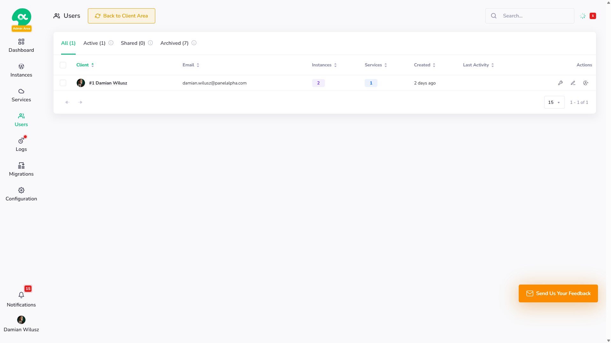
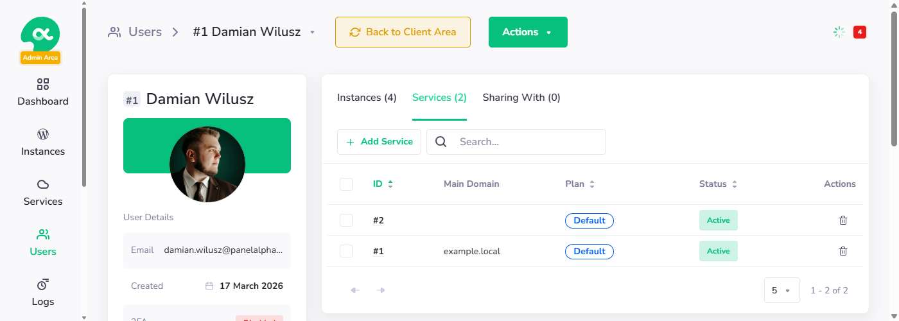

# Users

This section lists all platform users, including active owners and shared-access users.

> [!NOTE]
> The platform uses one default owner account (`#1`).  
> Creating additional owner users from Admin Area is not available.

## User Lists

Available tabs:
- **All** - full list of users.
- **Active** - users who currently own at least one service.
- **Shared** - users with instance access granted through sharing.
- **Archived** - users removed from active operations.

Available per-user actions:

- **Manage User** - open the user details page.
- **Edit User** - update base profile data (first name, last name, company, email, password).
- **Log In As User** - open client area in user context.
- **More Info** - quick profile tooltip with a shortcut to full details.

The default owner user (`#1`) is system-level and should be treated as the primary account.

## User Creation

The default owner user is fixed as `#1`. Creating additional owner users is disabled and the **Add User** option is not available.

For collaborator access, use instance sharing:
- [Sharing Instances](../client-area-instances/sharing-instances.md)

## User Details Page

Press the username or **Manage User** icon to open the user details page.

1. On the left side, a user summary box shows:
   - Email address
   - Creation date
   - Two-factor Authentication status
   - Last activity time
   
   Two buttons let you quickly **Log In As User** and **Edit User**.

2. A second widget summarizes **Instances**, **Services**, and **Sharing With**.
   
   The **Services** tab in user details is read-only:
   - adding services is not available
   - deleting services from this tab is not available

3. A dedicated **Activity** widget with user-related logs and category filters:
   - Show everything
   - Most Relevant
   - Plugins
   - Backups
   - Themes
   - Hosting
   - Users
   - Sharing access
   - Log-ins
   - Admins
   - Config
   
   Press **See more** to open the main Logs section.

4. **Actions** menu:
   - Edit the user details
   - Open reseller settings
   - Force reset password
