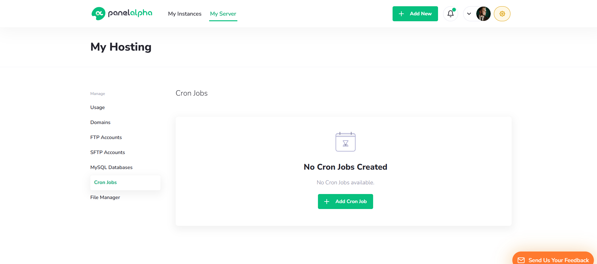
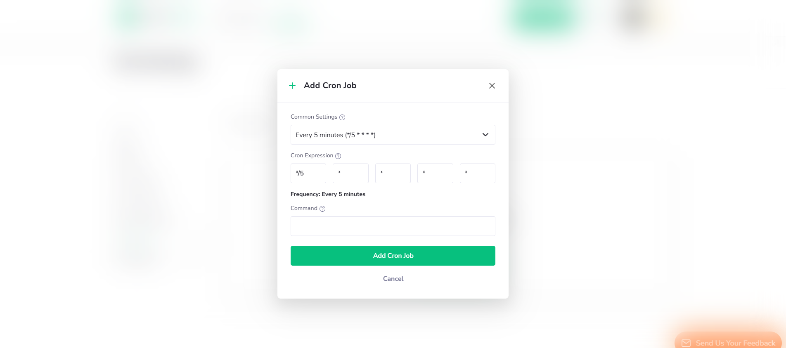

# Cron Jobs

Cron jobs run commands automatically on a schedule, just like in standard hosting environments.

To find a specific cron job, use the **search** field next to the action buttons.

The table includes:
- Cron Expression
- Description
- Command 

Under **Actions** you will find buttons to **Edit** and **Delete** your cron jobs.

## Adding a New Cron Job

To add another cron job, click on the **Add Cron Job** button above the table.

Set the **schedule** by choosing a preset from the **dropdown** or by entering a custom **cron expression**. Then enter the command to execute.
Click **Add Cron Job** to save. The new task is added to your hosting crontab.
