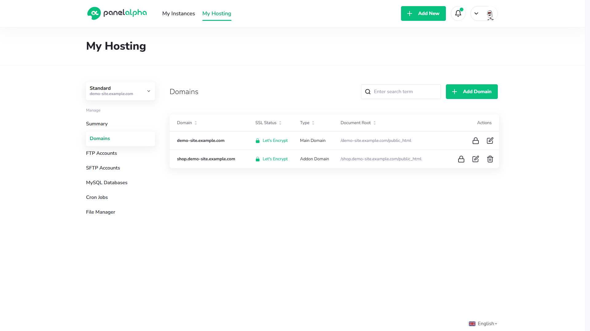
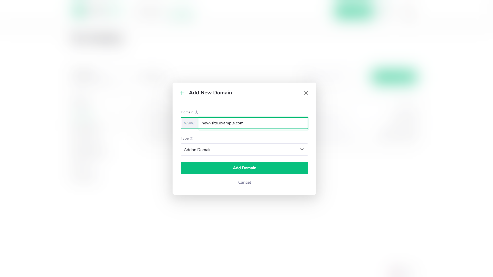

# Domains

   

All domains are listed in a single table. You can review existing domains (including the main domain), edit SSL settings, and add, edit, or delete domain entries. Sortable columns include:
- Domain — if action is required, a warning icon appears here
- SSL Status — hover for a tooltip explaining the status
- Type: Main Domain, Addon Domain, Subdomain
- Document Root path

The **Actions** menu on the right lets you **Edit SSL**, **Delete Domain**, and **Edit Domain** (for example change **Document Root** or enable **Redirect**).

To **Add Domain**, click the button above the table, enter the domain, and choose the domain type. To find a specific domain, use the **search** field.

   
