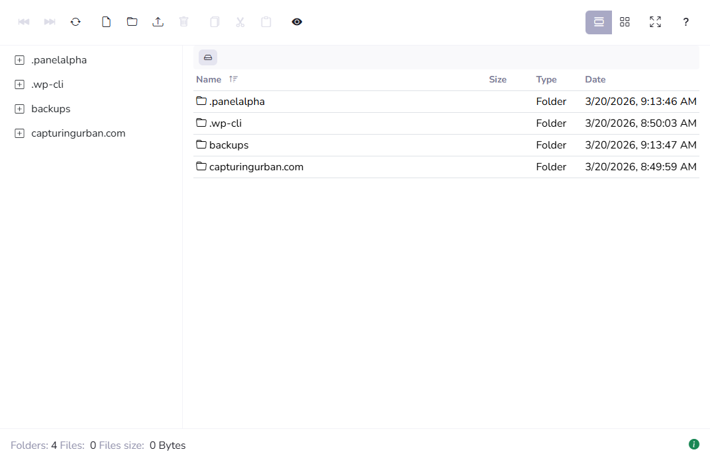
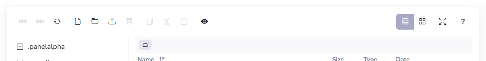
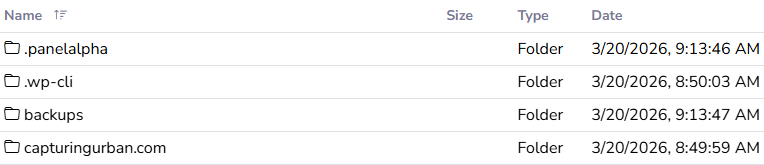

# File Manager

Use File Manager to browse, upload, edit, move, and delete files directly in Client Area.

Access can be controlled by the administrator in:
`Configuration -> Other -> Disable Privileges -> Manage Related Hosting -> Manage File Manager`

By default, this feature is enabled for end users and can also be delegated through **Shared Access**.

## Management

PanelAlpha File Manager includes a complete set of daily file actions.

### File actions

1. **Move Back** — go to the previous location.
2. **Move Forward** — go to the next location in history.
3. **Refresh** — reload the current file list.
4. **Add New File** — create a new empty file.
5. **Add New Folder** — create a folder.
6. **Upload** — send files from your computer to hosting.
7. **Delete** — remove selected files/folders.
8. **Copy** — copy selected files/folders.
9. **Paste** — paste copied/cut files/folders.
10. **Cut** — move selected files/folders.
11. **Show Hidden Files** — show or hide hidden files (for example dotfiles).

### File details

In **Table View**, each row shows:

- **Name** - file/folder name
- **Size** - file size in relevant units
- **Type** - file type
- **Date** - creation or last modified date

### Additional options

Use top-right controls to change how files are displayed.

- **Table View** - rows with detailed columns
- **Grid View** - visual tile layout
- **Full Screen** - maximize File Manager in browser view
- **About** - opens File Manager component details

- **Status (`i` icon)** - bottom-right indicator showing operation status and file-operation errors.
