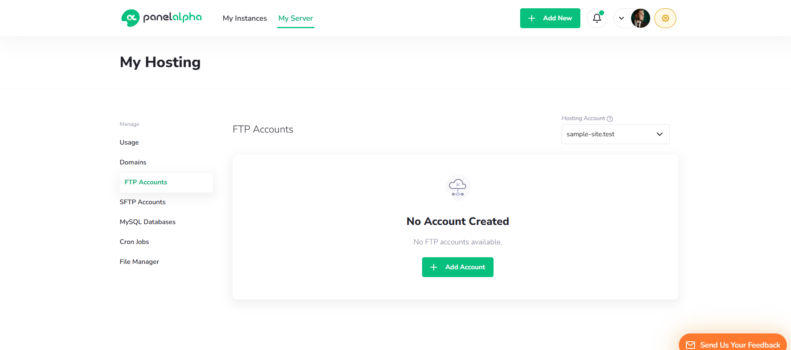
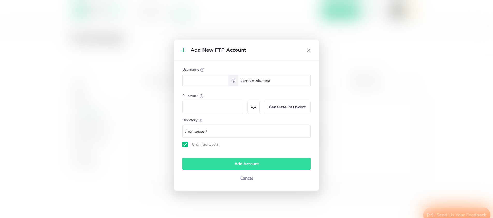

# FTP Accounts

Add and manage FTP accounts here. After your first account is added, you will see a table with sortable columns:
- User
- Directory
- Usage / Quota
- Last Update Time

Row actions let you see **access details**, **change password** and **quota**, or **delete** the account.

To find a specific account, use the **search** function next to the Add Account button.

## Add account

To **Add Account**, click the button above the table, enter the **FTP username**, set a **password** (or generate one automatically), and choose the account **directory**. You can also set a **storage quota** (MB) or leave it as **unlimited**.
