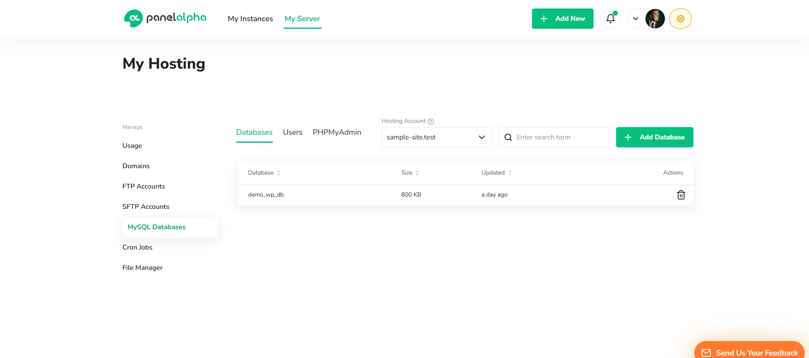
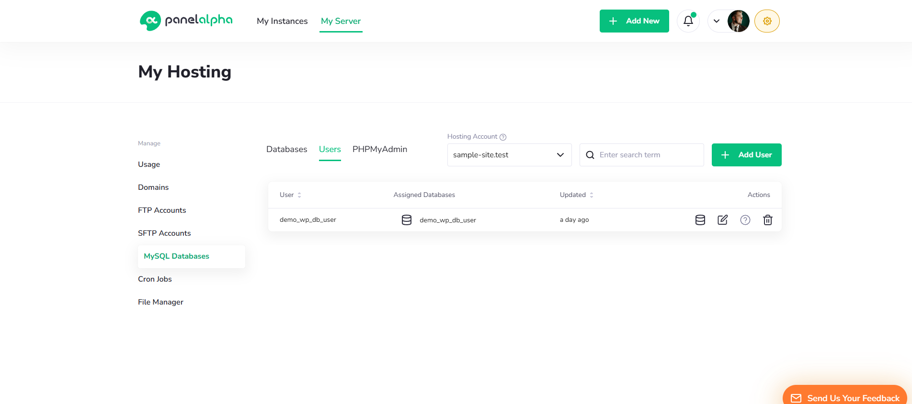
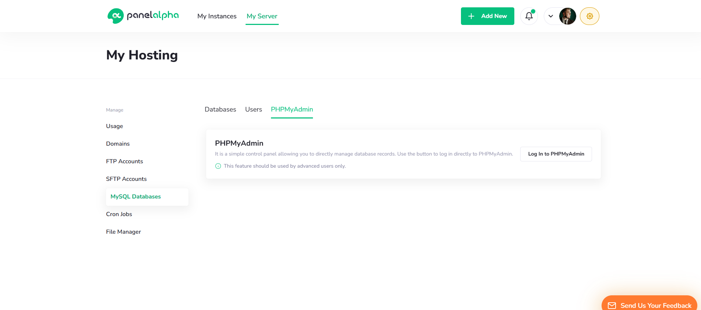

# MySQL Databases

The **MySQL Databases** section covers database management, database users, and quick access to PHPMyAdmin.

## Databases

Use **Add Database** above the table to create a new MySQL database. Use the **search** field to find existing databases. Row actions let you **Rename** or **Delete** a database. The table includes sortable columns:
- Database Name
- Size
- Last Updated Time

## Users

Use **Add User** above the table to create a new MySQL user. Use the **search** field to filter users. Row actions let you **Manage Privileges**, **Edit User**, **Show Access Details**, or **Delete User**. The table includes sortable columns:
- User
- Assigned Databases
- Last Updated Time

## PHPMyAdmin

Use the button on the right to log in to PHPMyAdmin.
