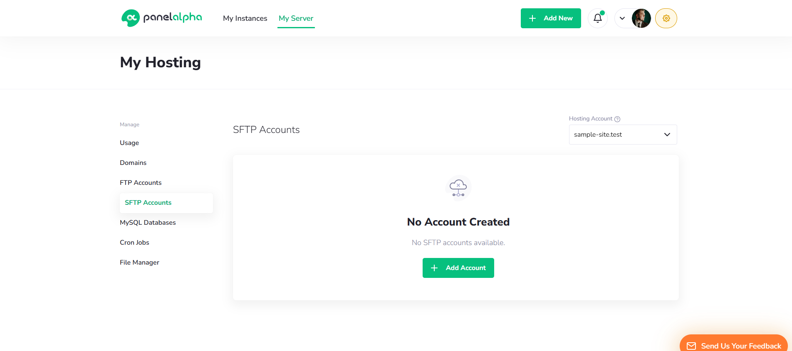
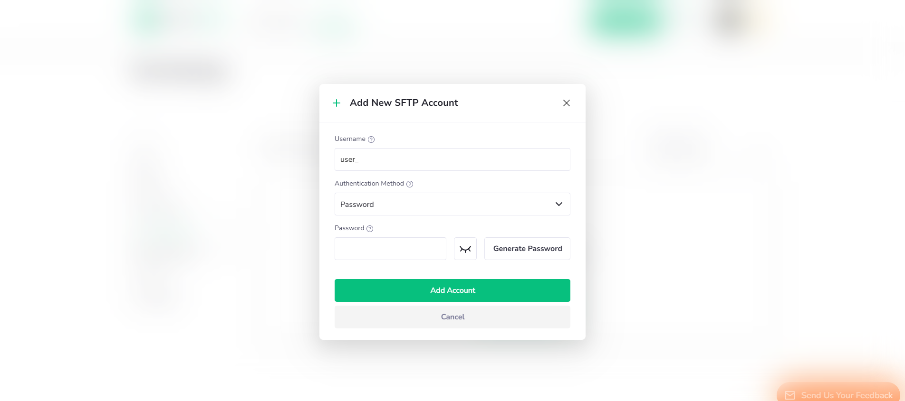

# SFTP Accounts

Add and manage SFTP (Secure File Transfer Protocol) accounts here. SFTP provides secure file transfer over SSH, encrypting both authentication credentials and data transfers.

## Requirements
- Available on hosting servers that expose SSH/SFTP (PanelAlpha Engine **v1.0.0+**, WP Cloud with SSH enabled, cPanel, DirectAdmin, Plesk) when the plan allows SFTP.  
- New accounts inherit plan limits; admins can set per-plan limits to control how many SFTP users a service may create.

After your first SFTP account is added, you will see a table with sortable columns:
- User
- Updated

Row actions let you **show access details**, **edit**, or **delete** the account.

To find a specific account, use the **search** function next to the Add Account button. You can also perform bulk actions by selecting multiple accounts using the **Actions** dropdown menu.

## Add account

To **Add Account**, click the button above the table and provide:

- **Username** — the SFTP account username (automatically prefixed with your hosting account name)
- **Authentication Method** — select from the dropdown menu (e.g., Password)
- **Password** — enter a password or click **Generate Password** to create a secure password

Once all fields are filled, click **Add Account**.

**INFO:** SFTP uses SSH encryption to protect your data during transfer, making it more secure than traditional FTP. All credentials and file transfers are encrypted, preventing interception by unauthorized parties.

## Managing SFTP Accounts

For each SFTP account in the table, you have access to the following actions:

- **Show Access Details** (info icon) - View the complete connection information for the account
- **Edit** (pencil icon) - Modify the account settings, including changing the password
- **Delete** (trash icon) - Remove the SFTP account permanently

## Connection Details

When you click **Show Access Details**, you will see the connection information needed to connect via SFTP:

- **Host/Server** — the SFTP server address
- **Port** — typically port 22 (SSH default)
- **Username** — your full SFTP account username
- **Password** — your account password

Use these credentials with any SFTP client such as FileZilla, WinSCP, or Cyberduck to securely transfer files.
