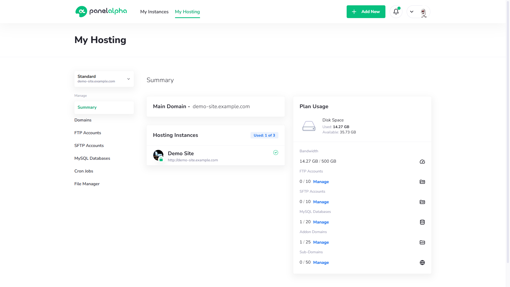

# Summary

The **Summary** route is a compatibility entry for **My Hosting** in Client Area.
In current Single Server builds, opening this route typically shows the **Usage** screen (the default hosting view).

Use this area to access hosting-level tools for your service.

   

## Available sections

Sections visible in the left-side **Manage** menu depend on your server integration and plan.

Common sections:
- [Usage](usage.md)
- [Domains](domains.md)
- [SFTP Accounts](sftp-accounts.md) (in some setups displayed as **SSH Accounts**)
- [MySQL Databases](mysql-databases.md)
- [File Manager](file-manager.md)

Additional sections that may be available depending on server type and enabled features:
- [FTP Accounts](ftp-accounts.md)
- [Cron Jobs](cron-jobs.md)

## Summary information

From this view you can quickly verify:
- current **RAM**, **CPU**, and **Disk Space** usage
- live server charts and short-term trends
- direct link to **Full Server Management** (if enabled)
- available hosting modules in the **Manage** menu

Use the **Manage** menu to move directly to domains, accounts, databases, cron jobs, and file operations.
