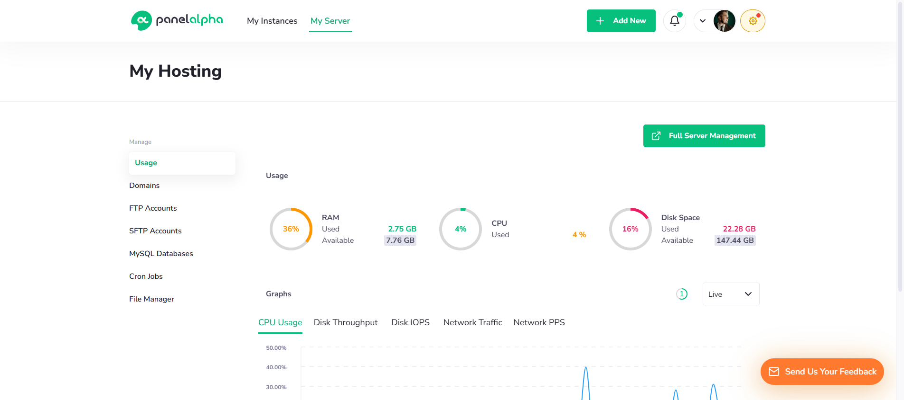

# Usage

The **Usage** page is the default view inside **My Server** in Client Area.
Use it to check current resource utilization and short-term performance trends.

## Available Metrics

The page provides:
- current **RAM**, **CPU**, and **Disk Space** usage
- used vs available values for key resources
- charts for:
  - CPU usage
  - disk throughput
  - disk IOPS
  - network traffic
  - network PPS

## Time Range and Export

You can switch chart range (for example `Live`) and export chart output as `SVG`, `PNG`, or `CSV`.
Available range options depend on the selected chart source and data retention.

## Daily Operations Guidance

1. Check whether CPU or RAM stays high over longer periods.
2. Monitor disk growth before reaching limits.
3. If abnormal usage appears, review recent changes in cron jobs, plugins, logs, or file activity.

## Related My Server Sections

- [Domains](domains.md)
- [FTP Accounts](ftp-accounts.md)
- [SFTP Accounts](sftp-accounts.md)
- [MySQL Databases](mysql-databases.md)
- [Cron Jobs](cron-jobs.md)
- [File Manager](file-manager.md)
