# Advanced Settings

Advanced settings for an instance are located in the **Advanced** section of instance details. They are grouped into categories:

- Site Details
- Security
- Auto Updates
- Developer Settings
- WordPress Config
- Users
- Themes
- Logs
- Copy Instance (if enabled in plan)

Each category is covered below.

## Site Details

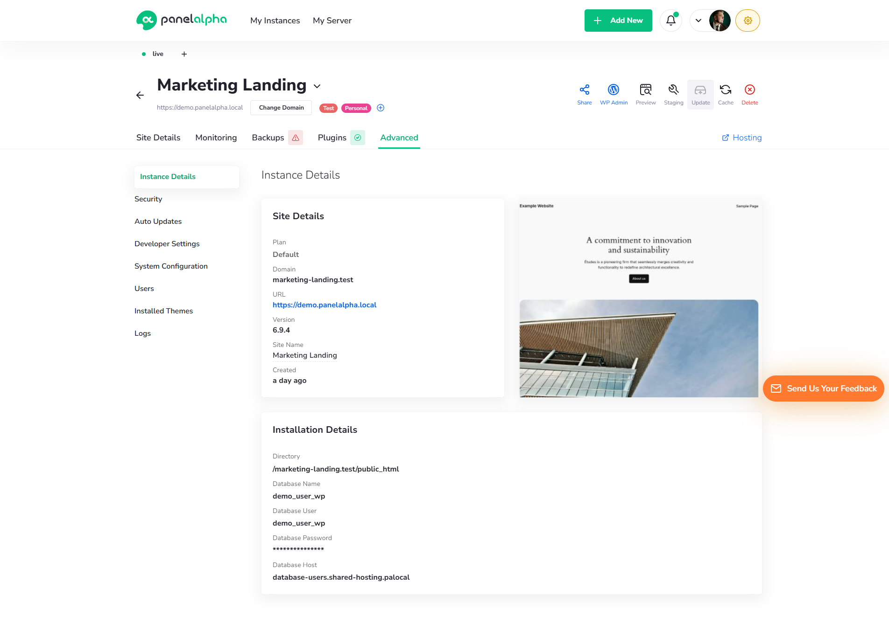

View detailed information about your site and installation:
- Domain
- URL
- WordPress Version
- Site Name
- Site Age
- Installation directory
- Database Name
- Database User
- Database Password
- Database Host

You can also see the site preview on the right-hand side.

## Security

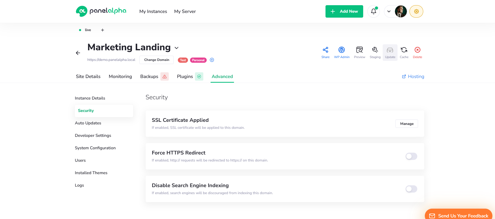

Manage your security settings:
- **SSL Certificate** — if enabled, an SSL certificate is applied to your domain
- **Force HTTPS Redirect** — if enabled, `http://` requests are redirected to `https://`
- **Disable Search Engine Indexing** — if enabled, search engines are discouraged from indexing this domain

## Auto Updates

Enable or disable automatic updates:
- Automatic WordPress update
- Automatic plugin updates
- Automatic theme updates

## Developer Settings

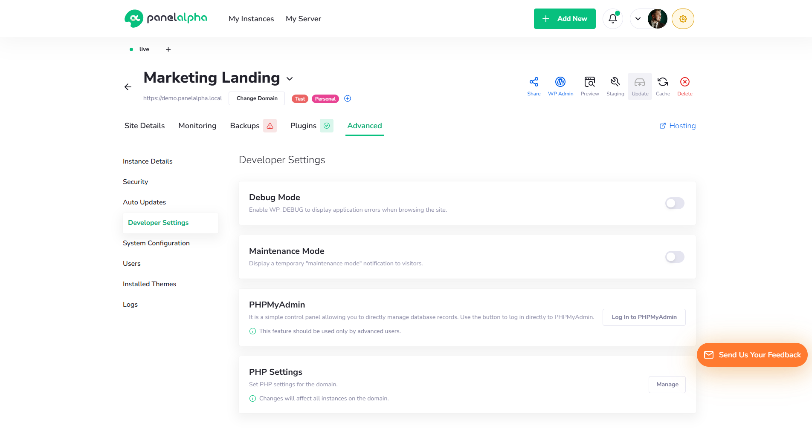

Developer tools available here:
- **WordPress Debug Mode** — when enabled, application errors are displayed while browsing the site
- **Maintenance Mode** — when enabled, a temporary maintenance notice is shown to visitors
- **Control Panel** — use SSO for direct login to the control panel *(Plesk, DirectAdmin, or cPanel)*. SSO is handled by a must-use plugin maintained by the system.
- **PHPMyAdmin Access** — shortcut for direct login to the phpMyAdmin panel
- **PHP Version** — check and update the PHP version for the domain. Changing the PHP version applies to all instances on the domain.
- **PHP Settings** — add, edit, or remove PHP configurations specific to this domain

## WordPress Config

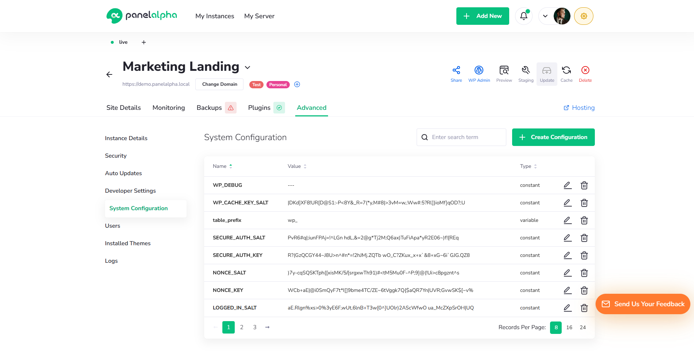

Remotely manage your **WordPress configuration** file. Add a new config using **Create Config**. Existing configs are shown in a sortable table with **Name**, **Value**, and **Type** columns. Each entry can be **edited** or **removed** using row actions, and you can filter the list with the **search bar** above the table.

## Users

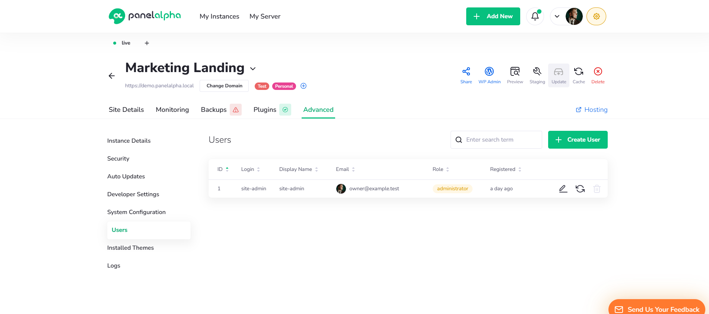

Manage admins and users that access your instance. Every user added appears in the users table with the following data:
- Id
- Login
- Display Name
- Email Address
- Role
- Registration Time

Use the icons on the right to **edit**, **reset password**, or **delete** the user.

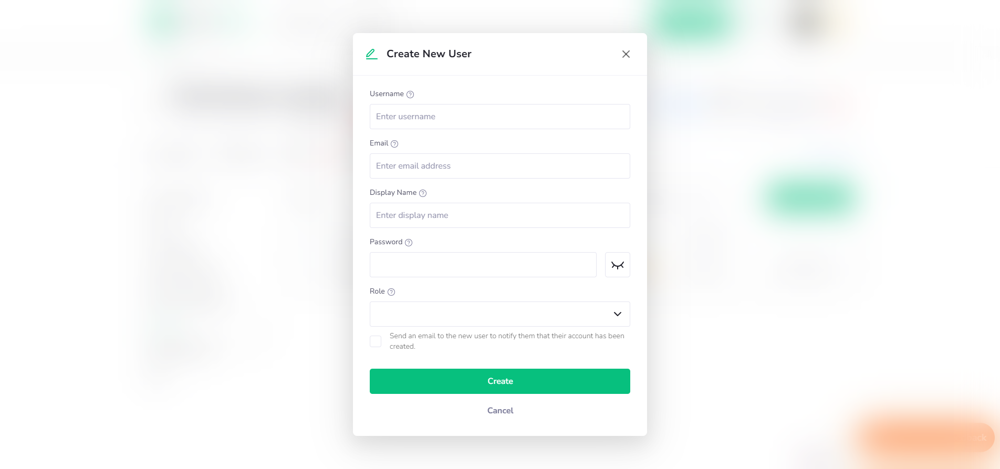

Find a specific user with the **search** feature above the table, or **create a new user** using the button next to it.

## Installed Themes

Manage themes here. As in the Plugins section, you can switch between tile and list views for installed themes and new-theme browsing. Both views expose the same actions.

**Installed Themes**

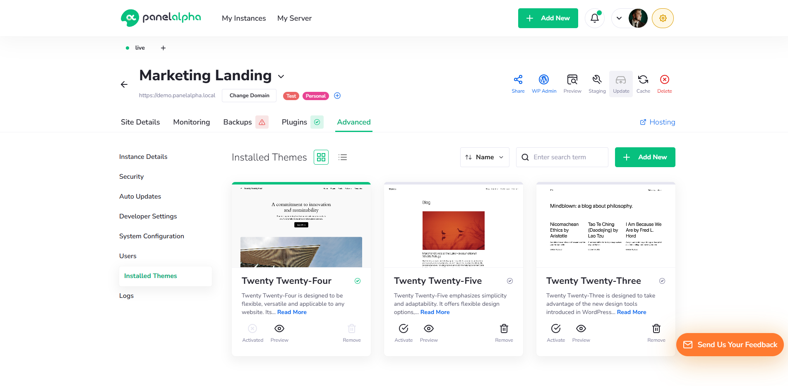

Every installed theme appears here.

- Each tile shows the **name** and a short **description**. Click **Read More** to expand the description.
- The symbol next to the name indicates if the theme is **up to date**.
- You can **deactivate**, **activate**, **preview**, or **remove** themes using the action buttons at the bottom of a tile.
- Perform actions in bulk by selecting multiple or all themes. Checkboxes appear to the left of each tile. After selecting at least one theme, the option to **select all** appears on the bottom bar.
- You can **sort** by Name or Status using the dropdown above the tiles.

List view:

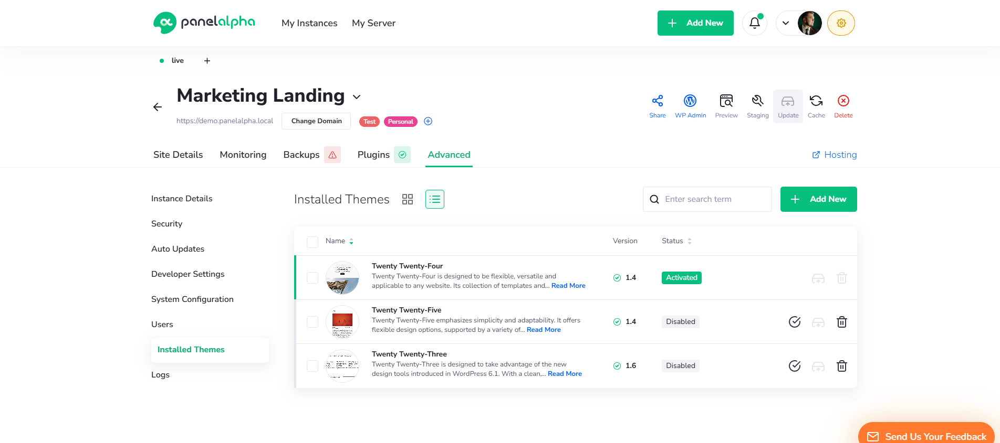

- The **name** and a short **description** are shown on the left. Click **Read More** to expand the description.
- The installed **version** appears next to it. The symbol indicates whether the theme is **up to date**.
- **Status** is shown by "Activated" or "Disabled" markers in the Status column, plus a green or gray highlight on the edge of the row.
- You can **deactivate/activate**, **update**, or **delete** themes using row actions on the right.
- Perform actions in bulk by selecting multiple or all themes. Checkboxes are on the far left, and the header checkbox selects all rows.
- You can **sort** by clicking Name or Status in the header.

**New Themes**

To install a new theme, click **Add New** to the right of the search bar.

Use the **search bar** to find the theme and confirm installation in the modal. After installation completes, the theme appears in **Installed Themes**.

If you cannot find a specific theme, it may be **blacklisted** by your administrator. Blacklisted themes are hidden from search and cannot be installed, even from a ZIP file. Blacklisted themes also cannot be selected during instance creation.

Tile view:

- The screenshot shows a real installation result where the newly added theme is available in tile view with action buttons.

List view:

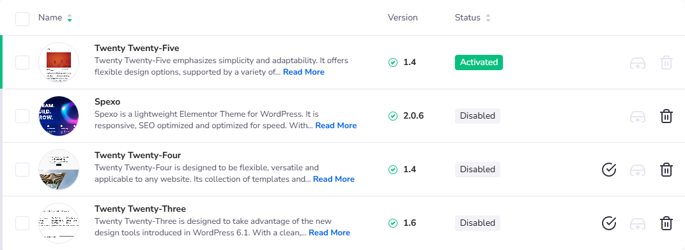

- The list view confirms the same installation with the theme name, version, status, and available row actions.

## Logs

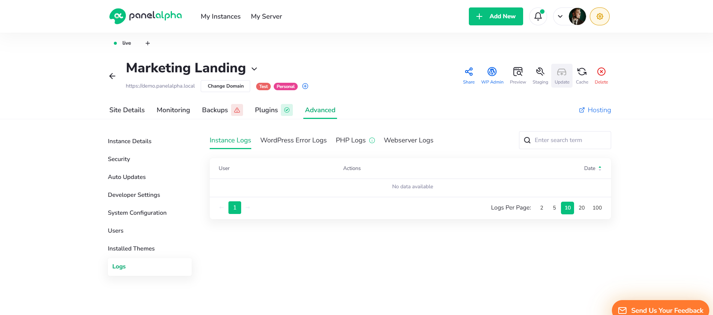

This section provides access to various logs. You can review and download:

- **Instance Logs** — general history of actions on this instance
- **WordPress Error Logs** — WordPress errors, warnings, and notices
- **PHP Logs** — PHP-level runtime errors and warnings
- **Webserver Logs**
   - `access.log` — incoming HTTP requests
   - `error.log` — webserver errors and warnings

## Copy Instance

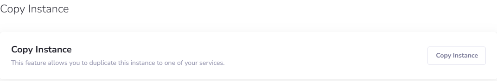

Use this feature to **duplicate the instance**. Copy operations run in the default service (`#1`) context.

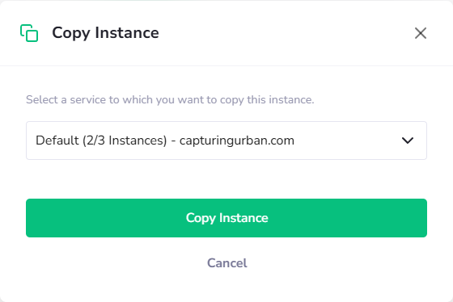

This option must be enabled by the administrator for the plan associated with the service. If not enabled, this section remains hidden.

Typical copy flow:

1. Open **Copy Instance**.
2. Click **Copy Instance**.
3. Select the target service in the modal.
4. Confirm the copy and monitor progress in task logs.
