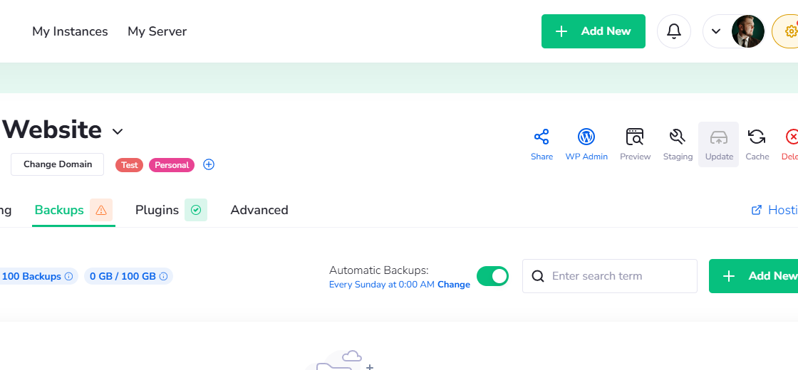
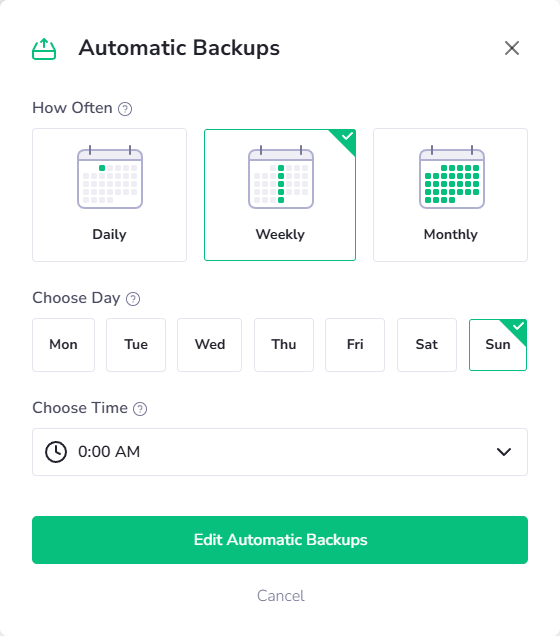
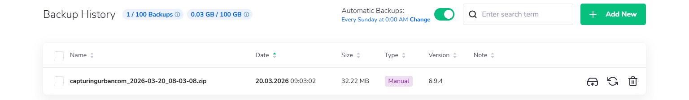

# Backups

Backups protect your website from data loss caused by accidental deletion, security incidents, or server issues. In the **Backups** section of instance details, you can create, schedule, restore, and remove backups.

Create a new backup by clicking **Add New**.
 

You can also enable and schedule **Automatic Backups**. Availability depends on the instance plan. In some plans, users can configure the schedule; in others, the backup policy is enforced by the administrator.

## Backup History

1. Check **Backup History**, which includes:
   - **Name** of the backup
   - **Date** and **time** of the backup
   - **Size**
   - **Type** (Automatic/Manual)
   - **WordPress Version**
   - Custom **Notes**

2. Use the **search** field above backup history.

3. Use row actions to **Download**, **Restore**, or **Delete** a backup.

4. Confirm that a new manual backup appears in the table with full metadata and action buttons.

If backups fail or restores stall, see the [Backup troubleshooting guide](../../troubleshooting-center/backups/backup-issues.md) for detailed steps.
