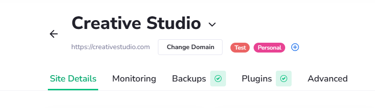
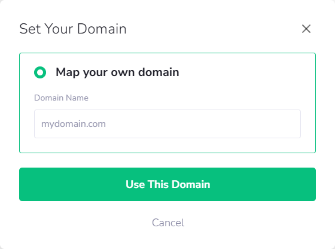
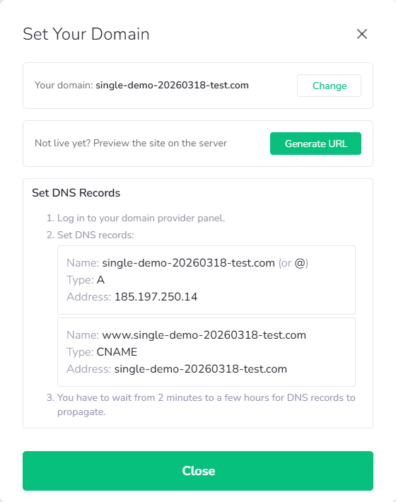

# Changing Domain

   

1. Open instance details and click the domain action button next to your URL.
   Depending on the current DNS state, it can appear as **Change Domain** or as a DNS status button.

   

2. In **Set Your Domain**, enter the new domain and confirm with **Use This Domain**.

   

3. Use the generated DNS instructions in the same modal to complete domain mapping.
   The panel shows the exact records required for your setup.

**Best practice:**
- Use production-ready domain names (avoid temporary placeholders in live environments).
- Keep DNS records consistent for both the root domain and `www` alias.

**Tip:** Starting from PanelAlpha 1.4.3, adding a root domain automatically pairs it with its `www` alias (and vice versa). Keep both DNS records reachable while the SSL order is processed. If you later switch the primary domain, remove or update stale DNS zones and records on your DNS provider to avoid pointing traffic to the old site.
