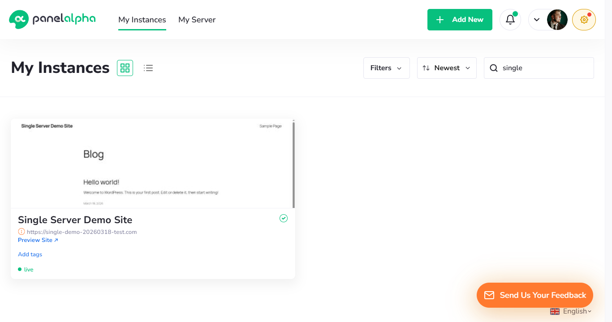
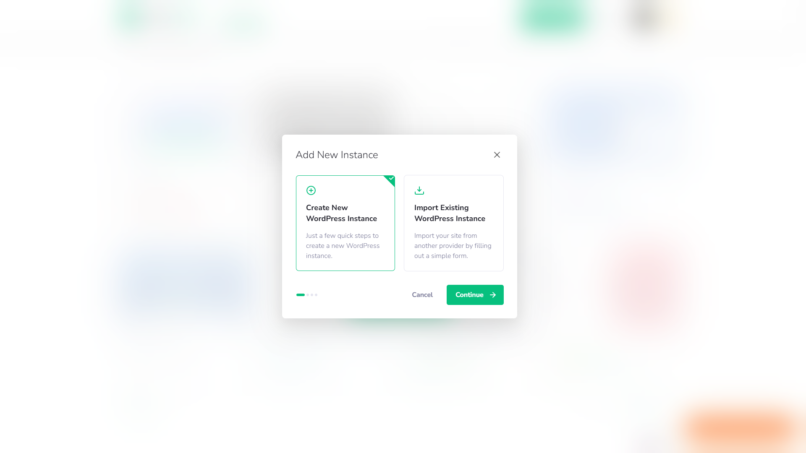
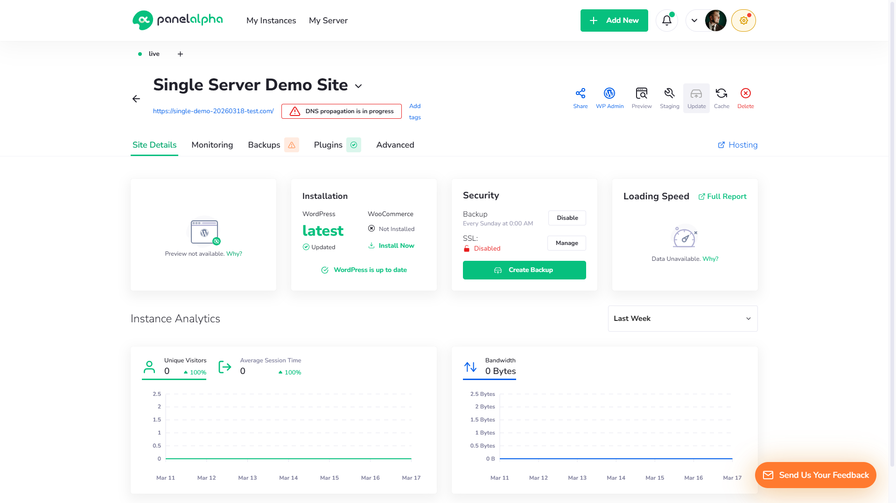

# Creating New Instance

The process of adding a new instance differs depending on the selected product and plan configuration.

In some setups, the flow is very short (for example, only location/domain input). In others, additional configuration steps are available.

Use the flow below as a reference. If a step does not appear in your panel, continue to the next one.

Creation is always performed on the default service (`#1`) assigned to the default owner (`#1`), so user/service selection is not part of this flow.

## Example Workflow

1. Open **Add New** in the top-right corner of Client Area.

2. Choose an installation type:
   - **Create New WordPress Instance**
   - **Import Existing WordPress Instance**

   Then click **Continue**.

3. Choose a theme for the new site.

4. Provide the domain for the new site (or adjust domain-related options if shown for your plan).

5. Set the website name and click **Create Site**. Instance creation runs asynchronously and may take a few minutes.

6. After installation, use instance details to manage domain status, actions, backups, and other daily operations.

