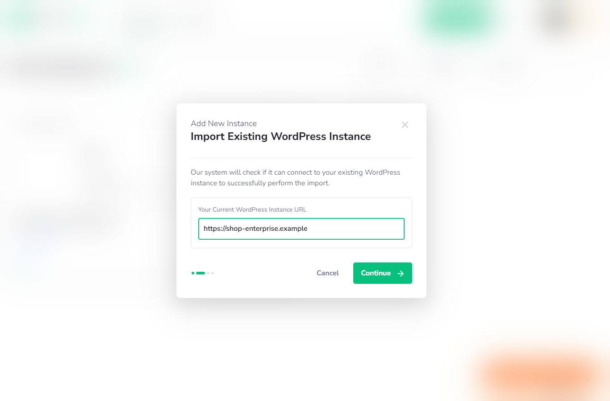
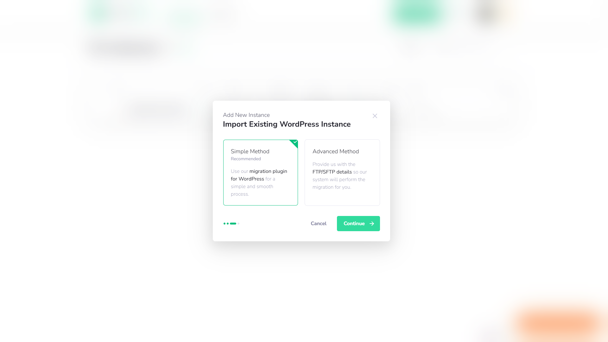
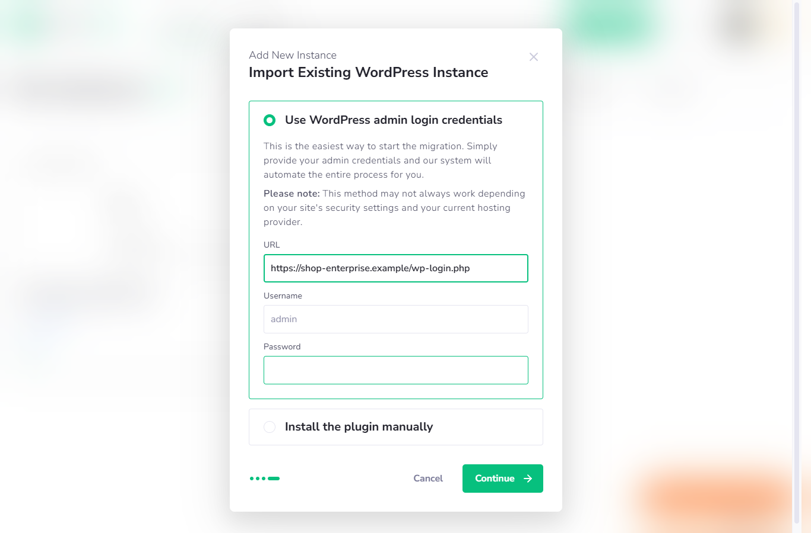
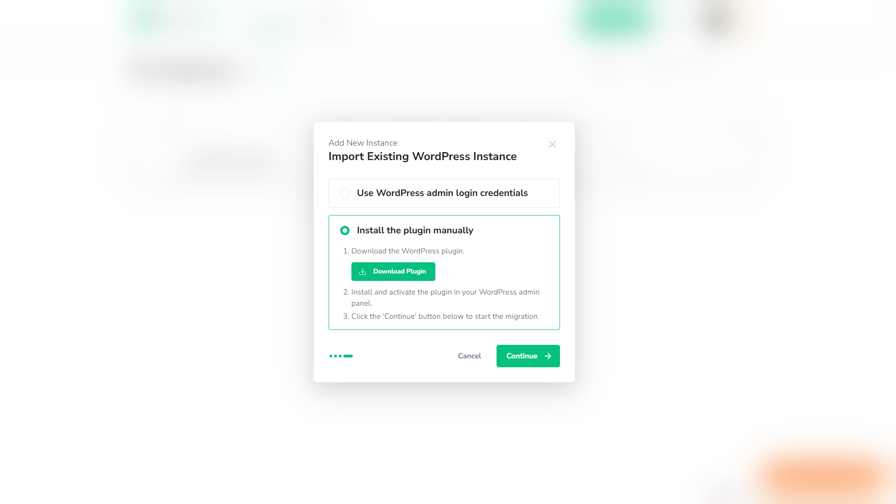
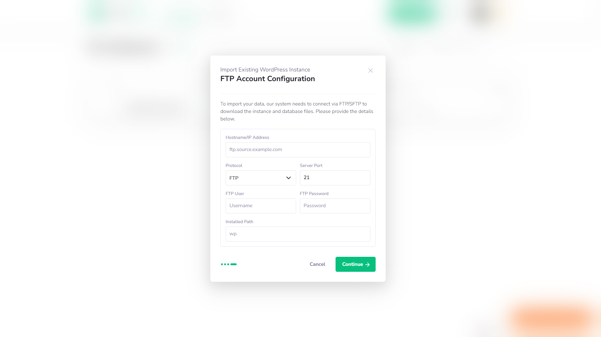
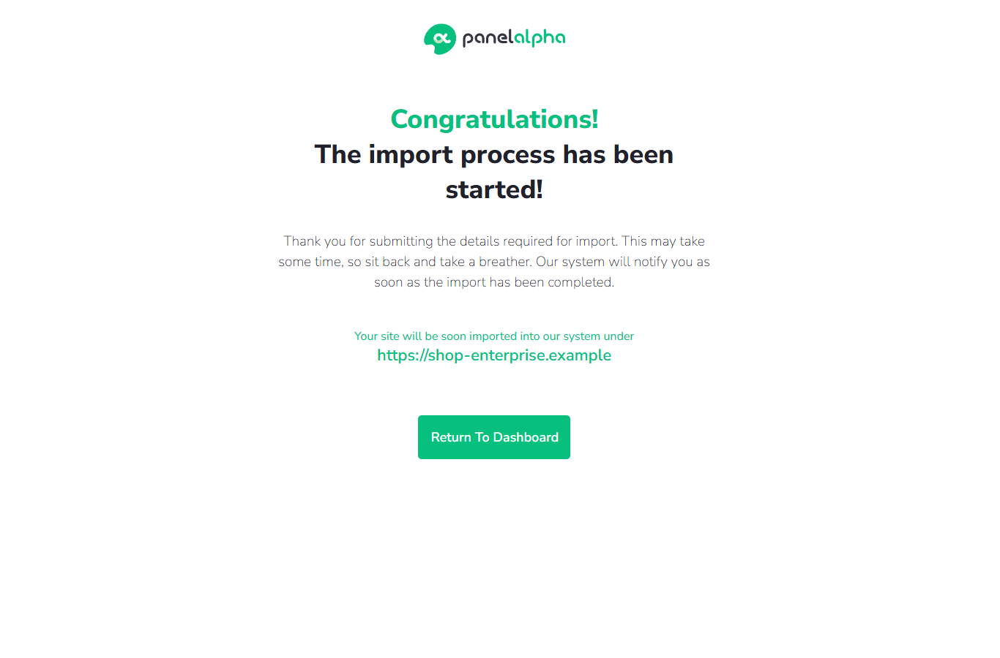
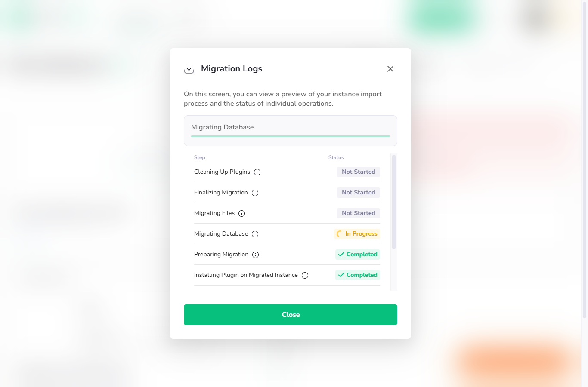
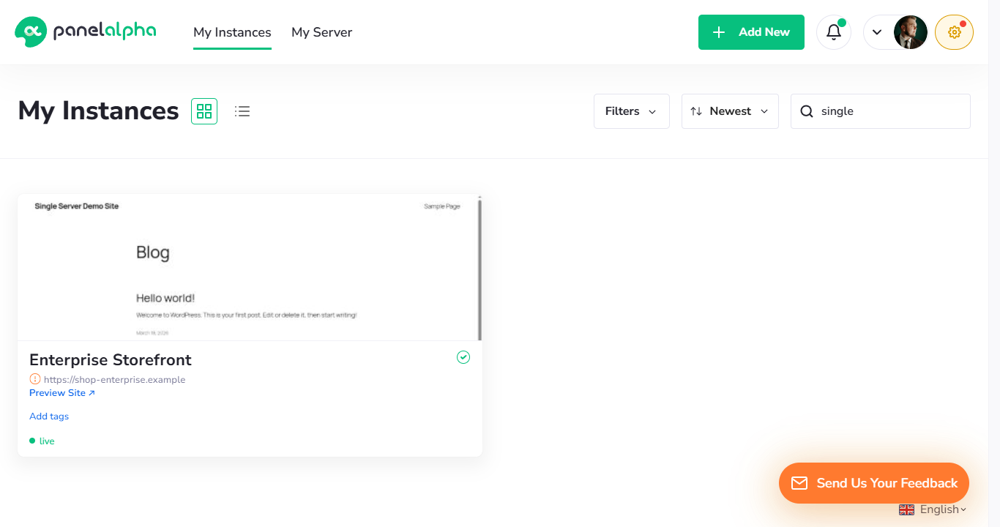

# Importing Existing Instance

PanelAlpha allows you to import existing WordPress instances into the system. Initiate the import from Client Area using one of two methods: a simple plugin-based approach (recommended) or an advanced FTP/SFTP method for complex scenarios.

## Starting the Import Process

1. Navigate to the **My Instances** page in the Client Area.
2. Click on **Add New**.

3. Select **Import Existing WordPress Instance**.

Import is automatically assigned to the default service (`#1`), so no service-selection step is shown.

## Enter WordPress URL

4. **Enter your current WordPress instance URL** (e.g., `https://example.com`).
5. Click **Continue**.

If your environment has additional onboarding options, they appear at this step.

**Note:** Sharing users is not part of the import wizard. After import, manage access from [Sharing Instances](sharing-instances.md).

## Choosing Import Method

PanelAlpha offers two import methods to accommodate different scenarios and technical requirements:

### Method 1: Simple Method (Recommended)

The simple method uses a PanelAlpha migration plugin to automate the import process. This is the recommended approach for most users.

**Advantages:**
- Fully automated migration
- No FTP credentials required
- Handles file and database migration automatically
- Works even if your hosting provider has FTP restrictions
- Real-time progress monitoring

**Two options are available:**

#### Option A: WordPress Admin Login Details

Provide your WordPress admin credentials and PanelAlpha will:
1. Log into your WordPress admin panel.
2. Install the migration plugin.
3. Initiate and complete the migration.
4. Clean up after itself.

**Required fields:**
- **Login URL** — your WordPress login page URL (e.g., `https://example.com/wp-login.php`)
- **Username** — WordPress admin username
- **Password** — WordPress admin password

**Note:** Your credentials are used only during migration and are not stored permanently.

#### Option B: Manual Plugin Installation

If you prefer not to provide admin credentials, install the migration plugin manually:

1. **Download the plugin** — click the download button to get the PanelAlpha WordPress Migrator plugin.
2. **Install the plugin** — upload and activate it in your WordPress admin area (`Plugins -> Add New -> Upload Plugin`).
3. **Run the migration** — the plugin automatically connects to PanelAlpha and initiates the migration.
4. **Monitor progress** — track migration status in real time.

### Method 2: Advanced Method (FTP/SFTP)

The advanced method uses FTP/SFTP to download your WordPress files and database directly from your hosting server.

**When to use:**
- You do not have WordPress admin access
- The plugin method fails or is incompatible
- You need more control over the migration process
- Your WordPress installation has been compromised and you want to migrate files directly

**Required information:**
- **Protocol** — FTP, SFTP, or FTPS
- **FTP Host** — your FTP server address (e.g., `ftp.example.com`)
- **FTP Port** — port number (default: 21 for FTP, 22 for SFTP)
- **FTP Username** — your FTP account username
- **FTP Password** — your FTP account password
- **Path** — path to your WordPress installation (e.g., `/public_html`, `/`, or `/blog`)

**Notes:**
- If you do not specify a path, PanelAlpha automatically searches common locations (`/`, `/public_html`, `/public`, `/htdocs`, `/httpdocs`).
- PanelAlpha verifies that WordPress is found at the specified location before proceeding.

## Import Submission Confirmation

After you submit migration details, PanelAlpha confirms the import has started and displays the target URL for the imported site.

## Import Progress

The import process runs in the background. Monitor it in **My Instances** tile view and use **Show Logs** to open a detailed progress modal.

## Import Completion

When the import completes, the site appears in **My Instances** as ready for management.

**Post-import verification:**
1. Visit your instance URL to verify the site loads correctly.
2. Log into WordPress admin to confirm access.
3. Check that plugins and themes are functioning properly.
4. Verify that media files and uploads are accessible.
5. Test any custom functionality or integrations.

## Monitoring Your Import

All client-initiated imports can be monitored from Admin Area under **[Migrations](../admin-area/migrations.md)**:

- **In Progress** — currently running migrations with real-time status
- **Failed** — migrations that encountered errors, with detailed error messages and retry options
- **Successful** — completed migrations with full details and logs

Administrators can:
- Monitor migration progress
- View detailed logs
- Retry failed migrations
- Mark migrations as successful (if issues were resolved manually)
- Stop ongoing migrations if needed
