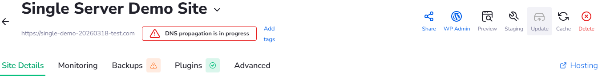
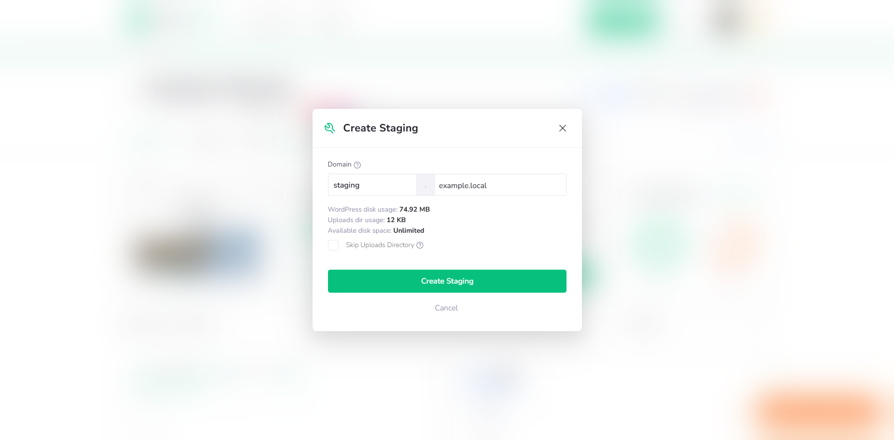
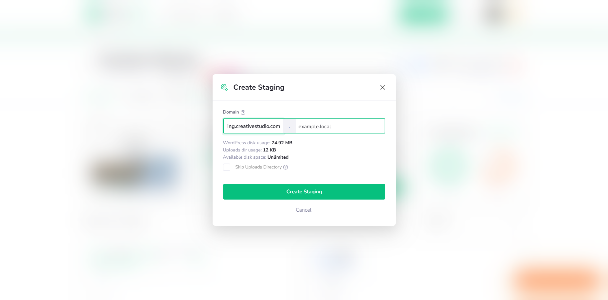
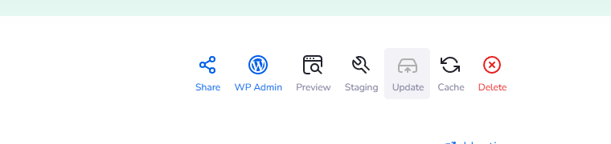
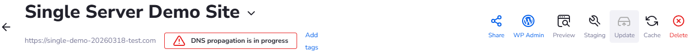
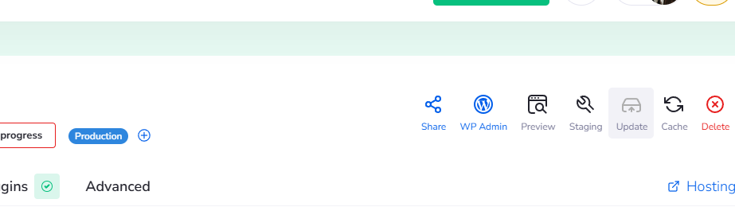
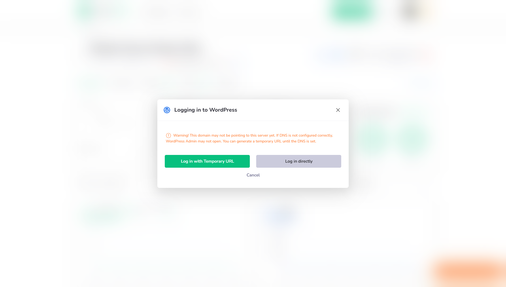
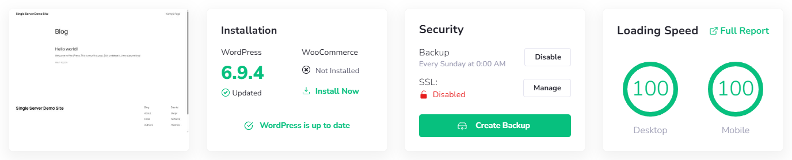
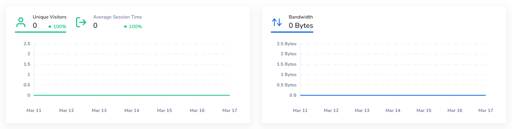

# Instance Details

Open instance details by clicking the instance name in list view or **Manage Site** in tile view.

The details page combines technical status, daily actions, and advanced management tools in one place.
If an instance is still provisioning, some widgets may temporarily show limited data.

## Live/Staging Instances

At the top left of the page, switch between **Live** and **Staging** environments. If staging does not exist yet, a **"+"** button is displayed. After staging is created, it appears as a dedicated **Staging** tab.

PanelAlpha supports **one staging instance per live instance**.

### Create staging

To create staging, click the **"+"** button (or the staging action in the top action menu).

The modal includes the **Domain** field. Its behavior depends on the plan configuration for staging domains:
- **Site Domain Subdomain**: PanelAlpha prepares the staging domain as a subdomain of the live site domain (for example `staging.example.com`).
- **Fixed Subdomain**: PanelAlpha prepares staging under an admin-defined fixed domain.
- **Any domain allowed**: the domain can be entered manually.

In setups where staging is created on the same hosting account, PanelAlpha performs a pre-check showing:
- WordPress disk usage
- `wp-content/uploads` usage
- Available disk space

In the same modal, you can use **Skip uploads directory** to speed up cloning and reduce disk usage. If available disk space is too low, this option is enforced automatically.

If your hosting setup marks staging as billable, the modal shows a warning about extra charges.

After confirmation, staging is created asynchronously and appears in the staging tab once finished.

### Retry or cancel failed staging

If staging creation fails, you can:
- **Try**: rerun staging creation for that failed staging entry.
- **Cancel**: remove the failed staging entry (including files/database cleanup request).

### Push to live

When you are on a **staging** instance, you can use **Push to Live**.

Before showing the final form, PanelAlpha compares database changes between staging and live. The push modal allows you to choose:
- Overwrite files
- Push full database
- Push structure changes in tables
- Push tables with changed data

The push runs as an async operation, and status is tracked for both environments.

### Push to staging

When you are on a **live** instance with an active staging environment, you can use **Push to Staging**.

This action is useful when quick changes were made directly on live and you want to sync them back to staging.

The same push scope options are available:
- Overwrite files
- Push full database
- Push structure changes in tables
- Push single tables with changed data

## Domain

Directly below the Live/Staging buttons, you will find the instance name. Use the **Edit** button next to it to rename the instance. Use the **downward arrow** to switch directly to another instance without returning to the main list.

Below the name, you can see the full site **domain**. Click it to open the website in a new tab.

On the right, you can use [**Change Domain**](changing-domain.md) and manage assigned tags. Use **Add More** to attach additional tags.

For clarity in daily operations, keep:
- a descriptive instance name
- a correct primary domain
- at least one meaningful tag (for example `Production` or `Staging`)

### Actions

Actions available from the instance list are placed in the top-right corner:
- [Share Instance](sharing-instances.md)
- [WP Admin (SSO)](instance-details.md#wp-admin-sso)
- Preview
- Staging — opens staging actions (Create Staging, Push to Live, Push to Staging) depending on the current environment
- Copy
- Update
- Cache
- Delete Instance

Some actions (for example **Update**) may be temporarily disabled while installation is in progress.

#### WP Admin (SSO)

Click the **WP Admin** button to log in to the WordPress admin panel using **Single Sign-On (SSO)**. This lets you access the WordPress dashboard directly without entering credentials.

SSO is powered by the **Control Panel Connection** must-use plugin, which is automatically installed on every PanelAlpha-managed instance.

If DNS propagation is still in progress, PanelAlpha displays a warning with two options:
- **Log in with Temporary URL** — uses a preview URL that bypasses DNS; recommended when the domain is not yet pointing to the server.
- **Log in directly** — opens the WordPress admin using the instance primary domain.

When DNS is correctly configured, clicking **WP Admin** logs you in directly without showing the modal.

### Menu

Instance details are grouped into sections accessible from the menu:
- [Site Details](instance-details.md#site-details)
- [Monitoring](monitoring.md)
- [Backups](backups.md)
- [Plugins](plugins.md)
- [Advanced](advanced-settings.md)

On the far right, use the button to open the related **hosting area**.

### Site Details

The default section is **Site Details**. Here you can:
- View the **site preview** thumbnail. On hover, you can:
   - Click **"Visit Website"**.
   - Click **"Refresh Thumbnail"**.
- Use **Preview Site** (temporary URL) when DNS propagation is in progress:
   - The **Preview Site** button is visible when the preview integration is enabled and propagation is not finished.
   - Click **Get Temporary URL** to generate a temporary address.
   - Copy the temporary URL or open it directly in a new tab.
- Check installation details:
   - **WordPress** version
   - **WooCommerce** version
   Both values are checked automatically so you can see if updates are available and apply them with one click.
- Review **Security** details:
   - Check the **backup schedule** and **create backups** if needed.
   - Set the **SSL Certificate** for your domain.
- See **Loading Speed** — view how fast your website loads on desktop and mobile platforms.

### Instance analytics

At the bottom of the page, **graphs** provide detailed insights into your website's performance:

- **Traffic data** — visits to your website over time
- **Unique Visitors** — individual users who accessed your site, excluding repeated visits
- **Average Session Time** — how long visitors typically spend on your website
- **Bandwidth usage** — data transferred to and from your website

You can adjust the time frame by selecting **Last Week**, **Last Month**, or **Last Year**.
