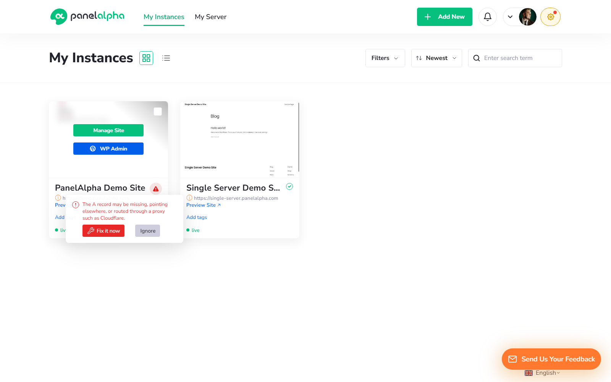
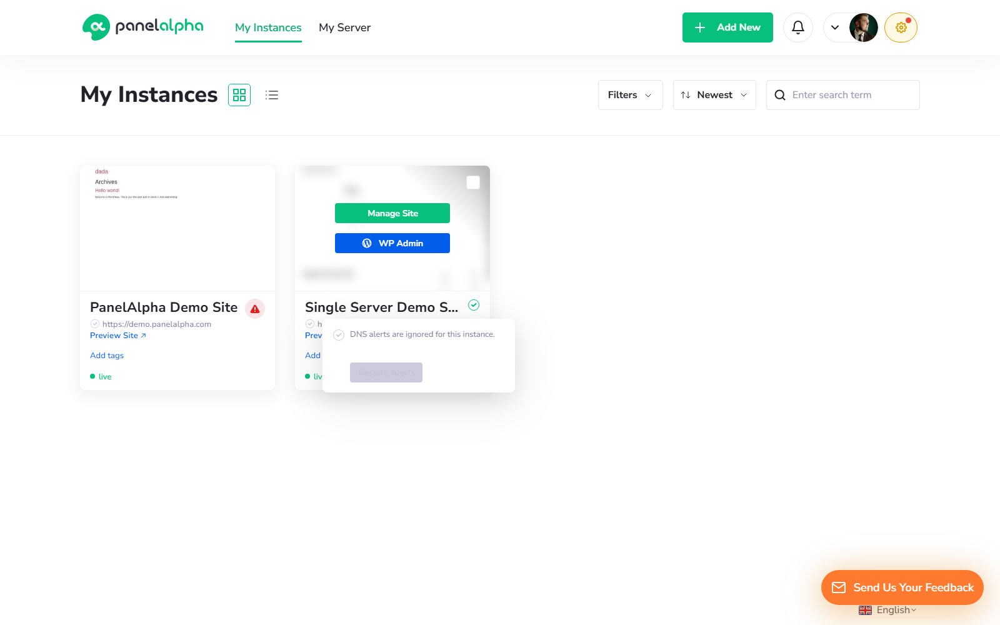

# List of Instances

After logging in to Client Area, manage all websites in **My Instances**.
This view contains fully installed instances, provisioning instances, and failed installations.

## My Instances

- **View modes** - switch between list and tile layout.
- **Selection** - select one or more instances to run supported bulk actions.
- **Filtering** - filter by tags, status, or search query (depending on enabled controls).
- **Sorting** - sort by name and additional metrics (for example visitors, bandwidth, or storage when data is available).

## Orange warning icon next to URL

On some instance cards, you may see a small orange exclamation icon on the left side of the instance URL.
Hover the icon to see a warning popover with **Fix it now** and **Ignore** options.
If the instance is live and opens correctly, you can ignore the warning.

After you click **Ignore**, this DNS alert changes to an ignored (gray) state.
To show it again, hover the gray alert and click **Restore Alerts**.

## Tags

Tags help organize large instance lists by project, client, or environment.

To create and assign a tag:
1. Click **Assign Tags** (or **Add tags** on an instance card/row).
2. Click **Add New**.
3. Enter tag name and select color.
4. Click **Create & Assign**.

Tags can be edited or removed later without affecting the instance itself.
