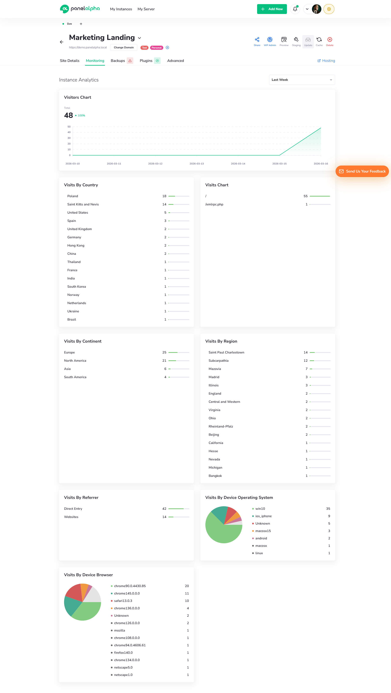

# Monitoring

In the **Monitoring** section of instance details, you can review visitor analytics. Use this data to understand user behavior, evaluate marketing performance, and identify optimization opportunities.

To access monitoring, open instance details and click the **Monitoring** tab.

## Visitors Chart

The **Visitors Chart** displays the total number of visits over the selected time period, along with a trend indicator showing the percentage change compared to the previous period.

Use the **time range selector** in the top-right corner to switch between **Last Week**, **Last Month**, and **Last Year** views.

Below the main chart, you can explore detailed breakdowns:
- **Visits By Country** – geographic distribution of your visitors
- **Visits Chart** – visits grouped by page URL
- **Visits By Continent** – high-level regional view
- **Visits By Region** – more granular geographic data
- **Visits By Referrer** – where visitors are coming from (search engines, social media, direct links)
- **Visits By Device** – desktop, mobile, or tablet
- **Visits By Device Brand** – specific device manufacturers
- **Visits By Device OS** – operating systems used by visitors
- **Visits By Device Browser** – which browsers visitors use
