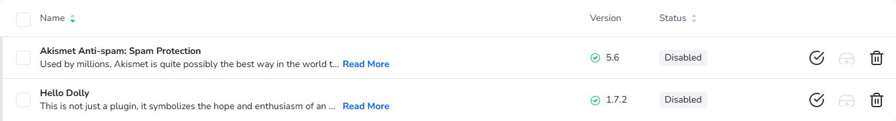
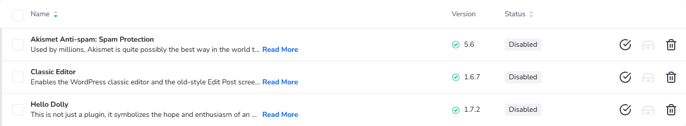

# Plugins

Use **Plugins** to extend WordPress features. Depending on plan configuration, new instances can include a predefined plugin set prepared by the administrator.

In the **Plugins** section of instance details, you can manage installed plugins and browse **New Plugins**. Both sections support **list view** and **tile view**, plus search and sorting controls.

## Installed plugins

Installed plugins include pre-installed plugins and any you have added. List view and tile view provide the same information in different layouts.

#### Tile view

- Each tile shows the **name** and a short **description**. Click **Read More** to expand the description.
- The symbol next to the name indicates if the plugin is **up to date**.
- **Status** is shown by a colored or gray highlight atop each tile.
- You can **deactivate**, **activate**, or **remove** plugins using the action buttons at the bottom of a tile.
- Perform actions in bulk by **selecting multiple** or **all** plugins. Checkboxes appear to the left of each tile. After selecting at least one plugin, the option to **select all** appears on the bottom bar.
- You can **sort** by Name or Status using the dropdown above the tiles.

#### List view

- The **name** and a short **description** are shown on the left. Click **Read More** to expand the description.
- The installed **version** appears to the right. The symbol next to it indicates if the plugin is **up to date**.
- **Status** is shown by "Activated" or "Disabled" markers in the Status column, plus a green or gray highlight on the edge of the row.
- You can **deactivate/activate**, **update**, or **delete** plugins using row actions on the far right.
- Perform actions in bulk by selecting multiple or all plugins. Checkboxes are on the far left, and the header checkbox selects all rows.
- You can **sort** by clicking Name or Status in the header.

## New plugins

To install a new plugin, click **Add New** to the right of the search bar.

Use the **search bar** to find the plugin and confirm installation in the modal. After installation completes, the plugin appears in **Installed Plugins**.

If you cannot find a specific plugin, it may be **blacklisted** by the administrator. Blacklisted plugins are hidden from search and cannot be installed, including via ZIP upload. If a plugin is already installed but blacklisted, activation is disabled with a tooltip explanation.

#### Tile view

- Each tile includes the plugin name, description, and action buttons.

#### List view

- Use row actions on the right to activate or remove installed plugins.

