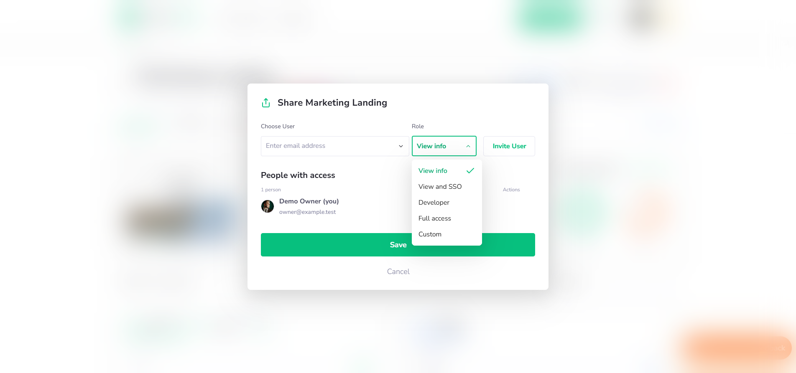
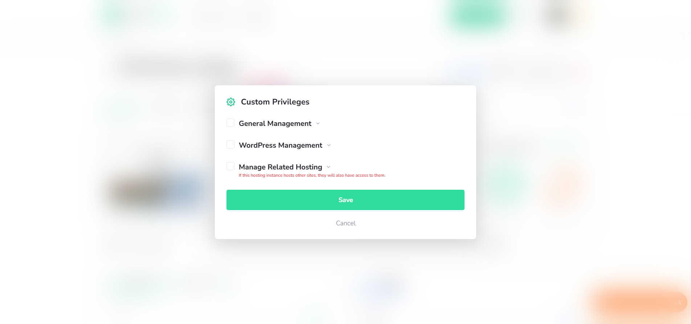

# Sharing Instances

Grant full or limited access to an instance for other users. Open instance details and click **Share** in the top-right corner.

### Share an Instance

1. Enter the target user's **email address**.
2. Assign a **role** from the dropdown. Hover over each role to see a permission summary.
3. Click **Invite User**.

The invitation is sent by email and the user appears in **People with access** with `Pending` status. You can resend the invitation from the action button next to the status.

**When assigning permissions, you can use the checkbox to give the staging environment the same permissions as the main instance.**

After the user appears on the list, you can change their role or revoke access at any time.

In **My Instances**, shared tiles show a dedicated sharing icon. Click it to reopen the sharing window.

### Custom Privileges

If you choose **Custom**, you can define detailed permissions per user. Clicking the checkmark on a category selects all privileges in that category.
- General Management
   - Change label
   - Refresh Thumbnail
   - Set Domain
   - Create Staging
   - Push to Live
   - Push to Staging
   - View Logs
   - View Reports
   - Copy Instance
   - Preview Instance
   - **Delete Instance**
   - Manage Shared Access
- WordPress Management
   - WP Admin SSO
   - Update WordPress
   - Manage Auto Update
   - Manage Backups
   - Manage Automatic Backup
   - Update Site Name
   - Clear Cache
   - Set Maintenance Mode
   - Set Debug Mode
   - Manage Themes
   - Manage Plugins
   - Manage WordPress Config
   - Manage WordPress Users
   - Manage Edge Cache
   - Manage Search Engine Indexing
   - Manage Cloudflare
- Manage Related Hosting
   - Manage Email Accounts
   - Manage DNS
   - Manage Domains
   - Manage SSL Certificates
   - Manage FTP Accounts
   - Manage SFTP Accounts
   - Manage MySQL Databases
   - Manage File Manager
   - Manage Cron Jobs
   - PHPMyAdmin SSO

Note the **Delete Instance** option when assigning privileges.  
The privileges within **Manage Related Hosting** category will be in effect for every site on the related hosting.

### Sharing Staging Instances

You can also share staging instances by assigning appropriate permissions. When a developer role is assigned, a notification with the created FTP/SFTP account details is sent to the provided email address.
