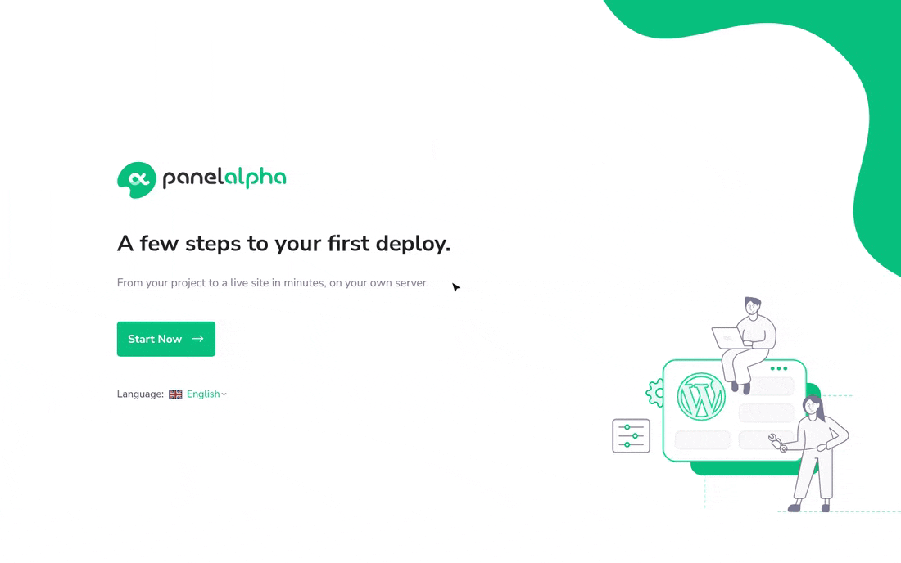
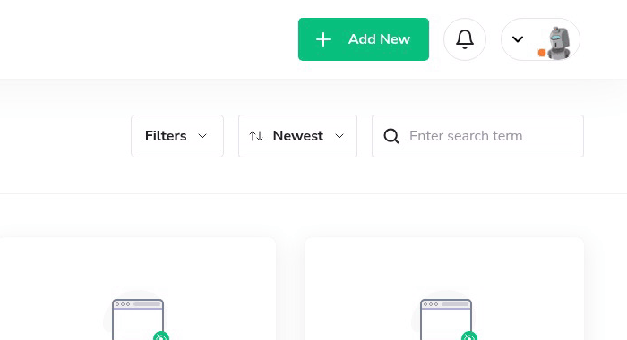

# First login

At your first visit the setup wizard creates your account. Open `https://panel.example.com`, not `http://`. The panel works over HTTPS only.

## Using the setup wizard

The wizard shows until the panel has an account. Every address on the panel leads to it until you finish.

1. On the first screen, select **Start Now**.

   

2. On the **Sign in** step, choose how you sign in:
   - **Connect with Hub** uses your PanelAlpha Hub account, which you can sign in to with GitHub or Google. Follow [Connecting with PanelAlpha Hub](#connecting-with-panelalpha-hub) below.
   - **Create a local account instead** makes an account that works on this server only. Go on with step 3.
3. On the **Server name** step, fill in the form:
   - **Server name** is a label for this server.
   - **Your Name** is optional.
   - **Email** is your login.
   - **Password** and **Confirm password** must match. The password needs at least 8 characters, with 1 lowercase character, 1 uppercase character, 1 number and 1 symbol.

4. Select **Continue**.
5. On the last step, select **Open PanelAlpha**.

You are signed in and land on the project list.

## Connecting with PanelAlpha Hub

1. On the **Sign in** step, select **Connect with Hub**.
2. Sign in on PanelAlpha Hub and approve the connection. You come back to the wizard.
3. Enter a **Server name** and continue. **Use another account** starts again with a different Hub account.
4. Select **Open PanelAlpha**.

Your Hub account is now the panel's account. Later, sign in with **Sign in with PanelAlpha** on the login page. What the connection does: [Settings](../the-panel/settings.md#panelalpha-hub).

If you finish the wizard with a local account, you can connect later in **Settings**.

## Signing in later

1. Open the panel address.
2. Enter your email address and select **Log In**.
3. Enter your password and select **Log In**.

**Remember Me** keeps you signed in. **Forgot password?** sends you a reset link. If you mistyped the address, select **Back** and correct it.

## What you see first

The project list is empty on a new server. The panel's own project is not in the list.

Open the user menu to reach **Tasks** and **Settings**: [Settings](../the-panel/settings.md). To create your first site: [Create a project](../projects/create-a-project.md).

Something not working? [Troubleshooting: The panel and your account](../troubleshooting/panel-and-account.md#first-login).
