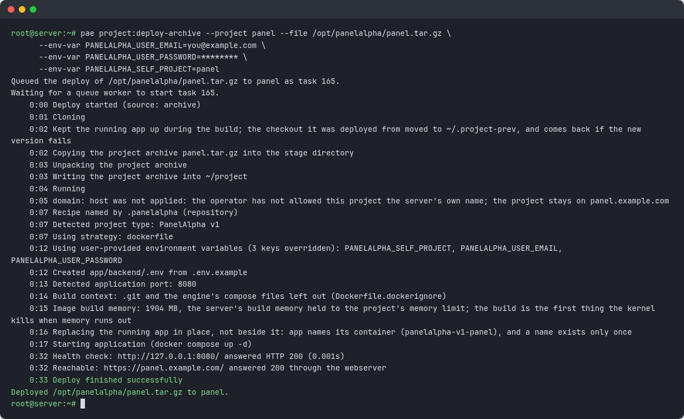

# Installing the panel

On a fresh server, one command as `root` installs the Engine and the panel: `curl -fsSL get.panelalpha.com/single-server | sh`.

The steps below are for an Engine you already have. You create a project for the panel on your PanelAlpha Engine and deploy the panel archive into it, with five commands as `root`. You need Engine 2.3.0, a domain pointing at the server and the panel archive: [Requirements](requirements.md).

## Installing

1. Download the panel archive from the public repository to `/opt/panelalpha`. `pae` runs inside the Engine, so the archive has to sit where the Engine can read it, and a path under `/opt/panelalpha` works:

   ```bash
   curl -fsSL -o /opt/panelalpha/panel.tar.gz \
     https://github.com/panelalpha/panelalpha-single-server/archive/refs/heads/master.tar.gz
   ```

2. Create an empty project for the panel. `panel` is the project name and `panel.example.com` is the domain you pointed at the server:

   ```bash
   pae project:create --project panel --domain panel.example.com --template dind
   ```

3. Let the panel talk to the Engine. The panel needs this to create and manage your projects:

   ```bash
   pae system:api-access:allow panel --scope=all
   ```

   The Engine gives the panel its API address and access token itself. Do not pass them yourself. The Engine applies the access in the background, as a task that takes a few seconds.

4. Let the panel answer on the server's own name and on a port other than 443:

   ```bash
   pae system:public-routing:allow panel --host-domain --ports
   ```

   - `--host-domain` moves the panel to the server's own name when the Engine has one. Without it, or when the Engine is known only by its IP address, the panel stays on `panel.example.com`.
   - `--ports` lets you move the panel to another port later in **Settings**.
   - Only one project on the Engine can hold the server's name.

5. Deploy the panel from the archive:

   ```bash
   pae project:deploy-archive --project panel --file /opt/panelalpha/panel.tar.gz \
     --env-var PANELALPHA_USER_EMAIL=you@example.com \
     --env-var PANELALPHA_USER_PASSWORD=<password> \
     --env-var PANELALPHA_SELF_PROJECT=panel
   ```

   The build takes about a minute. The command waits and prints the deploy log.

   If another task of the project is still running, for example the Engine still applying the access of step 3, the command refuses with a message that names that task, starting `Project 'panel' is busy:`. Wait a few seconds and run the same command again.

   

6. Open the panel address in a browser and sign in: [First login](first-login.md).

7. When you can sign in and see the project list, protect the panel's own project. **Once the project is protected, no API token can delete, stop or redeploy it, the panel's own included.** From then on you update and remove it only with `pae` on the server: [Updating the panel](updating.md).

   ```bash
   pae project:settings:set protected on --project panel
   ```

   `pae` prints what it is about to change and asks `Continue? (yes/no)`. Type `yes`. Add `--force` to the command to apply it without the question.

## The values you pass

Each `--env-var` in step 5 sets one value for the panel.

- `PANELALPHA_USER_EMAIL` is the email address of your first account. You sign in with it.
- `PANELALPHA_USER_PASSWORD` is the password of that account. It needs at least 8 characters, with a lowercase letter, an uppercase letter, a number and a symbol.
- `PANELALPHA_SELF_PROJECT` is the project name you gave in step 2. When you change the panel's address in **Settings**, the panel uses it to find its own project on the Engine and register the new domain there.
- `PANELALPHA_HUB_CODE` is an optional install code from your PanelAlpha Hub account, for example `WDJB-MJHT`. It connects the panel to your Hub account at the first start. See [Using a Hub install code](#using-a-hub-install-code).

Pass both `PANELALPHA_USER_EMAIL` and `PANELALPHA_USER_PASSWORD`, or neither. The one exception is `PANELALPHA_HUB_CODE`, which needs only the email. The panel reads these values only while it has no account. Leave them out and the panel opens a setup wizard in the browser where you create the account: [First login](first-login.md).

### Why PANELALPHA_SELF_PROJECT matters

The panel's own project is never in your project list. The panel leaves out every project that runs a panel, its own and another panel's, whether or not you pass `PANELALPHA_SELF_PROJECT`.

Without the value, the panel cannot move itself. **Settings** has no project to register the new address on, and saving one answers `The panel does not know its own Engine project, so the domain cannot be registered.` ([The panel address](panel-address.md)).

### Using a Hub install code

The panel claims the code once, at the first start, and only while it has no account. The code is used once, even if the panel restarts.

- The code needs `PANELALPHA_USER_EMAIL`. The Hub accepts the code only for the email of the account that created it.
- When the Hub accepts the code, that email becomes the panel's account and the panel is connected to your Hub account. `PANELALPHA_USER_PASSWORD` is then optional. Without a password the panel makes one, and you sign in with **Sign in with PanelAlpha**.
- When the Hub refuses the code, nothing changes. The panel makes the account from the email and password as usual, and you can connect later in **Settings**.

## When the account cannot be created

The panel creates the account at its first start. If it refuses the values, the deploy log names the rule that failed, for example:

```text
[bootstrap] first user creation failed: The password field must contain at least one symbol.
```

The panel then keeps the setup wizard closed. Its address shows a sign-in page with a message, and no one can create an account there. This stops a visitor from taking over a panel that already has the Engine access from step 3.

Fix it in one of two ways:

- Fix the value and deploy again with the same command.
- Create the account on the server:

  ```bash
  docker exec -it panel docker exec -it -u www-data panelalpha-v1-panel php /app/backend/artisan users:create you@example.com
  ```

  Enter a password that follows the rules above when the command asks for it, then sign in with that email address.

The message stays until a panel account exists. Remove `PANELALPHA_USER_EMAIL` and `PANELALPHA_USER_PASSWORD` and the panel opens the setup wizard again, as described above.

## Memory limit

The panel runs in a small account. To give it more memory, for example 2048 MB, run this. The change applies at the next rebuild:

```bash
pae project:limit:set --project panel --memory-limit 2048
```

## A panel from the one-line installer

The one-line installer deploys the panel from its Git repository and does not pass `PANELALPHA_SELF_PROJECT`. Such a panel lists its own project among yours, and moving it to another address in **Settings** fails with the message in "Why PANELALPHA_SELF_PROJECT matters" above.

`pae project:deploy-archive` refuses a project that deploys from a Git repository, so you set the value through the Engine API and rebuild the panel. Run this as `root`, with the panel's project name in place of `panel`. `pae domain:list` shows it next to the panel's address:

```bash
TOKEN=$(pae api:token:create self-project -s --expires=1h)
curl -k -X PUT https://127.0.0.1:2011/api/projects/panel/env-vars \
  -H "Authorization: Bearer $TOKEN" -H 'Content-Type: application/json' -H 'Accept: application/json' \
  -d '{"env_vars":{"PANELALPHA_SELF_PROJECT":"panel"},"apply":"none"}'
pae project:rebuild --project=panel
```

The call adds the value and keeps the panel's other variables. It also works on a protected project. When the rebuild has finished, delete the token: `pae api:token:list` shows its id, and `pae api:token:delete <id>` removes it after you confirm.
