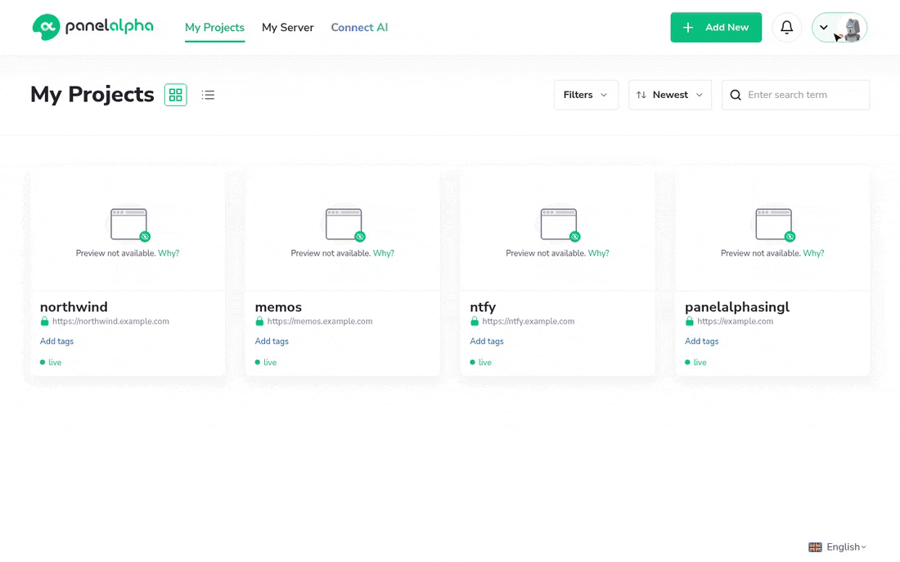

# The panel address

The panel address is the web address you open the panel on, for example `https://panel.example.com`. The installer sets it, and you can move it later in **Settings**. The panel works over HTTPS only, so it needs a certificate.

## Where the panel answers

The installer gives the panel its first address and prints it when it finishes. You can move the panel to a domain of your own later: [Moving the panel to another address](#moving-the-panel-to-another-address).

What your browser shows depends on the name:

- **The server's own name** uses the Engine's certificate. The Engine gets it from Let's Encrypt at install. The panel then answers without a warning when the server has a public address and port 80 is open. An Engine without a public address keeps a self-signed certificate (one the server signed itself, so browsers warn about it).
- **A domain of your own** gets its own certificate from Let's Encrypt through the Engine. It needs two things: the domain's A record points at the server (`203.0.113.10`) and port 80 is open.
- **A name under `panelalpha.direct` that is not the server's own name**, such as `panel.203-0-113-10.panelalpha.direct`, keeps a self-signed certificate, and your browser warns about it. Use a domain of your own for a trusted certificate.

The Engine does not request a certificate for a `panelalpha.direct` name, because every server shares that zone's weekly limit at Let's Encrypt. For the same reason, you cannot move the panel to one of those names later. The Engine refuses the certificate and the panel keeps its address ([Troubleshooting](../troubleshooting/panel-and-account.md#the-panel-address)).

## Moving the panel to another address

**Saving a new address moves the panel there, and the address it has now stops answering.** You sign in again at the new address.

The new address must be the server's own name or a name you own. The panel refuses a name under `panelalpha.direct` that is not the server's own name, and keeps its address ([Troubleshooting](../troubleshooting/panel-and-account.md#the-panel-address)).

1. Point the new domain's A record at the server.
2. Open **Settings**. On the **General** tab, find **Application URL**.
3. Replace the address. Use `https://` and a host, with no path, for example `https://panel.example.com` or `https://panel.example.com:8443`.

   

4. Select **Save Changes**.

The panel adds the new domain, gets a certificate for it and makes it the main domain. This takes a few minutes. When it is done, the page shows `The panel has moved` and `It now answers at <address> only. Sign in again there; it restarts at the new address within a few minutes.` Select **Open the new address**.

After the move:

- If you use social login, a dialog titled `Update your login providers` lists new callback URLs. **Add them to each provider's settings, or social login stops working.**
- Domains you added by hand to the panel project stay.

To use a port other than 443, the server's operator must allow it once with `pae system:public-routing:allow panel --ports`. Without that, the panel keeps port 443.

### More detail: a protected panel project

Moving the address works when the panel's project is protected. The Engine's protection refuses only one thing: deleting the main domain with a token. The move adds the new domain and makes it the main domain. Only then does it delete the old one, which is no longer the main domain by then.

Something not working? The messages you may see on this page and what to do about them: [Troubleshooting: The panel and your account](../troubleshooting/panel-and-account.md#the-panel-address).
