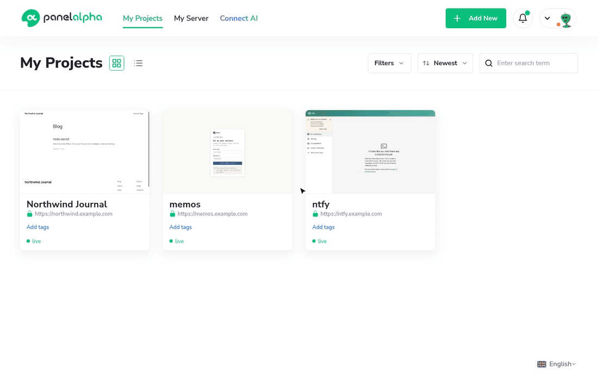

# The panel address

The panel address is the web address you open the panel on, for example `https://panel.example.com`. You set it at install and you can move it later in **Settings**. The panel is served over HTTPS only.

## Where the panel answers

At install you give the panel a domain with `--domain`. If you also allow the server's own name (`--host-domain` in [Installing the panel](install.md)) and the Engine has one, the panel moves to that name on the first deploy. Otherwise it stays on your domain.

The server's own name uses the Engine's certificate. The Engine obtains that certificate from Let's Encrypt at install, so the panel answers there without a warning when the server has a public address and port 80 is open. An Engine without a public address keeps a self-signed one.

Any other name gets its own certificate from Let's Encrypt through the Engine. That needs two things: the domain's A record points at the server (`203.0.113.10`), and port 80 is open.

One kind of name is the exception: a name under `panelalpha.direct` that is not the server's own name, such as `panel.203-0-113-10.panelalpha.direct`. The Engine refuses to request a certificate for such a name, because every server shares that zone's weekly limit at Let's Encrypt. A panel installed on such a name keeps a self-signed certificate and your browser warns about it. Moving the panel to one of those later does not work: the move asks the Engine for a certificate for the new name, the Engine refuses it and the panel keeps its address ([Troubleshooting](#troubleshooting)). Use a domain of your own for a trusted certificate.

## Moving the panel to another address

**Saving a new address moves the panel there, and the address it has now stops answering.** You sign in again at the new address. The new address must be the server's own name or a name you own: a name under `panelalpha.direct` that is not the server's own name is refused and the panel keeps its address ([Troubleshooting](#troubleshooting)).

1. Point the new domain's A record at the server.
2. Open **Settings**. On the **General** tab, find **Application URL**.
3. Replace the address. Use `https://` and a host, with no path, for example `https://panel.example.com` or `https://panel.example.com:8443`.

   

4. Select **Save Changes**.

The panel adds the new domain, gets a certificate for it and makes it the main domain. This takes a few minutes. When it is done the page shows `The panel has moved` and `It now answers at <address> only. Sign in again there; it restarts at the new address within a few minutes.` Select **Open the new address**.

<!-- TODO screenshot: assets/panel-address-moved-page.png. Show the page that reads "The panel has moved" with the Open the new address button. Use an example address such as https://panel.example.com. -->

If you use social login, a dialog titled `Update your login providers` lists new callback URLs. Add them to each provider's settings, or social login stops working.

A port other than 443 needs the server's operator to allow it once with `pae system:public-routing:allow panel --ports`. Without it the panel keeps port 443: [Installing the panel](install.md).

Domains you added by hand to the panel project stay.

Moving the address works when the panel's project is protected. The Engine's protection refuses only deleting the main domain with a token. The move adds the new domain, makes it the main domain and only then deletes the old one, which is no longer the main domain by then.

## Troubleshooting

**"Enter an address such as https://panel.example.com, without a path, query or fragment."** The address has a path, a query or a fragment. Remove it.

**"The port must be a number from 1 to 65535."** The port in the address is not one the panel can use. Use a port from 1 to 65535, or no port: `https://panel.example.com` uses 443.

**"The panel is served over HTTPS only, so its address starts with https://."** Change `http://` to `https://`.

**"The SSL certificate could not be issued. Point the domain's DNS at this server and try again."** The domain does not point at the server yet, or port 80 is closed. Fix the DNS record, then save again. The Engine sometimes gives its own reason instead, such as `Could not obtain a certificate for <domain>: DNS problem ...`.

**"Could not obtain a certificate for <domain>: <domain> is under panelalpha.direct, a zone every engine in the fleet issues under and shares one 50-certificate weekly limit on. Set shared_zone_issuance to obtain one anyway, or give the project a domain you own"** The new address is under `panelalpha.direct` and is not the server's own name, so the Engine will not request a certificate for it, and the panel does not move: it keeps the address it has. Use the server's own name or a domain you own ([Where the panel answers](#where-the-panel-answers)). The setting belongs to the Engine, on the server; the panel has no switch for it. Its key is `ssl_shared_zone_issuance`, and the server's operator can turn it on with `pae settings:set ssl_shared_zone_issuance 1`.

**"The panel is being deployed or backed up. Save again once that has finished."** Wait for the task to end, then save again: [Tasks](../the-panel/tasks.md).

**"This Engine cannot move the panel to another address. Update the Engine, then try again."** The Engine is older than 2.3.0: [Requirements](requirements.md).

**"The Engine could not register the domain. Try again later."** The Engine refused the new domain. Wait a little and save again.

**"The panel does not know its own Engine project, so the domain cannot be registered."** The panel was deployed without `PANELALPHA_SELF_PROJECT`. A panel deployed from an archive: deploy it again with that value ([Installing the panel](install.md)). A panel from the one-line installer: [A panel from the one-line installer](install.md#a-panel-from-the-one-line-installer).

**"<host> is the server's own name, which only the server's operator can give to an app. Allow it once on the server with `pae system:public-routing:allow <project> --host-domain`."** Run that command on the server with your panel project name, then save again.

**"This server lets the panel answer on port 443 only: another port opens it in the server's firewall, which only the server's operator can allow. Keep 443, or allow it once on the server with `pae system:public-routing:allow <project> --ports`."** Run that command on the server, or use port 443.
