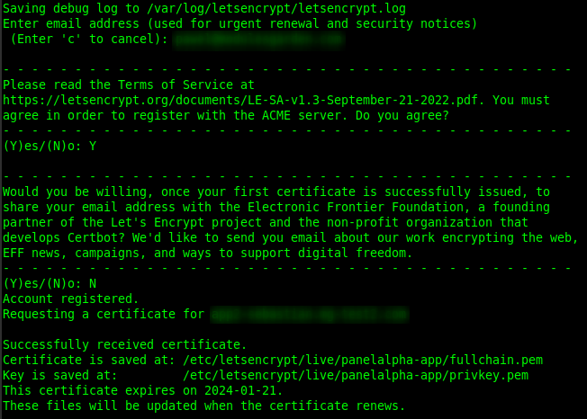
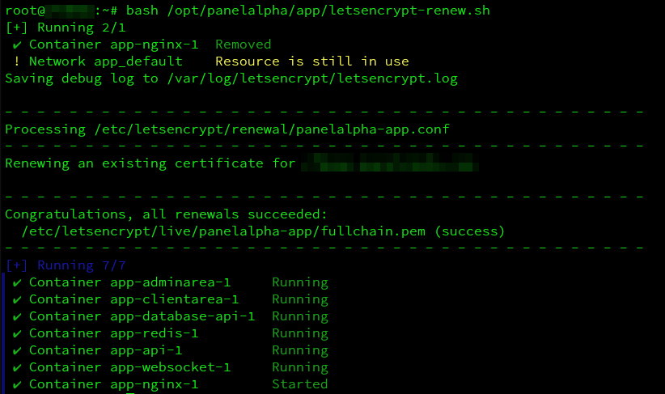

# SSL Configuration

This guide explains SSL setup for PanelAlpha.
SSL is required to keep access to Client Area and Admin Area secure.

## Prerequisites

- Root SSH access
- Domain pointing to your server IP
- Port `80` open for certificate validation

## Install Let's Encrypt Certificate

1. Stop PanelAlpha temporarily:

```bash
docker compose -f /opt/panelalpha/app/docker-compose.yml down
```

2. Request certificate:

```bash
docker run -it --rm --name certbot \
  -v "/etc/letsencrypt:/etc/letsencrypt" \
  -v "/var/lib/letsencrypt:/var/lib/letsencrypt" \
  -p 80:80 \
  certbot/certbot certonly --standalone \
  --cert-name panelalpha-app \
  -d YOUR_DOMAIN
```



3. Set certificate paths:

```bash
sed -i~ '/^SSL_CERT_FULLCHAIN=/s#=.*#=/etc/letsencrypt/live/panelalpha-app/fullchain.pem#' /opt/panelalpha/app/.env
sed -i~ '/^SSL_CERT_PRIVKEY=/s#=.*#=/etc/letsencrypt/live/panelalpha-app/privkey.pem#' /opt/panelalpha/app/.env
```

4. Start PanelAlpha again:

```bash
docker compose -f /opt/panelalpha/app/docker-compose.yml up -d
```

## Renewal

Run renewal script:

```bash
bash /opt/panelalpha/app/letsencrypt-renew.sh
```



Recommended cron entry:

```bash
0 0,12 * * * /opt/panelalpha/app/letsencrypt-renew.sh >/dev/null 2>&1
```

## Verify

Test both URLs after SSL setup:

- Client Area: `https://YOUR_DOMAIN:8444`
- Admin Area: `https://YOUR_DOMAIN:8443`

## Common Problems

- Domain DNS not pointing to the server IP
- Port `80` blocked during certificate request
- Incorrect certificate paths in `/opt/panelalpha/app/.env`
