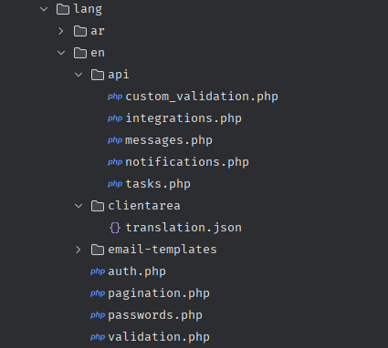
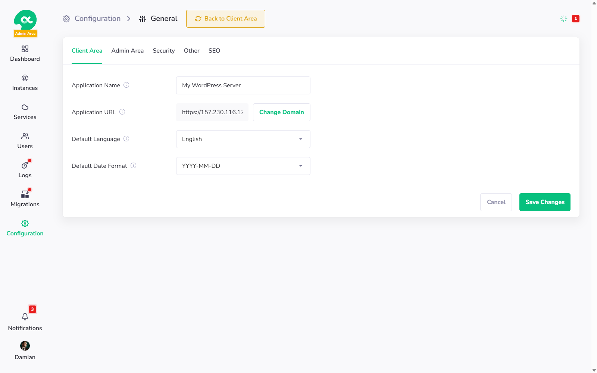
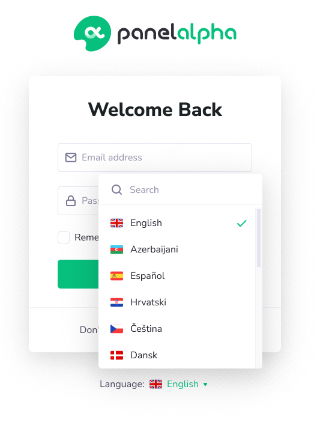

# Translations

This guide explains how to enable and manage interface translations.
By default, PanelAlpha uses English, but the Client Area language can be changed.

## Install Translation Files

Run the automatic sync script:

```bash
curl -fsSL -o /opt/panelalpha/sync-translations.sh https://raw.githubusercontent.com/panelalpha/PanelAlpha-Translations/refs/heads/main/scripts/sync-translations.sh
bash /opt/panelalpha/sync-translations.sh --lang "de"
```

Replace `de` with your target language code (`de`, `es`, `fr`, `it`, `pt_BR`).



## Sync Notifications

```bash
docker compose -f /opt/panelalpha/app/docker-compose.yml exec -T api php artisan notifications:sync
```

## Change Default Language

1. Open Admin Area (`:8443`).
2. Navigate to `Configuration -> General -> Client Area`.
3. Set **Default Language**.
4. Save.



Users can still select their own language in Client Area.



## Troubleshooting

- Language does not appear in the dropdown: verify translation folder name and permissions.
- Emails are still in old language: run `notifications:sync` again.
