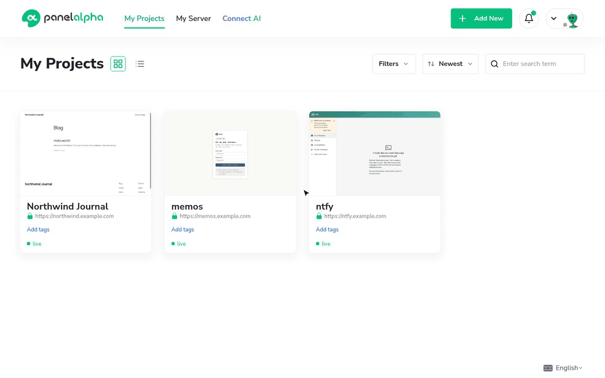
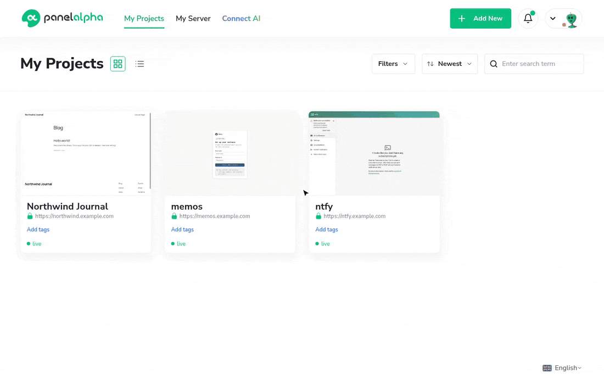

# Backups

A backup is a copy of one project that you can restore later. Backups are written to a **store**, a place that is set up once for the whole panel. Most servers need no setup, because a store already exists:

- **A server with no store** gets a default local store named `local` in `/opt/panelalpha/backups/local` from the Engine's install. The panel uses it.
- **A server that already had a store** keeps it, and the panel uses that one. This covers a store made with `pae backup:container:create` or by an earlier panel, such as `panel-local-…` in `/opt/panelalpha/backups`. Nothing is created and nothing has to be set up.

**Settings > Backups** shows the store in use, as its type and directory. Choose another store there if you want your backups somewhere else. Select **Remove store** to go back to the store the server came with.

## Setting up a store

You choose the store in **Settings > Backups**, with its kinds and fields: [Settings](../the-panel/settings.md).

**A local folder is lost with the server.** It protects you from your own mistakes but not from a lost disk. The store a fresh server starts with is local, so use S3, SFTP, FTP or FTPS for real protection.

An Engine installed before the default store existed, and not updated since, may have no store at all. A project on it shows `No backup store is set up, so backups cannot be created.` and a link **Configure a backup store**.

## What a backup holds

A backup of a PHP hosting project holds two parts: its files (**Directory**) and its databases (**Database**).

A backup of a container project holds two parts: its code (**Code**) and its data (**Data**). Code is the project's files. Data is the volumes and the databases of the containers. The table in the project's **Backups** tab shows the two as separate columns, and the tooltip lists the volumes and databases inside.

The two kinds of project: [Projects](../projects/projects.md).

## Making a backup

1. Open the project and go to the **Backups** tab, **Backup History**.
2. Select **Add New**.
3. In **Create Backup**, write a **Backup Note** if you want one. On a PHP hosting project, keep **Backup Directory** and **Backup Database** ticked for the parts you want.
4. Select **Create**.

   

**A container project is stopped while its code and data are copied.** It starts again right after. The dialog says: `This backup includes the project code and its data (volumes and databases). The project is stopped while its code and data are copied and starts again right after.`

While the backup runs, the list shows `Creating Backup` in place of the row's actions. A finished backup has a size and a **Type**: **Manual** or **Automatic**.

A backup with only one part ticked is an ordinary backup of that part. The **Database** and **Directory** columns show which parts it holds, and it downloads, restores and deletes like any other.

## Automatic backups

Each project can have a schedule. New projects get one by default, and you can change or stop it.

**For a project without a schedule**, the **Backups** tab shows `Automatic Backups: Disabled` with a switch beside it and no **Change**. To start one:

1. On the **Backups** tab, switch **Automatic Backups** on. The **Automatic Backups** dialog opens.
2. Choose **How Often**: Daily, Weekly or Monthly. Then choose the time and, for weekly or monthly, the day. **Choose Time** offers the quarter hours, and the minute the project already uses when it is not one of them.
3. Select **Enable Automatic Backups**.

   

**For a project that has a schedule**, the tab shows it with **Change** beside it. **Change**, or the time itself, opens the same dialog. The button reads **Edit Automatic Backups**. Choose another **How Often** or time and select it.

**To stop them**, switch **Automatic Backups** off and select **Disable** in the `Disable Auto Backups` confirmation. The schedule dialog itself has no way to turn the schedule off.

The time is shown in your local time. The card reads, for example, `Every day at 3:42 AM`.

### The default schedule

New projects get a default schedule from **Settings > Backups**: automatic backups on, daily in the 03:00 UTC hour, 7 backups kept. Each project gets its own minute inside that hour, so the projects of a server do not all back up at once. The project's **Backups** tab shows the time. A project that already exists keeps its own schedule.

### More detail

The schedule dialog opens at the project's current time. A project without a schedule opens it at the hour of **Settings > Backups** and the project's own minute in that hour, which is the time its default schedule would use. Turning automatic backups off deletes the schedule. Turning them on again offers that same hour and minute.

## Restoring a backup

**A restore overwrites the project. Anything made since the backup is gone.**

1. Go to the **Backups** tab and select **Restore** on the backup.
2. Choose what to restore.
3. Confirm.

**On a PHP hosting project**, tick **Restore Database** and **Restore Directory**. **Delete Existing Files** is ticked by default. If you untick it, existing files stay and may use extra disk space.

**On a container project**, tick **Restore data (volumes and databases)** and **Restore code**. Both start unticked, so tick at least one. **The project is stopped while the backup is restored. Restoring code replaces all files in the project directory. Restoring data replaces the volumes and databases from this backup.**

The list shows `Restoring Backup` while it runs.

## Downloading and deleting

**To download**, select **Download Backup**. The file opens in a new window. Allow pop-ups for the panel if it does not.

If the backup is split into several files, the panel asks `This backup is split into multiple files. What would you like to download?` and asks which part in **Backup Type**. The list has one entry per part:

- On a PHP hosting project: **Files** and **Database**.
- On a container project: **Code**, each volume and each database (the entry names the volume or the database).

One download holds one part, so download the other parts the same way.

**To delete**, select the delete action and tick the confirmation. You can also select several rows and delete them together.

Something not working? The messages you may see on this page and what to do about them: [Troubleshooting: Looking after a project](../troubleshooting/looking-after-a-project.md#backups).
