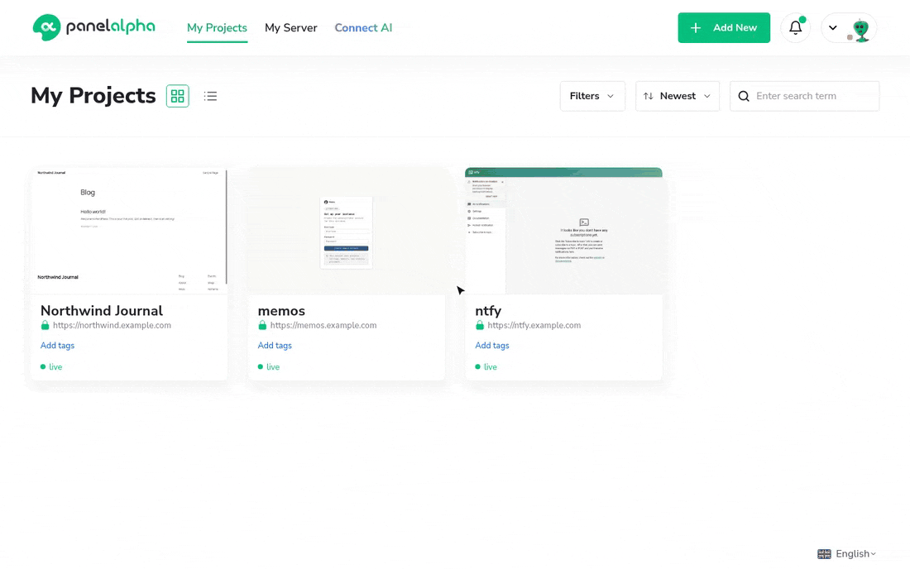

# Cron jobs and PHP

A cron job runs a command on a schedule. PHP settings choose the PHP version and limits of a PHP hosting project. Both are in the project under **Advanced**. **PHP version and PHP settings are not available for container projects**, which run PHP from their own image: [Projects](../projects/projects.md).

## Adding a cron job

1. Open the project, go to **Advanced > Cron Jobs** and select **Add Cron Job**.
2. In **Common Settings**, pick how often it runs, for example **Every 5 minutes (*/5 * * * *)** or **Once a day**. Choose **Custom** to write your own **Cron Expression**.
3. Enter the **Command**. It must be on one line.
4. On a container project, choose the **Service** the command runs in. **A run is skipped while that service is not running.**
5. Save. The panel shows `Cron job has been added.`

   

You can edit or delete a job from its row. While you write a **Cron Expression**, the **Frequency** line of the form reads back what the expression means, and says `Invalid Expression` while it cannot be read. A schedule the server refuses is not saved: the panel shows the reason, for example `Value 99 out of bounds (0-59)` or `Range values out of bounds in '10-70' (allowed 0-59)`.

A container project with no containers yet shows `This project has no container services yet. Deploy or start the project, then add a cron job.`

### Where the command runs

On a PHP hosting project the command runs inside the project's container as the project's user. Its working directory is the project's home directory, `/home/<name>`, and **the home directory itself is not writable**.

Use the site's folder instead. The **Document Root** in **Advanced > Domains** is relative to that home directory, so `/example.com/public_html` is `/home/<name>/example.com/public_html`. Write the job's output in the folder of the domain that holds the document root: it belongs to the project's user and is **not served**.

```
date >> /home/<name>/example.com/cron.log
```

A relative path starts in the home directory, so give the whole path. A file in the document root, `public_html`, is served to every visitor of the site, so never write the job's output there.

## Changing the PHP version

The version applies to a domain, so **it changes all projects on that domain.**

1. Open the project and go to **Advanced > Developer Settings**.
2. In the card **PHP Version**, select **Manage**.
3. In **Set PHP Version**, choose the version for the domain.
4. Save.

The card shows `Current PHP version: <version>`. The versions on offer come from the Engine.

## Changing PHP settings

1. Go to **Advanced > Developer Settings**.
2. In the card **PHP Settings**, select **Manage**.
3. Set the value of a setting. The dialog always lists `memory_limit`, `upload_max_filesize`, `post_max_size` and `max_execution_time`, with the value this project sets for it. A setting this project does not set has an empty value: type the value you want. **Add Directive** takes any other setting.
4. Save.

A saved setting reaches the site within a few seconds: PHP keeps the settings it reads for a folder in a cache for a few seconds, so a request the server handles before that cache is refreshed still uses the old value. The dialog shows the saved value as soon as you save it.

An empty value means this project does not set that setting, so the server's PHP configuration applies. To remove a setting the project sets, clear its value and save: the panel removes the setting and, within the same few seconds, the server's PHP configuration applies again. The dialog does not show the values the server uses.


## Troubleshooting

**A cron job seems not to run.** The panel does not show what the job printed. Make the command write a file next to the document root, for example `date >> /home/<name>/example.com/cron-test.log`, wait for the schedule and open that file in **Advanced > File Manager**, in the folder of the domain. If the file is missing, check that the command writes the whole path into the site's folder: the home directory is not writable and a relative path starts there. Also check the schedule and, on a container project, that the chosen **Service** is running.

**"Invalid PHP directive: <name>."** The setting does not exist. Check the spelling.

**"Invalid directive value."** The value has a line break. Write it on one line.

**"The PHP version applies only to PHP hosting projects. A dind project runs PHP from its own image; set it there."** The project is a container project. Change PHP in the project's own image.

**"Custom PHP INI settings apply only to PHP hosting projects. A dind project runs PHP from its own image; set php.ini there."** Same cause. Set `php.ini` in the project's own image.
