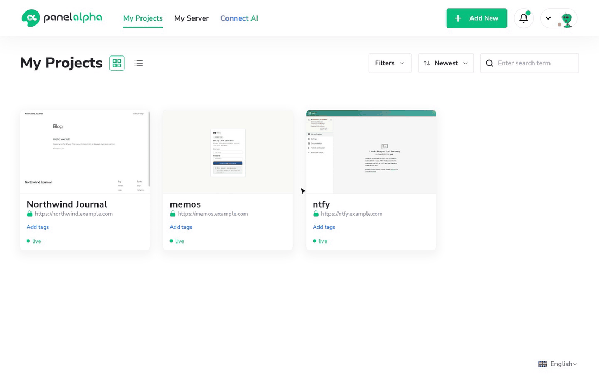

# Databases

A project can have MySQL databases and database users. A **database** holds the data of a site. A **database user** is a login that lets a program use a database.

You manage both in the project under **Advanced > MySQL Databases**, which has the tabs **Databases**, **Users** and **PHPMyAdmin**. The **Users** tab never shows the password of an existing user. A WordPress project shows its own database user and password in **Advanced > Project Details**, masked. Select **Show** to read one.

## Creating a database

1. Open the project, go to **Advanced > MySQL Databases** and select the **Databases** tab.
2. Select **Add Database**.
3. Enter the name in **Database**. The panel shows the project's prefix before it.
4. Select **Add Database**.

The whole name, the prefix included, is at most 64 characters long, which is MySQL's limit. A name starts with a letter, an underscore or a hyphen. It uses only letters, numbers, underscores and hyphens.

   

## Creating a database user

1. Go to **Advanced > MySQL Databases** and select the **Users** tab.
2. Select **Add User**.
3. Enter a **Username** and a **Password** (at least 8 and at most 64 characters, no spaces). The panel shows the project's prefix before the name. Select **Generate Password** to let the panel make a password for you.
4. Select **Add User**.

The name follows the same rules as a database name. The whole name, the prefix included, is at most 32 characters long, which is the panel's limit for a MySQL user. The field takes at most 16 characters for the part you type.

A new user can use no database until you give it one.

### More detail

The prefix counts toward the 32 characters. A project name is 3 to 15 characters, so the prefix is at most 16 and the 16 characters you may type always fit.

## Giving a user access to a database

1. On the **Users** tab, open the privileges action of the user. The dialog is called **Database Privileges: <user>**.
2. Choose the **Database**.
3. Set **Privileges** to **None**, **Read Only**, **Read & Write Only**, **Full** or **Custom**. With **Custom** you tick each privilege.

The database name in the user's row opens the privileges of that one database as **Edit Privileges For: <database>**. Use either dialog to grant, change or remove the user's privileges.

## Connection details

On the **Users** tab, select the eye action of the user (its tooltip reads **Show Access Details**). The **MySQL Access Details** window shows **MySQL User**, **MySQL Host** and **MySQL Port**. Use them exactly as shown. The host is reachable from the project's own code, not from your computer.

A WordPress project also lists **Database Name**, **Database User**, **Database Password** and **Database Host** under **Advanced > Project Details**, in the **Installation Details** card. **Database User and Database Password are masked.** Select **Show** to read one. The panel asks for your password first when you have not entered it for a while. Each request is recorded in the project's **Logs**, so you can see when the login or the password was read.

The card has Redis rows only when the project reports a Redis host, and the panel reports none.

## Renaming and deleting

- **Rename a database.** Use the edit action of the row, enter a **New name** and save. A WordPress project gets its `wp-config.php` updated to the new name.
- **Change a user's password or name.** Use the edit action of the user.
- **Delete a database or a user.** **Deleting a database removes its data, and a backup is the only way back. Make one first:** [Backups](backups.md). Then use the delete action and tick the confirmation.

## phpMyAdmin

phpMyAdmin is a web tool that lets you work on the records of a database directly. The panel logs you in for you.

1. Go to **Advanced > MySQL Databases** and select the **PHPMyAdmin** tab.
2. Select **Log In to PHPMyAdmin**. The panel warns: `This feature should be used by advanced users only.`

If the project's domain does not point at the server yet, the panel warns that phpMyAdmin may not open. It offers a temporary address until DNS is set.

If you have no databases, you see `No databases available.`

## Importing a database

The **Databases** tab has no import button. Import a SQL file through phpMyAdmin.

## Troubleshooting

**"The project kind is not known yet, so its database cannot be renamed."** The panel has not learned what the project runs. Open the project page, wait a moment and try again.

**"The Engine could not rename the database."** The rename failed on the server. Check the tasks list and try again: [Tasks](../the-panel/tasks.md).
