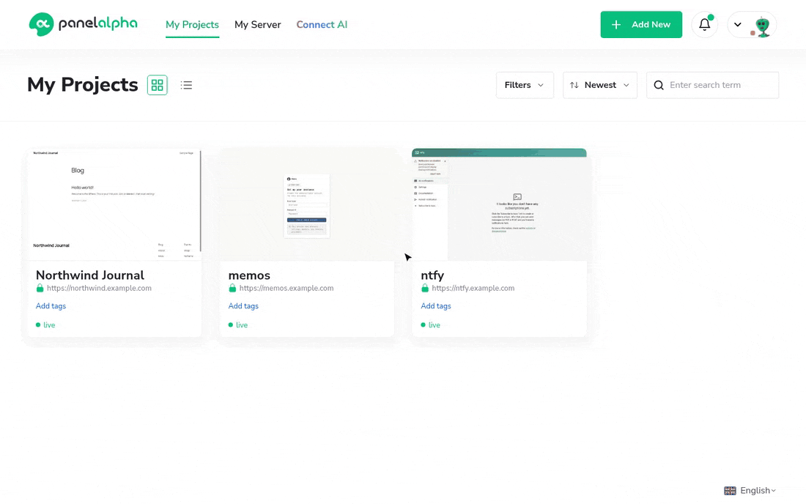
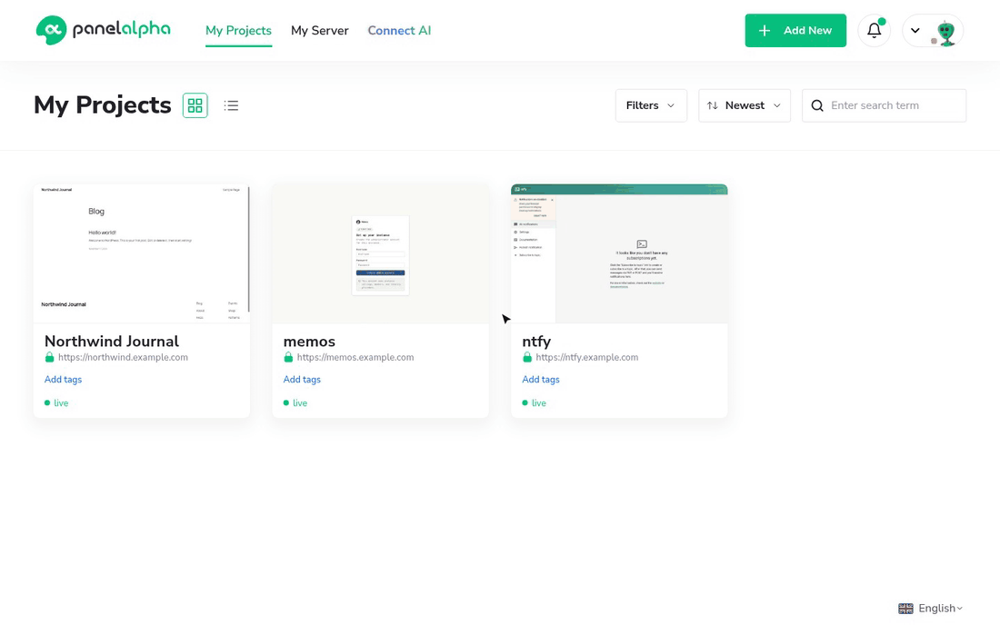

# Databases

A project can have MySQL databases and database users. A **database** holds the data of a site. A **database user** is a login that lets a program use a database.

You manage both in the project under **Advanced > MySQL Databases**, which has the tabs **Databases**, **Users** and **PHPMyAdmin**. The **Users** tab never shows the password of an existing user.

## Creating a database

1. Open the project, go to **Advanced > MySQL Databases** and select the **Databases** tab.
2. Select **Add Database**.
3. Enter the name in **Database**. The panel shows the project's prefix before it.
4. Select **Add Database**.

A name starts with a letter, an underscore or a hyphen. It uses only letters, numbers, underscores and hyphens. The panel tells you if it is too long.

   

## Creating a database user

1. Go to **Advanced > MySQL Databases** and select the **Users** tab.
2. Select **Add User**.
3. Enter a **Username** and a **Password** (at least 8 and at most 64 characters, no spaces). The panel shows the project's prefix before the name. Select **Generate Password** to let the panel make a password for you.
4. Select **Add User**.

The name follows the same rules as a database name.

A new user can use no database until you give it one.

## Giving a user access to a database

1. On the **Users** tab, open the privileges action of the user. The dialog is called **Database Privileges: <user>**.
2. Choose the **Database**.
3. Set **Privileges** to **None**, **Read Only**, **Read & Write Only**, **Full** or **Custom**. With **Custom** you tick each privilege.

You can also select the database name in the user's row to change the privileges for that one database.

## Connection details

On the **Users** tab, select the eye action of the user (its tooltip reads **Show Access Details**). The **MySQL Access Details** window shows **MySQL User**, **MySQL Host** and **MySQL Port**. Use them exactly as shown. The host works from the project's own code, not from your computer.

A WordPress project also lists its database name, user, password and host under **Advanced > Project Details**, in the **Installation Details** card. The user and password are masked. Select **Show** to read one.

## Renaming and deleting

- **Rename a database.** Use the edit action of the row, enter a **New name** and save. A WordPress project gets its `wp-config.php` updated to the new name.
- **Change a user's password or name.** Use the edit action of the user.
- **Delete a database or a user.** **Deleting a database removes its data, and a backup is the only way back. Make one first:** [Backups](backups.md). Then use the delete action and tick the confirmation.

## phpMyAdmin

phpMyAdmin is a web tool that lets you work on the records of a database directly. The panel logs you in for you.

1. Go to **Advanced > MySQL Databases** and select the **PHPMyAdmin** tab.
2. Select **Log In to PHPMyAdmin**. The panel warns: `This feature should be used by advanced users only.`

If the project's domain does not point at the server yet, the panel warns that phpMyAdmin may not open and offers a temporary address until DNS is set.

## Importing a database

The **Databases** tab has no import button. Import a SQL file through phpMyAdmin.

Something not working? Messages and fixes: [Troubleshooting: Looking after a project](../troubleshooting/looking-after-a-project.md#databases).
