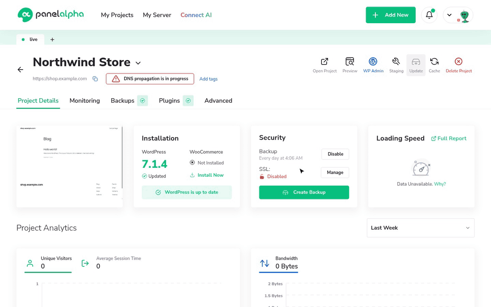
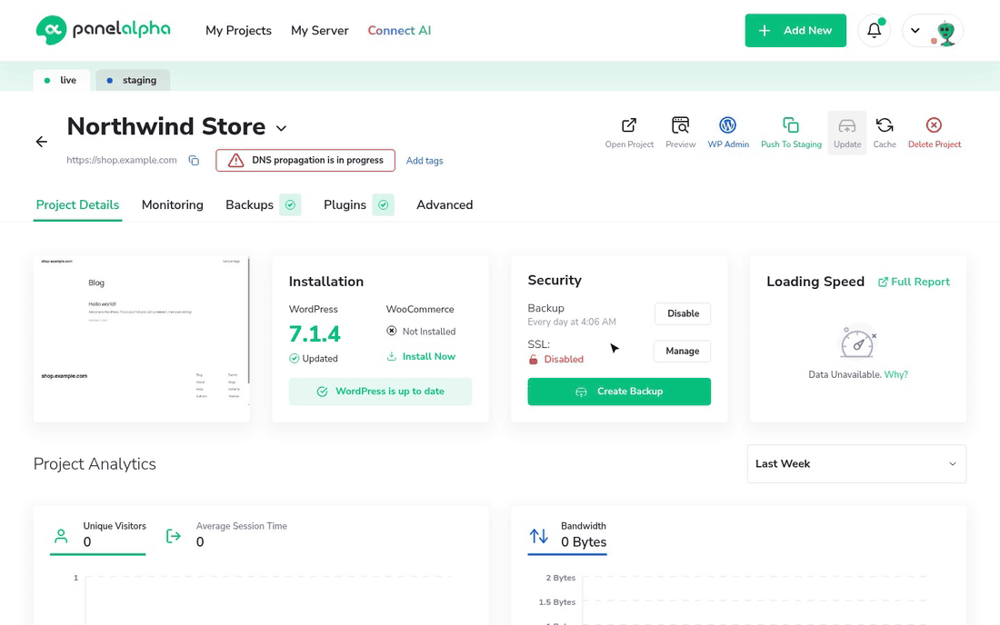
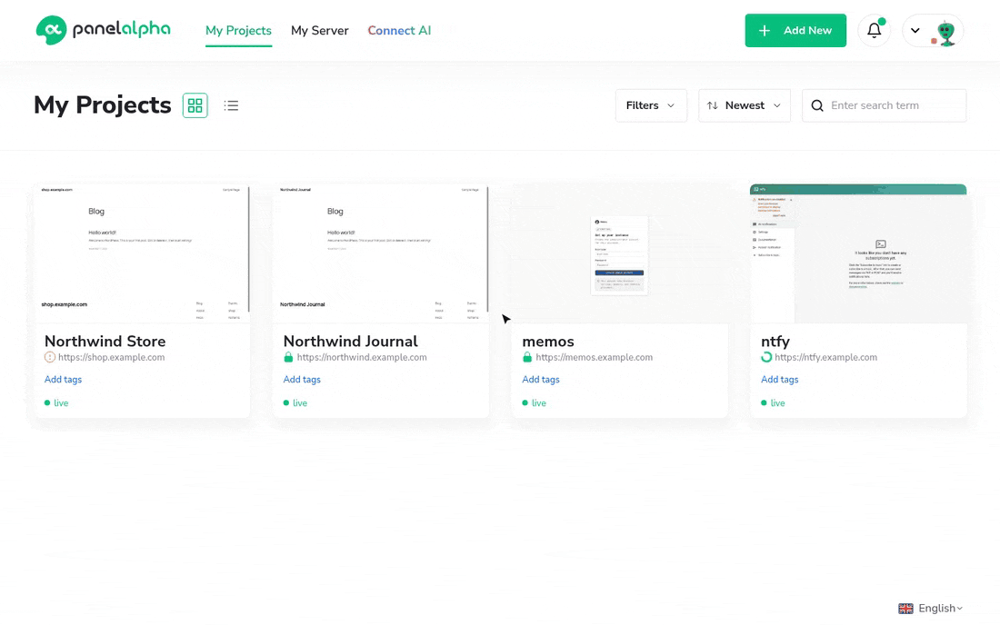

# Domains and SSL

A project answers on one main domain. You can use your own domain, add more domains and subdomains, redirect a domain and give each domain an SSL certificate, which makes visitors see the padlock. You do this in the project under **Advanced > Domains** and **Advanced > Security**.

## Pointing your own domain at a project

New projects get an address from the default domain set in the panel: [Settings](../the-panel/settings.md). To use your own domain as the project's main domain:

1. Open the project and select **Change Domain** next to the project address at the top of the page. While the project's domain does not point at this server, the button reads **DNS propagation is in progress** instead and opens the same dialog.
2. In **Set Your Domain**, choose **Map your own domain** and enter the domain, for example `example.com`.
3. Select **Use This Domain**. The panel changes the project's address at once. The dialog then shows **Set DNS Records** with the records to set at your domain provider. A **DNS record** is a line in your domain provider's settings that tells the internet where a name lives.

   - Name `example.com` (or `@`), type `A`, address the IPv4 address of your server. The dialog shows the address.
   - Name `www.example.com`, type `CNAME`, address `example.com`.

   

4. Set these records. Wait for them to spread. This takes from 2 minutes to a few hours.

The same records show when you open **Change Domain** (or **DNS propagation is in progress**) again on a project that already has a domain. **Change** next to `Your domain` in that dialog takes you back to step 2.

**Making another domain the main one changes the project's address, not the project.** Only its main domain and the address it answers on change.

- The project keeps its name in My Projects and on the server. Its account, its home directory and its files stay as they are.
- The new main domain serves the same folder the old one served.
- A WordPress site's addresses are updated, so its pages and **WP Admin** go on working.
- The project's custom proxy rules move to the new main domain.
- Its tunnel and its visitor statistics do not move. A tunnel serves one domain name, and the statistics the panel shows are the main domain's, so they start again from zero.

**Changing the main domain away from a `panelalpha.online` address removes that address for good.** Such an address is served through a tunnel, and the Engine does not make a `panelalpha.online` name a project's main domain again. The dialog warns you before you change it.

The other option in **Set Your Domain** is **Use a free subdomain**. It gives the project an address under a base domain your Engine offers. If the address is refused, you see `Domain name is not available.` Choose another name.

The panel checks the name before it changes anything:

- `Domain Name must be valid` under the field means the text is not a domain.
- A name that starts with `www.` is refused with `Domain cannot start with 'www.'`. Enter `example.com`. The panel adds `www` itself.
- A project that the server owner has protected cannot be changed: `The server operator has protected this project, so it cannot be deleted, stopped or redeployed from the panel.`

### When the domain does not point at the server

The panel checks the project's domain against the server. If it does not point here, two things change:

- The top bar of the project shows **DNS propagation is in progress** in place of **Change Domain**.
- **My Projects** shows a warning icon next to the project's address.

Point at the icon. It reads `The A record may be missing, pointing elsewhere, or routed through a proxy such as Cloudflare.` It offers two choices:

- **Fix it now** opens **Set Your Domain** with the records to set: the ones in step 3 above.
- **Ignore** turns the warning off for this project. The tip then reads `DNS alerts are ignored for this instance.` **Restore Alerts** turns it back on.

If DNS cannot point at the server yet, **Set Your Domain** also offers **Generate URL** under `Not live yet? Preview the site on the server`. It gives a temporary address so you can look at the site first: [Staging and preview](../projects/staging-and-preview.md).

## Adding a domain

1. Open the project, go to **Advanced > Domains** and select **Add Domain**.
2. In **Type**, choose **Addon Domain** or **Subdomain**.
3. For an addon domain, enter the domain without `www.`. The panel adds `www` itself. For a subdomain, enter the name and choose the parent domain, for example `shop` under `example.com`.
4. Select **Add Domain**.

Set the DNS records for the new domain at your domain provider, as in the section above.

## Changing a domain, redirecting it or removing it

1. Go to **Advanced > Domains** and open the edit action of the row.
2. Change the **Document Root**, which is the folder the domain serves. It starts with `/`.
3. To send visitors elsewhere, tick **Redirect Domain** and enter the **Redirect URL**. The list then shows `redirected to <address>`.
4. Select **Update**.

To remove a domain, use the delete action of the row and tick the confirmation. **The main domain cannot be removed.**

## Making an addon domain the primary one

The primary domain is the project's main domain. The star is offered on the main domain and on addon domains only.

1. Go to **Advanced > Domains** and select the star on the row.
2. Confirm **Set As Primary Domain**.

**All other domains of the project keep the redirect settings they have. The panel does not add a redirect to the new primary domain.** To send the visitors of an old domain to the new one, tick **Redirect Domain** on its row, as in the section above.

What changes for the domains:

- The domain that becomes the main one is removed from the project and added again. It comes back without the tunnel, the custom proxy rules and the visitor statistics it had on its own.
- The old main domain stays in the project as an addon domain, with its files. It goes on serving the site, because the new main domain serves the same folder.
- A WordPress site's addresses are updated as on a domain change, so its pages and **WP Admin** go on working on the new main domain.

### More detail about panelalpha.online addresses

If the main domain is a `panelalpha.online` address, the panel keeps it working. It re-adds it as an addon domain together with its tunnel, so the address serves the site as before, and the dialog tells you so.

That address cannot be the main domain again. The Engine refuses a `panelalpha.online` name as a main domain with `A PanelAlpha Online address is served through the proxy as a tunnel, so it cannot be the project's main domain.`

## SSL certificates

Each domain has a certificate. It comes from Let's Encrypt, from you, or it is self-signed, which browsers do not trust. The **SSL Status** column in **Advanced > Domains** shows the issuer, `Self Signed` or `No SSL`.

1. Go to **Advanced > Domains** and select the padlock icon on the row (its tip reads **Edit SSL**). You can also use **Advanced > Security**, card **SSL Certificate Applied**, button **Manage**.
2. In **Set SSL Certificate**, choose the **SSL provider**: **Let's Encrypt** or **Custom Certificate**.
3. For **Let's Encrypt**, select **Generate**. The panel shows `The SSL certificate is being generated.` The domain must already point at the server, or the certificate waits for DNS.
4. For a certificate of your own, fill in **Certificate (CRT)** and **Private Key (KEY)**. **Certificate Authority Bundle (CABUNDLE)** is optional. Select **Install**. The panel shows `The SSL certificate has been installed.`

If installation fails, the status reads `The SSL certificate installation for example.com has failed. Please contact support.` Check that the DNS records are right and try again.

A name under `panelalpha.direct`, `panelalpha.online`, `sslip.io` or `nip.io` cannot get a Let's Encrypt certificate from the panel. The panel then shows an error that mentions `shared_zone_issuance`. Use a domain of your own, or ask the server owner to allow it with `pae settings:set ssl_shared_zone_issuance 1`.

Many servers share these names, and Let's Encrypt allows only 50 new certificates a week for each of them. That is why the panel does not issue them.

### Removing an installed certificate

**The certificate you replace is not kept, and neither is its private key.** Save the CRT and the KEY first if you want them again.

1. Go to **Advanced > Domains** and select the padlock icon on the row (its tip reads **Edit SSL**), or use **Advanced > Security**, card **SSL Certificate Applied**, button **Manage**.
2. Select **Remove Certificate**, then confirm with **Remove**.

The domain goes back to the certificate the server gives a new domain. That is its own one where that covers the name, otherwise the one its operator configured, which is self-signed by default. A self-signed certificate brings the browser warning back, and the **SSL Status** column reads `Self Signed`.

The dialog shows the certificate the domain carries now as soon as the server confirms the removal, and every page that is open for the project updates. If the server's Engine cannot do this yet, the dialog answers `This server's Engine cannot remove a certificate yet.`

### Forcing HTTPS

1. Go to **Advanced > Security**.
2. Turn on **Force HTTPS Redirect**.

This works only when the domain has a certificate.

Other projects can share the same domain. If so, the panel lists them first: `This project is installed on example.com along with other projects. Changing this option, it will also affect the following projects:`.

## Troubleshooting

**"Domain cannot start with 'www.'"** You entered the address with `www.`. Enter `example.com`. The panel adds `www` for you.

**"Domain already exists."** (in **Change Domain** the answer names the domain: `example.com is already on this engine.`) Another project on this server already has that domain. Remove it there first or use another name.

**"Domain Name must be valid"** (in **Add Domain**: `Domain must be valid`; a name the server refuses: `Invalid domain name.`) The text is not a domain name. Enter it as `example.com`, without a path and without `www.`.

**"Cannot delete main domain"** The main domain has no delete icon. To remove it, make another domain the main one first, then remove this one.

**"Cannot delete domain with existing subdomains"** Remove the subdomains first, then remove the domain.

**"Invalid certificate/key"** The certificate and the private key do not belong together. Check that you pasted the key of this certificate.

**"Could not obtain a certificate for <name>: ... is not a public hostname a certificate authority will issue for"** The name is not a public domain name. Use a domain you own.
