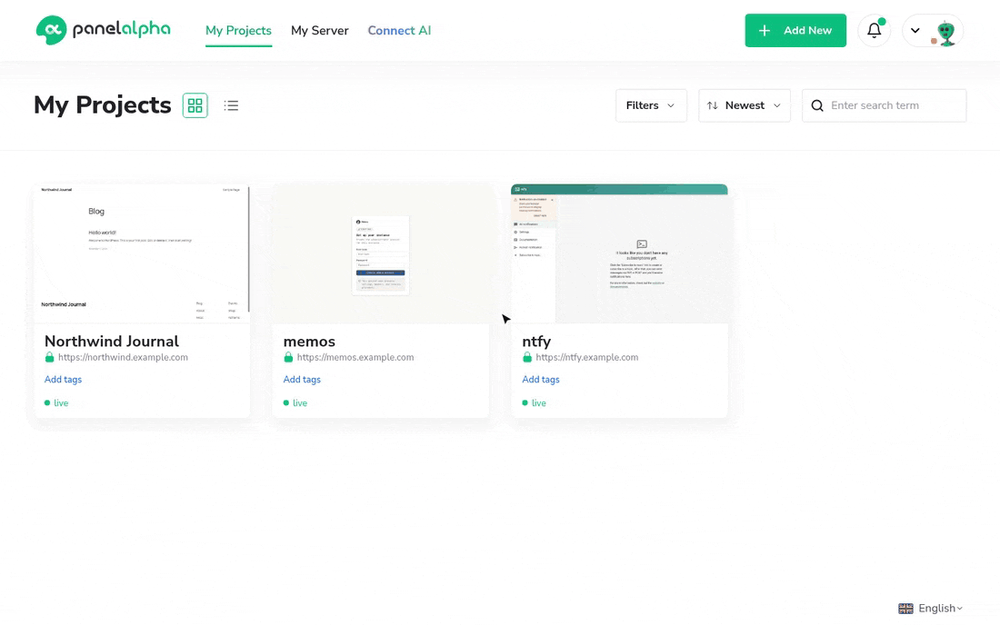
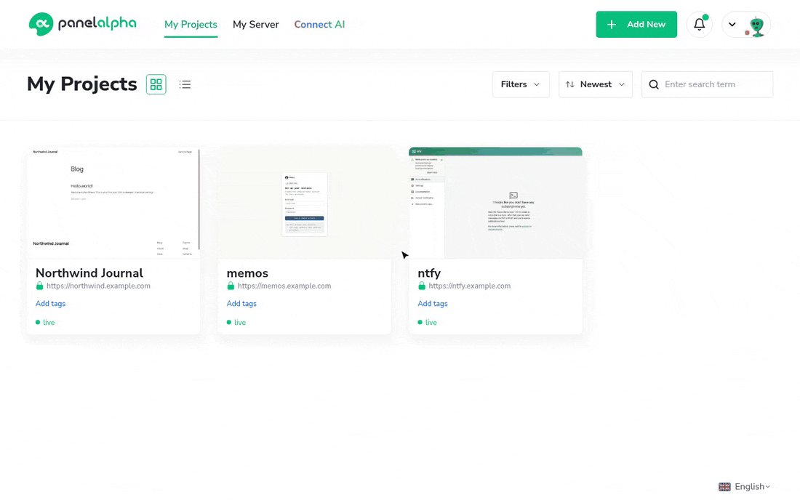
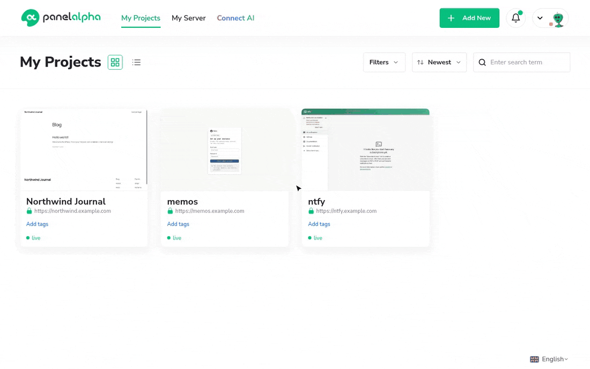

# Files and access

You can work on a project's files in the file manager in the panel, or from a program such as FileZilla with an FTP or SFTP account. All three are in the project under **Advanced**.

An **FTP account** is a username and password that give a program access to a folder of the project. An **SFTP account** does the same over an encrypted connection.

## File manager

Open the project and go to **Advanced > File Manager**. You can upload files and create new folders and files.

Right-click a file or folder to see its menu. The menu offers only the actions that fit:

- **Open** for folders.
- **View** for files the panel can preview, such as images.
- **Edit** for text files.
- **Unzip** for archives.
- **Download**, **Copy**, **Cut**, **Rename**, **Zip**, **Delete** and **Properties**.

**Paste** shows after you copy or cut something.

## FTP accounts

1. Go to **Advanced > FTP Accounts** and select **Add Account**. The **Add FTP Account** window opens.
2. Enter the **Username** and choose the domain. The name takes letters and numbers only. Enter a **Password** (at least 8 characters). The **Directory** is optional.
3. When the server supports quotas, tick **Unlimited Quota** or enter a **Quota (MB)**.
4. Save.

**Directory** is a folder inside the project home. The field shows `/home/<name>/` before what you type, so enter the rest of the path, for example `/example.com/public_html`, and do not type the home again. The folder has to exist already. The Engine refuses anything else with `The directory must be an existing directory inside the project home.`

**To change the password of an account**, select **Edit FTP Account** on its row, enter the new **Password** (at least 8 characters, as for a new account) and select **Update**. The account keeps its username, directory and quota. Programs that use it need the new password from then on. If the panel refuses the new password, the window stays open and the reason is shown under the field.

**To see the details to connect**, open the login details of the account: **FTP Username**, **FTP Host** and **FTP Port**. The host is the main domain of the project, and the port is 21.

A project on the panel's free `panelalpha.online` address is different. Its host is the server's own IP address instead. The PanelAlpha proxy that serves that address carries the website only, not port 21.

## SFTP accounts

1. Go to **Advanced > SFTP Accounts** and select **Add Account**. The **Add SFTP Account** window opens.
2. Enter the **Username**. The panel puts a prefix before it. Use letters, numbers and underscores.
3. In **Authentication Method**, choose **Password** or **SSH Key**.
   - **Password:** you can have the panel generate one. **An SFTP password needs at least 8 characters with upper and lower case letters, a number and a symbol.** An FTP password needs only 8 characters.
   - **SSH Key:** paste the **Public key**, on one line.
4. Save.

The login details show **SFTP Username**, **SFTP Host** and **SFTP Port**. The host is the main domain of the project, and the port is 2222. On a project on the panel's free `panelalpha.online` address, the host is the server's own IP address instead. The PanelAlpha proxy serves that address on the web ports only.

To cut off everyone at once, open **Actions** and select **Disconnect All**.

### Accepted SSH keys

A key can be `ssh-ed25519`, `ecdsa-sha2-nistp256`, `ecdsa-sha2-nistp384`, `ecdsa-sha2-nistp521`, a security key (`sk-ssh-ed25519@openssh.com` or `sk-ecdsa-sha2-nistp256@openssh.com`) or `ssh-rsa` from 2048 to 16384 bits. Paste one key on one line. The panel refuses any other key with `The public key must be one OpenSSH key line: ssh-ed25519, ecdsa-sha2-nistp256/384/521 or ssh-rsa of at least 2048 bits.`

## Password for a whole site

The panel has no feature to protect a site with a password.

Something not working? The messages you may see on this page and what to do about them: [Troubleshooting: Looking after a project](../troubleshooting/looking-after-a-project.md#files-and-access).
