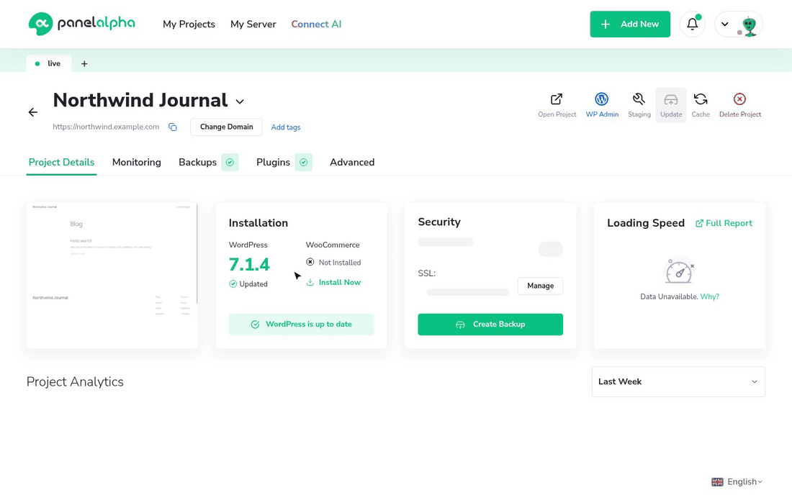
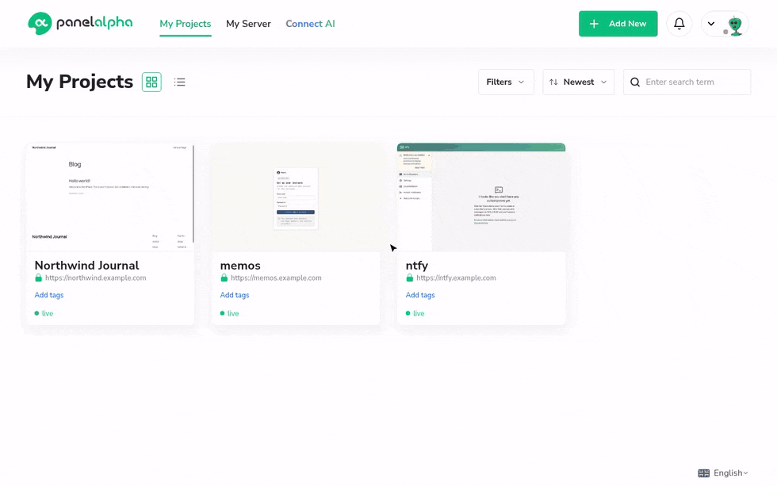

# Statistics and logs

The panel shows who visits a project, how much disk and bandwidth it uses, and the logs it writes. Container projects also have a page for their containers.

## Visitor statistics

Open the project and go to the **Monitoring** tab. **Visitors Chart** shows visits over the last week, month or year. Below it are cards for country, continent, region, referrer (the site a visitor came from), device operating system and browser.

The panel updates the statistics once a day. A new project shows `There is no data to display yet`. Check again the next day.

The **Project Details** tab also shows **Unique Visitors**, **Average Session Time** and **Bandwidth**. The session time is an estimate.

The country, continent and region cards stay empty until you download the visitor location data on the server: [On the server](../getting-started/on-the-server.md#visitor-countries).

## Usage of the server

Open the user menu and select **My Server**. The page shows how much **RAM**, **Disk Space** and **CPU** the whole server uses. Below are graphs of:

- **CPU Usage**
- **Disk Throughput**: how much data the disk reads and writes.
- **Disk IOPS**: how many read and write operations the disk handles.
- **Network Traffic**: how much data goes in and out.
- **Network PPS**: how many network packets go in and out.

Choose **1 hour**, **12 hours** or **Live** in **Period**. **Live** is the last 5 minutes.

## Logs

Open the project and go to **Advanced > Logs**. Which tabs you see depends on the project:

- **Project Logs:** what was done to the project, with who did it and when.
- **Deploy Logs:** the deploy log of a container project. Pick a run from the list above the log.
- **WordPress Error Logs:** the error log of a WordPress site. It stays empty until WordPress is set to write errors to its log. Turn on **Debug Mode** in **Advanced > Developer Settings** for debugging. The page shows the last 100 entries. Use **Download** for the whole log.
- **PHP Logs:** the PHP errors. A container project has no PHP log here.
- **Webserver Logs:** the web server logs. Pick a file from the list at the top. The access log lists each visit. The error log lists the web server's errors.

Every tab except **Project Logs** has a **Download** button that saves the log you are looking at.

A tab with nothing to show says `No PHP Logs Were Found...` or similar. The web server log often holds more detail.

## Containers

A container project has the page **Advanced > Containers**. It lists each service of the project with its image, state, uptime and ports.

- **Start All**, **Stop All**, **Restart** and **Pull & Redeploy** act on the whole project: [Projects](../projects/projects.md).
- Each service has its own **Start**, **Stop**, **Restart** and **Logs** actions. **Logs** shows the output of one service.

The panel asks for a confirmation before a restart, a stop or a redeploy.

### Public URLs

**Public URLs** is for container projects and developers. It forwards a domain of the project to a port of a service. The panel tells you if the domain is not one of this project or if the service already has a URL on that port.
