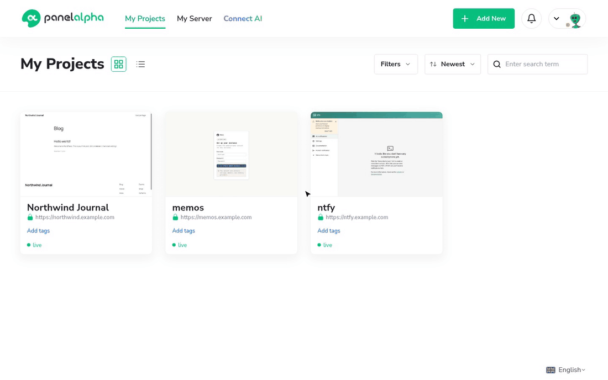

# Statistics and logs

The panel shows who visits a project, how much disk and bandwidth it uses, and the logs it writes. Container projects also have a page for their containers.

## Visitor statistics

Open the project and go to the **Monitoring** tab. **Visitors Chart** shows visits over the last week, month or year. Below it are the cards **Visits By Country**, **Continent**, **Region**, **Referrer**, **Device Operating System** and **Device Browser**.

<!-- TODO screenshot: assets/statistics-monitoring-tab.png. Show the Monitoring tab with the Visitors Chart and the cards Visits By Country and Referrer. Use sample data. -->

The **Visits By Country**, **Continent** and **Region** cards stay empty until the server owner downloads the local geolocation database with `pae geolocation:database update`. The panel updates the statistics once a day. A new project shows `There is no data to display yet`. Check again the next day.

The **Project Details** tab also shows **Unique Visitors**, **Average Session Time** and **Bandwidth**. The session time is an estimate.

## Usage of the server

Select **My Server** at the top and then **Usage**. The page shows RAM, CPU and **Disk Space** (**Used** and **Available**, in GB) for the whole server, and graphs for **CPU Usage**, **Disk Throughput**, **Disk IOPS**, **Network Traffic** and **Network PPS**. Choose **1 hour**, **12 hours** or **Live**. **Live** is the last 5 minutes and is the default.

## Logs

Open the project and go to **Advanced > Logs**. Which tabs you see depends on the project:

- **Project Logs:** what was done to the project. A table with **User**, **Actions** and **Date**. Search and sort by date; the page size is 2, 5, 10, 20 or 100.
- **Deploy Logs:** the deploy log of a container project. Pick a run from the list above the log. A running deploy has a **Live** badge.
- **WordPress Error Logs:** the error log of a WordPress site, as text. It stays empty unless `WP_DEBUG` and `WP_DEBUG_LOG` are on. It shows the last 100 entries and says `100 entries from the log are displayed. To see more, please download.` Use **Download** for the whole log.
- **PHP Logs:** the PHP errors, as a table with **Time**, **Level** and **Message**. A container project has no PHP log file here.
- **Webserver Logs:** the web server logs. Pick a file from the list at the top. An access log has **Time**, **IP Address**, **Request**, **Status** and **Size**. An error log has **Time**, **Level** and **Message**.

The PHP, web server and deploy logs show 15 rows a page, or 50 or 100. A file log loads from its newest end. When you go past the rows loaded, the table fetches the next older part. The search box filters the rows already loaded.

Every tab except **Project Logs** has a **Download** button next to the heading. It saves the log you are looking at, and is off while the log loads or is empty. A web server file the panel cannot show as text gets `You Cannot Preview the Contents of This File.` and the same button.

A tab with nothing to show says `No PHP Logs Were Found...` or similar. The web server log often holds more detail.

## Containers

A container project has the page **Advanced > Containers**. The table has the columns **Service**, **Image**, **State**, **Uptime**, **Ports** and **Actions**: each service with its image, its state, how long it has been running, the ports it publishes, and its own actions. The list refreshes every 15 seconds.

- **Start All**, **Stop All**, **Restart** and **Pull & Redeploy** act on the whole project: [Projects](../projects/projects.md).
- Each service has its own **Start**, **Stop**, **Restart**, **Logs** and **Public URLs** actions. **Logs** shows the output of one service. An empty service shows `(no output)`.

A confirmation is asked before a restart, a stop or a redeploy. A page with no services shows `No Containers Found` above `No containers available. They will appear here once a project is deployed.`

### Public URLs

**Public URLs** forwards a domain of the project to a port of that service. The address must be a domain of this project, or you see `The server name is not a domain of this project.` A second URL on the same port shows `<name> already has a public URL on port <port>. Choose another port, or remove that URL first.`
