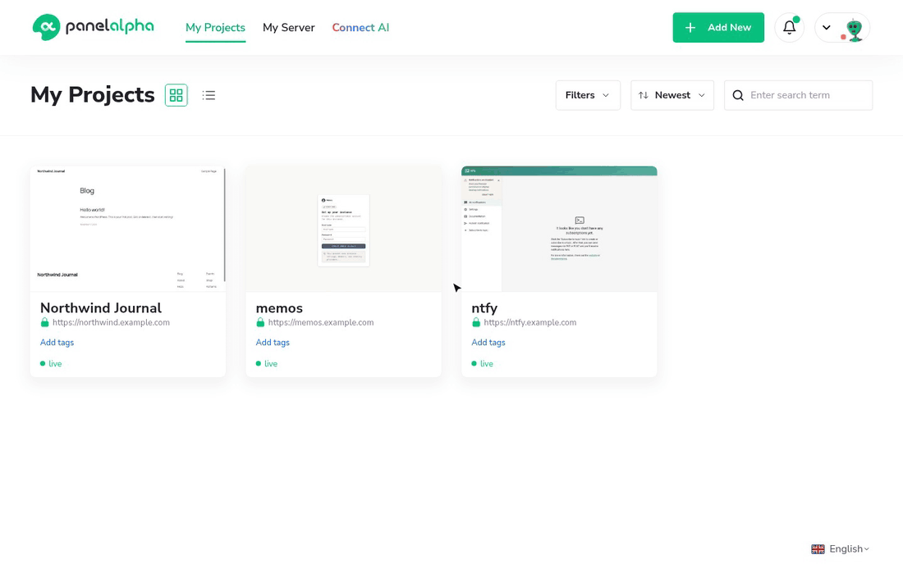
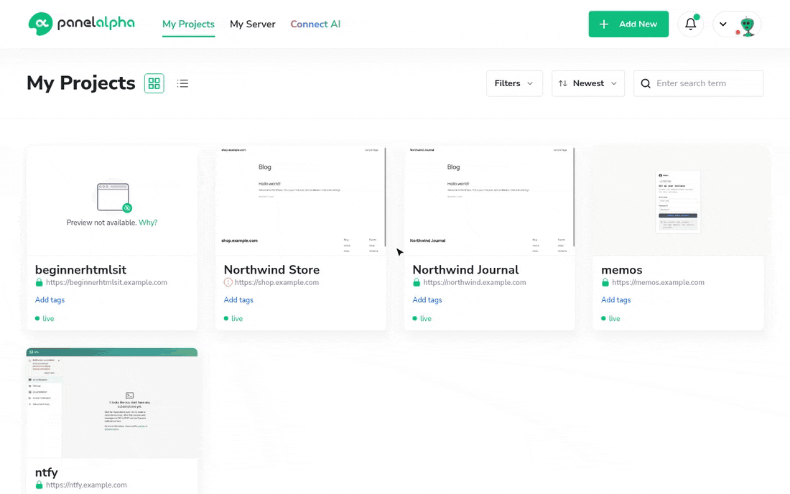

# Create a project

You create a project from WordPress, from a Git repository or from files. WordPress makes a PHP hosting project. Git and files make a container project: [Projects](projects.md).

## Starting

1. Go to **My Projects** and select **Create First Project**. Later, use the create button on the same page.
2. Choose how to create your project: **WordPress**, **Git** or **Files**.

   

If your account allows only one source, the panel skips this choice.

You can also drop one archive on the project list. The panel shows `Drop an archive with your application and launch!` and starts the files path. A folder or another kind of file is refused before the project is created.

## Creating a WordPress site

1. Choose **WordPress**. If the panel asks, choose **Create New WordPress Project**.
2. Enter the domain. Either map your own domain in **Map your own domain**, or pick a name under **Use a free subdomain** when the server offers one.
3. Select **Create Project**.

   

The panel starts the install and shows `Your site is now being created for you!`. It can take a few minutes. You can leave the page, and a notification tells you when it is done: [Around the panel](../the-panel/around-the-panel.md#notifications).

When it finishes, the screen reads `Congratulations!` and `Your site has been installed!`. Select **Start Creating** to open the project, or **Back To Dashboard** to return to the project list.

Unless the install form says otherwise, the panel sets the WordPress administrator name to `admin`, uses your account email as the administrator email, and generates a random password. You do not need that password. **WP Admin** in the project's top bar opens the dashboard signed in for you: [Managing WordPress](wordpress.md).

If the domain still needs DNS records, the panel lists them after the install. Set them at your DNS provider: [Domains and SSL](../looking-after-a-project/domains-and-ssl.md).

To move an existing site here instead: [Importing a WordPress site](importing-wordpress.md).

### The full install form

Some servers open a full install form instead of the domain screen. Without that form, the panel installs the newest WordPress in the document root of the domain.

The form has two tabs:

- **Basic Configuration**: the domain, a **Subdirectory** for the site and the **WordPress version** (locked to the newest when the plan offers no other).
- **Advanced Configuration**: the **Language**, the **Database Name** and **Database Prefix**, and the **Administrator Username** and **Administrator Email**.

When the install ends on a server with this form, the last screen offers **Log in to WordPress**, which opens the dashboard, and **Project Details**.

## Creating a project from Git

1. Choose **Git**.
2. Enter the **Repository URL**.
3. For a private repository over HTTPS, turn on **Private repository** and paste the **Access token**. A **How to create?** link next to the field shows the steps when your server has a documentation link set.
4. Select **Continue**.

The panel checks the repository (`Connecting to the repository…`, `Detecting git branches…`, `Detecting environment variables…`). Then one of two things happens:

- The repository has several branches or an `.env.example` file: the **Environment variables** step opens. Choose the branch and adjust the values, or select **Skip** to keep the defaults.
- The repository has no `.env.example` file: there are no values to adjust, and the step is titled **Choose a branch**.

The deploy then starts and the panel shows its live log.

### An SSH address

An SSH address (for example `git@github.com:example/app.git`) works differently. The panel creates a **deploy key** for you to add to the repository:

1. Enter the address and the branch (the default is `main`).
2. Select **Generate deploy key**. The project is created now.
3. Add the shown key to the repository as a read-only deploy key.
4. Tick **I added the deploy key to the repository** and select **Continue**.

Details on keys, tokens and branches: [Git](git.md).

### The project name

The wizard does not ask for a project name. For a Git or files project the panel makes the name from the repository or archive name. It keeps only lowercase letters and digits and cuts the result to 15 characters.

## Creating a project from files

1. Choose **Files**.
2. Drop one `.zip` or `.tar.gz` archive of your app, or select it with **click to browse**.
3. Review the **Environment variables** step if it opens, then deploy.

The upload dialog says `Drop your project archive here`. It takes exactly one `.zip` or `.tar.gz` archive, up to 256 MB. A folder, a loose `.sql` file, a second file or a bigger archive is refused before the project is created. Pack your project, and its database dump if it has one, into one archive first.

### Replacing the files later

Use **Upload new version** on the **Source** card of **Project Details**. It takes a `.zip` or `.tar.gz` archive, up to 256 MB, the panel's upload limit. The drop area names the limit, and a bigger file is refused before it is uploaded.

If the upload does not finish, the project waits for its files. This happens when you select **Cancel Deploy** while it runs or you close the window. **Project Details** then says `Waiting for your files`. Upload the archive afterwards with **Upload new version** on the **Source** card.

## Troubleshooting

**"Invalid repository URL."** The address is not an HTTPS or SSH repository address. Copy it from your Git provider.

**"The repository was not found. Check the repository address and that the token can read it if the repository is private."** The address is wrong, or the repository is private and the token cannot read it.

**"The repository refused this token. Check the token and that it can read this repository."** The token is wrong or has no read access.

**"The host cannot be reached from the panel."** The panel cannot connect to that host. It refuses private addresses and the address of this server, so a repository that runs on the same server cannot be used. Check the host name, or host the repository somewhere else.

**"Could not read the repository."** The panel could not open the repository and got no clear reason from the server. The host may be down or slow. Check the address and the token and try again.

**"The repository did not accept the key. Check that you added it to this repository."** The deploy key is not in the repository yet. Add it in the repository's deploy key settings and select **Continue** again.

**"Add only one archive."** You added a folder or more than one file. Upload a single `.zip` or `.tar.gz`.

**"Allowed file types: .zip, .tar.gz"** The file has another type. Pack it as `.zip` or `.tar.gz`.

**"Domain is already in use."** A project on this server already has that domain. Choose another one.

**"Installation failed."** The install did not finish. Select **Try Again**. What you see depends on the kind of project:

- **WordPress project.** Its card in **My Projects** and its **Installation** card on **Project Details** read `Installation failed. Try Again`. Its progress window reads `Error!` and `Installation was unsuccessful. Please try again.`
- **Git or files project.** It has no **Installation** card. Its card reads `Deploy failed`. Its progress window reads `Error!` and `Something went wrong, please try again.`, with the deploy log below them. The deploy log holds the reason.

To read the deploy log, select **Show Logs** on the project's card in **My Projects**, or in the row's **Actions** menu in the table view.

On **Project Details**, a files project's **Source** card reads `Last deploy failed`. A Git project's **Source** card shows the repository, not the failure.

If the install fails again, see the task in [Tasks](../the-panel/tasks.md).

A project created from an archive cannot repeat that deploy, because the archive is deleted when its deploy ends. The panel asks for the archive again (see the next entry).

**Cancel Installation** deletes the project with its files and databases instead of trying again. These all open the same confirmation:

- the card's **Cancel Installation** button
- the button behind the card's installation indicator (point at it)
- **Cancel Installation** in the table view's **Actions** menu

The delete runs only after you tick **Yes, I understand and want to cancel the installation.** there.

**"This project deploys from an uploaded archive, and that archive is deleted when its deploy ends. Upload the archive again to retry."** **Try Again** has no archive left to deploy. Upload the archive again with **Upload new version** on the **Source** card of **Project Details**.
