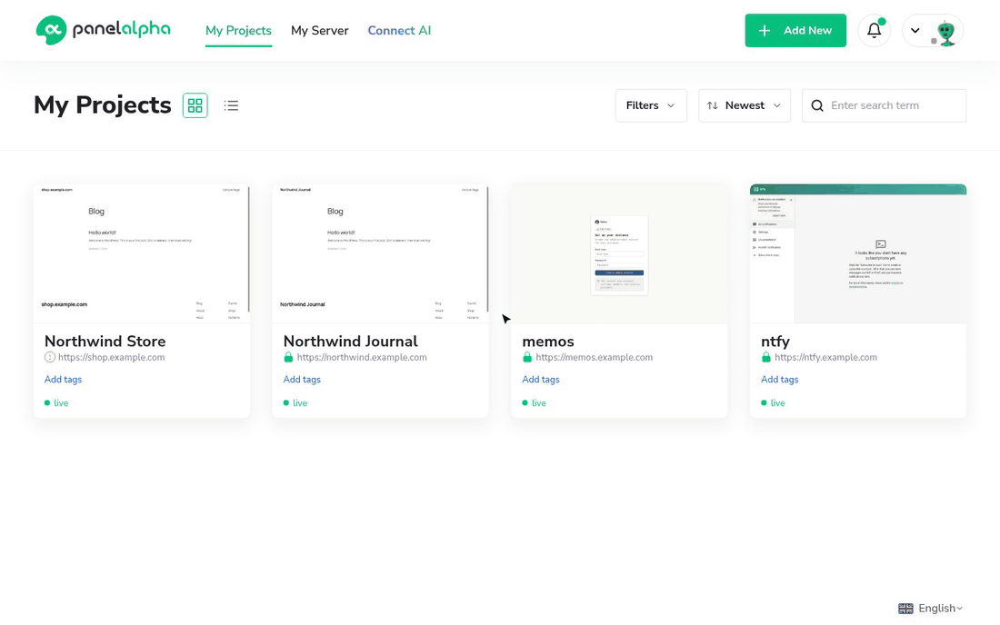

# Create a project

You create a project from WordPress, from a Git repository, from files or from an app in the PanelAlpha GO! catalog. WordPress makes a PHP hosting project. Git, files and PanelAlpha GO! make a container project: [Projects](projects.md).

## Starting

1. Go to **My Projects** and select **Create First Project**. Later, use the create button on the same page.
2. Choose how to create your project: **WordPress**, **Git**, **Files** or **PanelAlpha GO!**.

   

If your account allows only one source, the panel skips this choice.

You can also drop one archive on the project list. The panel shows `Drop an archive with your application and launch!` and starts the files path. A folder or another kind of file is refused before the project is created.

## Creating a WordPress site

1. Choose **WordPress**. If the panel asks, choose **Create New WordPress Project**.
2. Enter the domain. Either map your own domain in **Map your own domain**, or pick a name under **Use a free subdomain** when the server offers one.
3. Select **Create Project**.

   

The panel starts the install and shows `Your site is now being created for you!`. It can take a few minutes. You can leave the page, and a notification tells you when it is done: [Around the panel](../the-panel/around-the-panel.md#notifications).

When it finishes, the screen reads `Congratulations!` and `Your site has been installed!`. Select **Start Creating** to open the project, or **Back To Dashboard** to return to the project list.

The panel sets the WordPress administrator name to `admin`, uses your account email as the administrator email and generates a random password, unless the install form says otherwise. You do not need that password. **WP Admin** in the project's top bar opens the dashboard signed in for you: [Managing WordPress](wordpress.md).

If the domain still needs DNS records, the panel lists them after the install. Set them at your DNS provider: [Domains and SSL](../looking-after-a-project/domains-and-ssl.md).

To move an existing site here instead: [Importing a WordPress site](importing-wordpress.md).

### The full install form

Some servers open a full install form instead of the domain screen. Without that form, the panel installs the newest WordPress in the **document root** of the domain (the folder the domain serves).

The form has two tabs:

- **Basic Configuration**: the domain, a **Subdirectory** for the site and the **WordPress version** (locked to the newest when the plan offers no other).
- **Advanced Configuration**: the **Language**, the **Database Name** and **Database Prefix**, and the **Administrator Username** and **Administrator Email**.

When the install ends on a server with this form, the last screen offers **Log in to WordPress**, which opens the dashboard, and **Project Details**.

## Creating a project from Git

1. Choose **Git**.
2. Enter the **Repository URL**.
3. For a private repository over HTTPS, turn on **Private repository** and paste the **Access token**. A **How to create?** link next to the field shows the steps when your server has a documentation link set.
4. Select **Continue**.

The panel checks the repository (`Connecting to the repository…`, `Detecting git branches…`, `Detecting environment variables…`). Then one of two things happens:

- The repository has several branches or an `.env.example` file: the **Environment variables** step opens. Choose the branch and adjust the values, or select **Skip** to keep the defaults.
- The repository has no `.env.example` file: there are no values to adjust, and the step is titled **Choose a branch**.

The deploy then starts and the panel shows its live log.

### An SSH address

An SSH address (for example `git@github.com:example/app.git`) works differently. The panel creates a **deploy key**, an SSH key that lets the panel read the repository. You add it to the repository:

1. Enter the address and the branch (the default is `main`).
2. Select **Generate deploy key**. The project is created now.
3. Add the shown key to the repository as a read-only deploy key.
4. Tick **I added the deploy key to the repository** and select **Continue**.

Details on keys, tokens and branches: [Git](git.md).

### The project name

The wizard does not ask for a project name. For a Git or files project the panel makes the name from the repository or archive name. It keeps only lowercase letters and digits and cuts the result to 15 characters.

## Creating a project from PanelAlpha GO!

**PanelAlpha GO!** is a catalog of open-source apps from [go.panelalpha.com](https://go.panelalpha.com). PanelAlpha deployed and tested each of them on PanelAlpha Engine. The catalog tells the panel where the app's code is, and the panel deploys it on your server as a Git project.

**The panel must be connected to PanelAlpha Hub first.** Until it is, the **PanelAlpha GO!** option is greyed out and reads `Connect this panel to PanelAlpha Hub first to browse and install apps.` Select **Connect to PanelAlpha Hub** to open **Settings** and connect: [Settings](../the-panel/settings.md#panelalpha-hub). The catalog is free with a PanelAlpha Hub account.

1. Choose **PanelAlpha GO!**. The catalog opens with the heading **Choose an App**.
2. Find an app. Type in the search field (at least 2 characters). You can search by name, by category or by the app it replaces, for example `Notion`. You can also use the list on the left: **Popular** shows every app, **Latest** shows the most recently verified apps first, and below them is one entry per category.
3. Select **Install** on the app's card. To read more first, select **Details**. It shows the app's description and screenshots, with the same **Install** button.

<!-- TODO screenshot: assets/single-server/create-project-go-catalog.gif. Show the catalog with the search field, the category list and a few app cards, then Details and Install. -->

Each card shows the app's name, a short description, the apps it replaces and its stars on GitHub or another Git host. The sort menu orders the apps by **Most tried** (the default), **Name A-Z**, **Recently verified** or **Most stars**. The catalog shows 24 apps at a time. **Show more apps** loads the next ones.

After **Install**, the panel creates a container project from the app's repository and shows its live log. It does not ask for a name, a domain, a branch or environment variables. The server picks the project name and address, the same way as for any new project. The project is then an ordinary Git project: [Git](git.md).

If PanelAlpha GO! cannot be reached, the catalog says `The catalog is unavailable` and `PanelAlpha Go could not be reached. Your other ways to create a project still work.` Select **Try Again** to load it again later.

## Creating a project from files

1. Choose **Files**.
2. Drop one `.zip` or `.tar.gz` archive of your app, or select it with **click to browse**.
3. Review the **Environment variables** step if it opens, then deploy.

The upload dialog says `Drop your project archive here`. It takes exactly one `.zip` or `.tar.gz` archive, up to 256 MB. A folder, a loose `.sql` file, a second file or a bigger archive is refused before the project is created. Pack your project, and its database dump if it has one, into one archive first.

### Replacing the files later

Use **Upload new version** on the **Source** card of **Project Details**. It takes a `.zip` or `.tar.gz` archive, up to 256 MB, the panel's upload limit. The drop area names the limit, and a bigger file is refused before it is uploaded.

If the upload does not finish, the project waits for its files. This happens when you select **Cancel Deploy** while it runs or you close the window. **Project Details** then says `Waiting for your files`. Upload the archive afterwards with **Upload new version** on the **Source** card.

Something not working? Messages and fixes: [Troubleshooting: Projects](../troubleshooting/projects.md#create-a-project).
