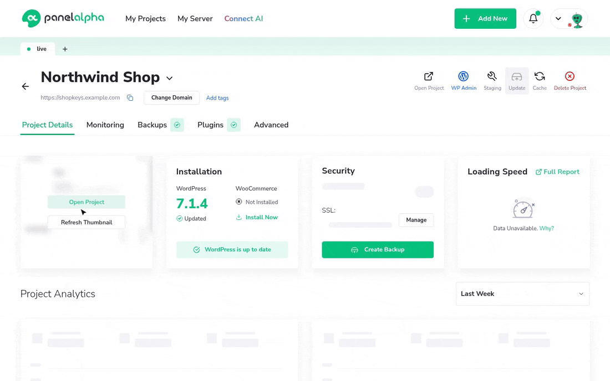
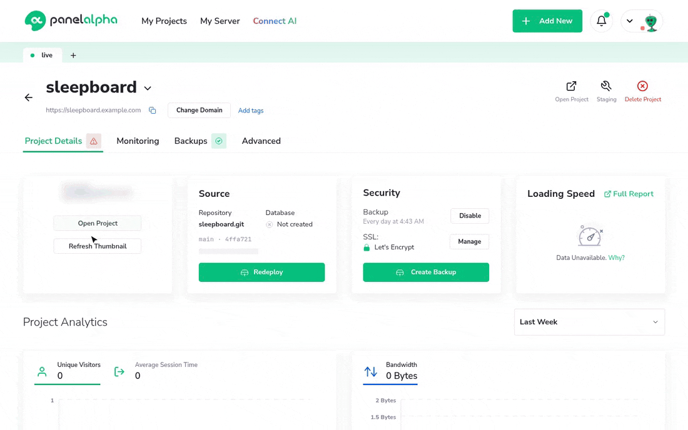

# Git

A Git project is a container project that the panel builds from your repository. Create one first: [Create a project](create-a-project.md).

A **deploy** builds and starts the project from the latest commit of a branch. A commit is one saved change in your repository. A branch is one line of work in it.

**The panel cannot roll a project back to an earlier commit.** It always deploys the latest commit of a branch.

## Redeploying

A redeploy runs the deploy again with the newest commits. **Project Details** has a **Source** card with the repository and the deployed commit. It shows `Up to date` or how many commits behind the project is.

1. Select **Redeploy** on the **Source** card.
2. Pick the **Branch**. If you choose a branch other than the deployed one, the window shows the warning `This resets the target to origin of the selected branch.`
3. Review the new commits. If the project deploys with commands of its own, the panel lists its deploy steps below the commits (**Install dependencies**, **Run build command**, **Run migrations**). Untick a step to skip it for this deploy. A project without such commands shows no list.
4. Confirm.

Once the project has a staging copy, the window also offers **Deploy to staging environment**. If you tick it, the chosen branch goes to the copy and production stays as it is: [Staging and preview](staging-and-preview.md).

## Deploy logs

The deploy log shows what a deploy did, step by step.

- **Table view:** in **My Projects**, open the **Actions** menu of the project's row and select **Show Logs**.
- **Card view:** **Show Logs** appears on the project's card while it deploys and when its install failed.

The **Deploy Logs** window lists the steps **Preparing environment**, **Cloning repository** and **Running stack**, each with its time. The log is below them.

- A redeploy runs only **Running stack**. The steps it does not run say **Skipped** and have no time.
- The step where a failed deploy stopped shows the outcome instead of a time: **Failed**, or **Cancelled** for a deploy you stopped.
- While the deploy runs, the title has the **Live** badge. **Cancel Deploy** stops the deploy and shows only while it runs.
- **Download Logs** saves the log.

You can close the window. The deploy continues in the background.

Earlier deploys are in **Advanced > Logs**, on the **Deploy Logs** tab. Select a run in the list at the top to read it. A run that is still going shows the **Live** badge there too.

## Changing the branch

Changing the branch deploys the project again from another branch.

1. Open the project and go to **Advanced > Git**.
2. In the **Branch** card, select **Manage**. Choose the branch in **Branch name** and select **Change branch**. The window says `Enter the branch name for this site.` and warns `Save or discard local file changes on the server before changing the branch.`

A branch change needs files on the server that match the repository. If the site has files that are not in the repository, the panel opens the **Local changes detected** dialog instead of switching: see [Local changes on the server](#local-changes-on-the-server).

## Local changes on the server

A site connected to Git can get files that its repository does not have. These are files you upload or edit in **Files**, and files a deploy step of the project writes (a lock file, `node_modules`).

**Discard local changes and Force pull both delete the local changes on the server, and they cannot be recovered.** To keep your changes, use **Push local changes first, then pull**, or copy them out in **Files** first.

**Pull** and **Change branch** both stop at these files and open the **Local changes detected** dialog. It offers three choices:

1. **Discard local changes** resets the checkout to the last commit of the branch and removes the files the repository does not track.
2. **Force pull (overwrite changes)** replaces the site's files with the branch's content.
3. **Push local changes first, then pull** commits the site's changes, pushes them to the branch and merges the branch back, so nothing is lost.

After **Discard local changes** or **Force pull**, select **Pull** or **Change branch** again to run what you started.

## Environment variables

Environment variables are settings that your app reads when it starts, such as an address or a key. **Advanced > Environment variables** keeps the variables the app container gets.

- The table shows each key and its value. The pencil edits a row and the bin deletes it.
- **Add variable** adds one.
- **Import** adds a block of `KEY=value` lines at once. Turn on **Overwrite existing keys** to replace the values you already have.

The panel keeps the variables with the project, so a redeploy does not lose them.

Saving applies them. The panel restarts the app container, and the new values are in it when it comes back, a few seconds later.

If you turn off **Restart the app container after saving**, the panel only stores the variables. The next **Redeploy** applies them. **Restart** in **Advanced > Containers** does not apply stored variables.

**Advanced > Environment variables** is on every project that is not WordPress, and a Git project is one of them. A WordPress project has no such page. It keeps its configuration in **Advanced > System Configuration**.

## Connecting and disconnecting a repository

Connecting links a project to a Git repository (GitHub, GitLab or Bitbucket). **Advanced > Git** starts with a **Connect repository** card when the project has no repository.

1. Enter the **Repository URL**.
2. For a private repository over HTTPS, turn on **Private repository** and enter the **Access token**.
3. Select **Connect repository**.

**Connect repository** downloads the branch into the site. The message after it says the site's files now match the branch.

- A site file with the same name as one in the repository is replaced with the repository's version.
- Files the repository does not have stay where they are.
- A site that already has a Git checkout keeps its files. Its message says they are unchanged.

If the panel cannot download the branch, it refuses the connect and nothing is connected: see [Troubleshooting](../troubleshooting/git.md).

An SSH address asks for the branch and shows a deploy key instead: [Deploy key](#deploy-key).

Once a repository is connected, the card shows it under **Repository**, with a **Disconnect** button. **Disconnect** asks you to confirm in `Disconnect repository`. It removes the Git link from the panel and leaves the files on the server.

### More detail about connecting

The page is the same for every kind of project.

- A project deployed from its repository is already connected. The Engine refuses to disconnect it: **Disconnect** shows `Git is managed by deploy.` and the repository stays.
- A WordPress site starts with no repository, so it is the project this card is for.
- A connected site can still have files of its own. **Pull** or a branch change asks before dropping them: see [Local changes on the server](#local-changes-on-the-server).

## Pull, push and the deployment log

Once a repository is connected, **Advanced > Git** also has these cards:

- **Last deployed commit** shows the commit, its message and when it was deployed. **Check for updates** compares the site with the repository. The answer is `Up to date with the repository branch`, or how many commits the repository has that the site does not.
- **Pull from repository** updates the site with the latest files from the branch. If the site has files of its own, the panel asks first: [Local changes on the server](#local-changes-on-the-server).
- **Push to repository** sends the site's file changes to the branch. If the repository has newer commits, the card says `The repository has newer commits. Pull those changes before pushing from this site.` A project deployed from its repository cannot push. The panel shows `Git is managed by deploy.`
- **Deployment log** lists the recent connects, pulls, pushes and branch changes of the site, each with its status.

## Access token

An HTTPS repository uses an **access token**, a password-like text that your Git provider gives you. The token needs read access to the repository and permission to manage its webhooks (a webhook is how your Git provider tells the panel about a new push).

1. Open **Advanced > Git** and find the **Access token** card.
2. Select **Manage**.
3. Select **Save token** in the dialog.

The card shows `Token saved` or `No token saved`. If the repository stops answering, the page shows `Cannot access the repository. Update your access token.`

### More detail about the access token

The panel tests the token before it saves it. It reads the repository with the token, and it asks your Git provider's API (GitHub, GitLab, Bitbucket) for the repository with the token.

- If the provider does not know the token, the panel does not save it, however public the repository is. A message gives the reason.
- If the provider's API cannot be asked, or answers something other than a refusal, the panel keeps the token as long as it could read the repository.

## Deploy key

An SSH repository uses a **deploy key**. **Advanced > Git** shows it in the **Deploy key (SSH)** card: the public key and its **Fingerprint**. Add the key in the **Deploy keys** settings of your repository. Read-only access is enough.

**Generate a new key replaces the old one, and pull and deploy stop working until you add the new key to the repository.** If you select **Delete key**, pull and deploy over SSH stop working. Remove the key at your Git provider as well.

## Auto-deploy

**Auto-deploy** redeploys the project when someone pushes to the branch.

1. Open **Advanced > Git**.
2. Turn on **Auto-deploy on push** in the **Auto-deploy** card. The card reads `Automatically pull and update this site when new commits are pushed to branch <branch> in the repository.`

The switch stays on only after the panel has registered the webhook. The panel adds it at GitHub, GitLab or Bitbucket with your saved token, so the token must be allowed to manage webhooks.

If there is no token, or the provider refuses it, the switch goes back off and the panel shows the reason in a message: see [Troubleshooting](../troubleshooting/git.md).

Turning **Auto-deploy on push** off removes the webhook at your Git provider.

Something not working? The messages you may see on this page and what to do about them: [Troubleshooting: Git](../troubleshooting/git.md).
