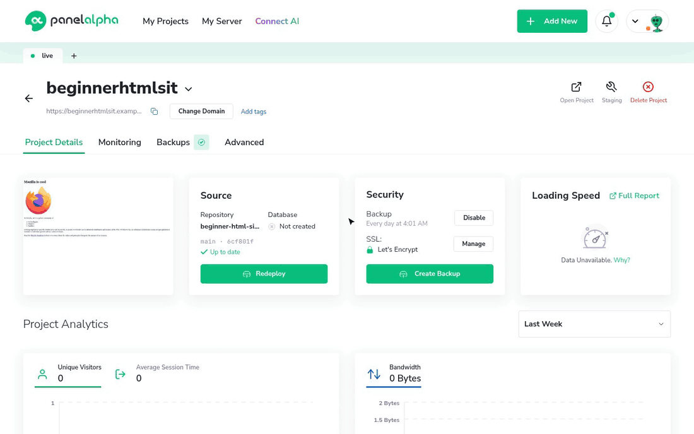
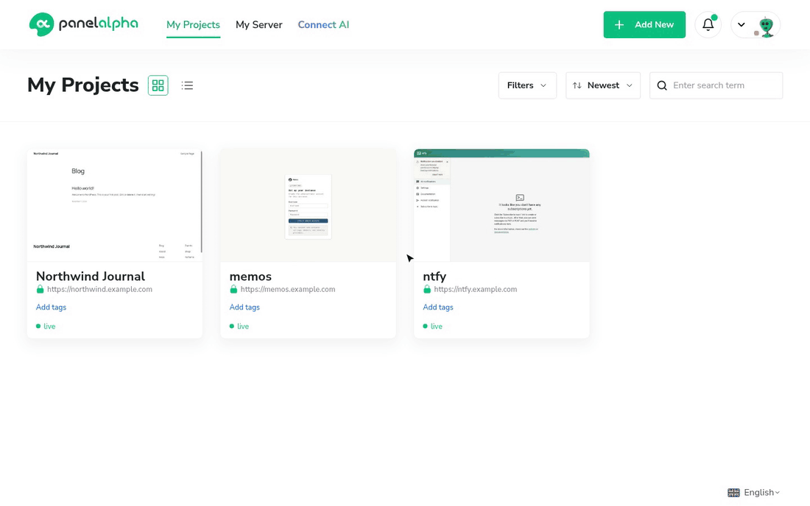
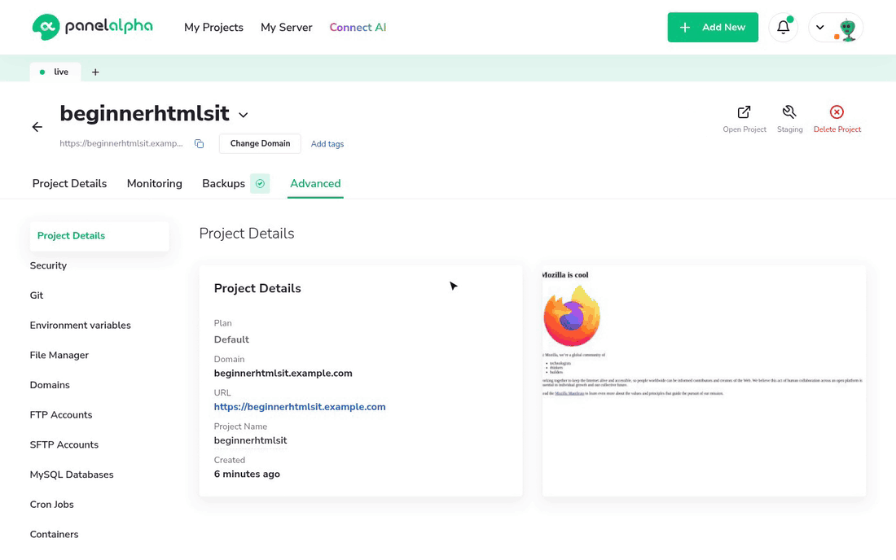

# Git

A project made from a Git repository is a container project that the panel builds from your repository. Create one first: [Create a project](create-a-project.md).

**The panel cannot roll a project back to an earlier commit.** It deploys the latest commit of a branch.

## Redeploying

**Project Details** has a **Source** card with the repository and the deployed commit. It shows `Up to date` or how many commits behind the project is.

1. Select **Redeploy** on the **Source** card.
2. Pick the **Branch**. Choosing a branch other than the deployed one shows the warning `This resets the target to origin of the selected branch.`
3. Review the new commits. When the project deploys with commands of its own, the panel lists its deploy steps below the commits (**Install dependencies**, **Run build command**, **Run migrations**); untick a step to skip it for this deploy. A project without such commands shows no list.
4. Confirm.

The window offers **Deploy to staging environment** once the project has a staging copy; ticked, the chosen branch goes to the copy and production is unchanged: [Staging and preview](staging-and-preview.md).

## Deploy logs

In **My Projects**, open the **Actions** menu of the project's row in the table view and select **Show Logs**. On a project's card, **Show Logs** appears while it deploys and when its install failed.

The **Deploy Logs** window lists the steps **Preparing environment**, **Cloning repository** and **Running stack**, each with its time, and the log below them. A redeploy runs only **Running stack**, so the steps it does not run say **Skipped** and have no time. The step a failed deploy stopped in says the outcome (**Failed**, or **Cancelled** for a deploy you stopped) instead of its time. While the deploy runs, the title carries the **Live** badge and **Cancel Deploy** stops the deploy. It shows only while the deploy runs. **Download Logs** saves the log. You can close the window, as the deploy continues in the background.

The earlier deploys are in **Advanced > Logs**, on the **Deploy Logs** tab: select a run in the list at the top to read it. A run that is still going shows the **Live** badge there as well.

## Changing the branch

1. Open the project and go to **Advanced > Git**.
2. In the **Branch** card, select **Manage**. Choose the branch in **Branch name** and select **Change branch**. The window says `Enter the branch name for this site.` and warns `Save or discard local file changes on the server before changing the branch.`

The project is deployed again from that branch.

A branch change needs a checkout without local changes. When the site has files that are not in the repository, the panel opens the **Local changes detected** dialog instead of switching: see [Local changes on the server](#local-changes-on-the-server).

## Local changes on the server

A site connected to Git can get files its repository does not have: what you upload or edit in **Files**, and what a deploy step of the project writes (a lock file, `node_modules`).

**Pull** and **Change branch** both stop at those files, and both open the **Local changes detected** dialog:

1. **Discard local changes** resets the checkout to the last commit of the branch and removes the files the repository does not track.
2. **Force pull (overwrite changes)** replaces the site's files with the branch's content.
3. **Push local changes first, then pull** commits the site's changes, pushes them to the branch and merges the branch back, so nothing is lost.

**Discard local changes and Force pull both delete the local changes on the server, and they cannot be recovered.** Use **Push local changes first, then pull** to keep them, or copy them out in **Files** first.

After **Discard local changes** or **Force pull**, select **Pull** or **Change branch** again to run what you started.

## Environment variables

**Advanced > Environment variables** keeps the variables the app container gets. The table shows each key and its value; the pencil edits a row and the bin deletes it. **Add variable** adds one. **Import** adds a block of `KEY=value` lines at once; turn on **Overwrite existing keys** to replace the values you already have.

The panel keeps the variables with the project, so a redeploy does not lose them.

Saving applies them: the panel restarts the app container and the new values are in it when it comes back, a few seconds later. If you turn off **Restart the app container after saving**, the panel only stores them, and the next **Redeploy** applies them. **Restart** in **Advanced > Containers** does not apply stored variables.

**Advanced > Environment variables** is on every project that is not WordPress; a Git project is one of them. A WordPress project has no such page: it keeps its configuration in **Advanced > System Configuration**.

## Connecting and disconnecting a repository

**Advanced > Git** starts with a **Connect repository** card when the project has no repository. The card invites you to link the project to a Git repository (GitHub, GitLab or Bitbucket).

1. Enter the **Repository URL**.
2. For a private repository over HTTPS, turn on **Private repository** and enter the **Access token**.
3. Select **Connect repository**.

**Connect repository** downloads the branch into the site. A site file with the same name as one in the repository is replaced with the repository's version, and files the repository does not have stay where they are; the message after it says the site's files now match the branch. A site that already has a Git checkout keeps its files, and its message says they are unchanged. A connect that cannot download the branch is refused and nothing is connected: see [Troubleshooting](#troubleshooting).

An SSH address asks for the branch and shows a deploy key instead: [Deploy key](#deploy-key). Once a repository is connected the card shows it under **Repository**, with a **Disconnect** button. **Disconnect** asks you to confirm in `Disconnect repository`. It removes the Git link from the panel and leaves the files on the server.

The page is the same for every kind of project. A project deployed from its repository is already connected, and the Engine refuses to disconnect it: **Disconnect** shows `Git is managed by deploy.` and the repository stays. A WordPress site starts with no repository, so it is the project this card is for. A connected site can still have files of its own, and **Pull** or a branch change asks before dropping them: see [Local changes on the server](#local-changes-on-the-server).

## Pull, push and the deployment log

Once a repository is connected, **Advanced > Git** also has these cards:

- **Last deployed commit** shows the commit, its message and when it was deployed. **Check for updates** compares the site with the repository: `Up to date with the repository branch`, or how many commits the repository has that the site does not.
- **Pull from repository** updates the site with the latest files from the branch. When the site has files of its own, the panel asks first: [Local changes on the server](#local-changes-on-the-server).
- **Push to repository** sends the site's file changes to the branch. When the repository has newer commits, the card says `The repository has newer commits. Pull those changes before pushing from this site.` A project deployed from its repository cannot push: the panel shows `Git is managed by deploy.`
- **Deployment log** lists the recent connects, pulls, pushes and branch changes of the site, each with its status.

## Access token

An HTTPS repository uses an **access token**. Open **Advanced > Git**, find the **Access token** card, select **Manage**, then **Save token** in the dialog. The token needs read access to the repository and permission to manage its webhooks.

The card shows `Token saved` or `No token saved`. The panel tests the token before it saves it: it reads the repository with it, and it asks your Git provider's API (GitHub, GitLab, Bitbucket) for the repository with it. A token the provider does not know is not saved, however public the repository is, and the reason appears in a message. When the provider's API cannot be asked, or answers something other than a refusal, the panel keeps the token if it could read the repository. If the repository stops answering, the page shows `Cannot access the repository. Update your access token.`

## Deploy key

An SSH repository uses a **deploy key**. **Advanced > Git** shows its **Public key** and **Fingerprint**. Add the key in the **Deploy keys** settings of your repository. Read-only access is enough.

<!-- TODO screenshot: assets/single-server/git-deploy-key-card.png. Show the deploy key card of a project connected over SSH: the Public key (an example key, shortened), the Fingerprint and the Delete button. Needs a repository that has the key added. -->

**A new key replaces the old one, and pull and deploy stop working until you add the new key to the repository.** If you **Delete** the key, pull and deploy over SSH stop working. Remove the key at your Git provider as well.

## Auto-deploy

**Auto-deploy** redeploys the project when someone pushes to the branch.

1. Open **Advanced > Git**.
2. Turn on **Auto-deploy on push** in the **Auto-deploy** card. The card reads `Automatically pull and update this site when new commits are pushed to branch <branch> in the repository.`

The switch stays on only once the panel has registered the webhook. The panel adds it at GitHub, GitLab or Bitbucket with your saved token, so the token must be allowed to manage webhooks. Without a token, or when the provider refuses it, the switch goes back off and the panel shows the reason in a message: see [Troubleshooting](#troubleshooting). Turning **Auto-deploy on push** off removes the webhook at your Git provider.

<!-- TODO screenshot: assets/git-auto-deploy-card.png. Show the Auto-deploy card with the Auto-deploy on push switch turned on. -->

## Troubleshooting

Each message belongs to the card it starts from.

**Advanced > Git > Connect repository**

A refused **Connect repository** over HTTPS shows its message under **Repository URL** or **Access token**, and keeps it there until you change that field or select **Connect repository** again.

**"The repository refused this token. Check the token and that it can read this repository."** The token is wrong or has no read access to the repository.

**"The repository was not found. Check the repository address and that the token can read it if the repository is private."** The address is wrong, or the token cannot see the repository. Nothing was connected.

**"The host cannot be reached from the panel."** The address does not resolve, or it points into the server's own network. Use the address from your Git provider.

**"Could not reach <host>, so the repository cannot be read and nothing was connected. Check the address, and that this server can reach it."** The Git provider did not answer. Nothing was connected.

**"The repository has no branch to connect yet. Push a commit to it first, then connect again."** The repository is empty, so there is nothing to deploy. Nothing was connected.

**"The repository could not be read: <git's reason>"** git's own reason, when it is none of the above. Nothing was connected.

**"Could not connect the repository. Check the URL and token."** The panel could not read the answer. Try again.

An SSH address shows its refusal under the deploy key instead: **"The repository did not accept the key. Check that you added it to this repository."** when the key is not on the repository yet, and **"Could not connect. Check the address and the key."** for every other reason.

**Advanced > Git > Access token > Manage > Save token**

**"The repository refused this token. Check the token and that it can read this repository."** and **"The repository was not found. Check the repository address and that the token can read it if the repository is private."** as above; the token is not saved. The first one is also what you see when your provider does not know the token, however public the repository is.

**"The repository could not be reached to check the token. Try again later."** The Git provider did not answer, so the token was not checked and not saved.

**"The host cannot be reached from the panel."** and **"The repository address is not allowed. Check the repository address; the token was not tested."** The panel will not contact that address, so the token was not tested and not saved. Use the address from your Git provider.

**"The panel cannot check a token against this project's repository address, so the token was not saved."** The recorded address is not one the panel can read.

**Advanced > Git > Auto-deploy on push**

**"Could not register a webhook with the Git provider. Check that your token can manage webhooks for this repository."** The token cannot manage webhooks. Make a token with that permission and save it.

**"The repository credentials are missing; update the git credentials first."** The project has no access token, and Auto-deploy needs one to add the webhook. Select **Manage** in the **Access token** card and save a token, then turn Auto-deploy on again.

**Deploying**

**"A deploy of this project is already running."** or **"The project is busy with another operation. Please try again later."** Wait for the running deploy to end, or cancel it in its Deploy Logs window.

**"Deploys are only available for container projects."** The project is not a container project, so the panel cannot build it from the repository: it pulls and pushes the files of a WordPress or classic PHP project, nothing more. Create a project from Git to deploy one.

**"This project cannot be deployed from git. Create a new project instead."** In the create-project wizard, the project that step would turn into a Git project cannot become one. Create a new project from Git.

**"Git is not available for this server yet."** The Engine does not support Git for this project.
