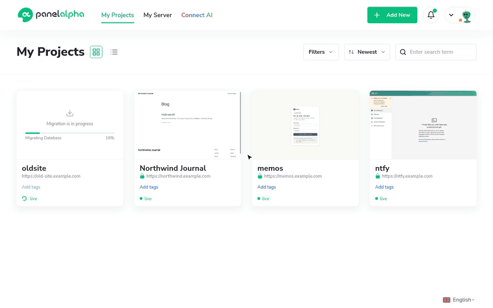

# Importing a WordPress site

Importing copies an existing WordPress site from another host into a new PHP hosting project on this server. It works over your WordPress admin login or over the migration plugin. **Importing over FTP or SFTP is not available.**

Before you start:

- The source site must be reachable from this server on a public address. A URL that points back to this server, or to a private, loopback, link-local, Docker or reserved address, is refused.
- The new project gets the domain of the source site, without `www.`. Make sure that domain is not already used by another project on this server.

## Importing a site

1. Go to **My Projects**, select **Create First Project** (or the create button) and choose **WordPress**.
2. Choose **Import Existing WordPress Project**.
3. Enter **Your Current WordPress Project URL**. The panel checks that it can reach the site as you type.
   - WordPress found: select **Continue**.
   - The site answers, but WordPress is not on it: `WordPress could not be detected on this URL.` Select **Continue Anyway** to go on.
   - The check fails: the reason shows under the field (for example `Source WordPress host did not resolve`) and **Continue** stays unavailable until the URL is right.
4. Choose **Simple Method** (recommended).
5. Choose how to connect:
   - **Use WordPress admin login credentials**: enter the **URL**, **Username** and **Password** of a WordPress administrator.
   - **Install the plugin manually**: select **Download Plugin**, install and activate it in the WordPress admin of the old site, then select **Continue**.
6. Select **Continue** to start.

The admin login method may not work, depending on the security settings and the host of your old site. If it fails, use the plugin.

If the old domain does not point to the old host yet, open **Advanced** on the first step and fill **IP Address** with the old server's IPv4 address.

The panel shows `Congratulations!` and `The import process has been started!`. If you leave the page while the panel is still starting the import, the browser asks you to confirm with `The import is still in progress. If you leave this page, the import may be interrupted.`

## Following the import

The project card shows **Migration is in progress**, then **Import completed** or **Importing failed.** Open the migration log to see each step: it shows the step, its status, the current file and the current table.

- **Cancel Migration** stops it and removes what was entered.
- **Try Again** retries a failed import.

## After the import

1. Open the site and check it.
2. If you used the plugin, remove it from the old site.
3. Point the domain to this server: [Domains and SSL](../looking-after-a-project/domains-and-ssl.md).

When the domain points here, the Engine removes the preview address and requests a Let's Encrypt certificate. It checks every 15 minutes.

## Troubleshooting

**"Importing over FTP is not available. Use your WordPress admin login or the migration plugin."** The panel shows the **Advanced Method** (FTP and SFTP) form, but the server refuses it. Go back and choose **Simple Method**.

**"Source WordPress host did not resolve."** The panel could not reach that name. Check it and that the old site is online, or fill the old server's IPv4 address in **Advanced** (step 3).

**"No WordPress REST API at <address>"** WordPress did not answer at that address. Check the address of the old site and that its REST API is not blocked.

**"Source WordPress URL must lead to a public address: loopback, link-local, private, reserved, Docker network and this Engine's own addresses are refused."** The URL points at this server or at an address that is not public. Import over the old host's public domain or IP address. A site on this server cannot be imported into itself.

**"Cannot connect to WordPress. Please verify the URL or admin credentials. Alternatively, please install the plugin manually."** The URL or login is wrong, or the site cannot be reached. Check them, or use the plugin.

**"Using your WordPress admin credentials will not work (probably due to Cloudflare/firewall/WAF restrictions). Please install the plugin manually."** A firewall on the old site blocks the login. Install the plugin manually.

**"Migration plugin not found in your WordPress."** The plugin is not installed or not active on the old site. Install and activate it, then try again.

**"The migration plugin on your WordPress comes from another download. Download the plugin again, install and activate it, then try again."** Remove the old copy of the plugin and use the one from **Download Plugin**.

**"This site's domain is already used by a project on this server."** Another project already has that domain. Remove or rename that project first.

**"Cannot generate subdomain for imported project"** The source address is an IP address. Use the site's domain name as the URL.

**"Import preparation failed. Please try again."** The import did not start. Try again.
