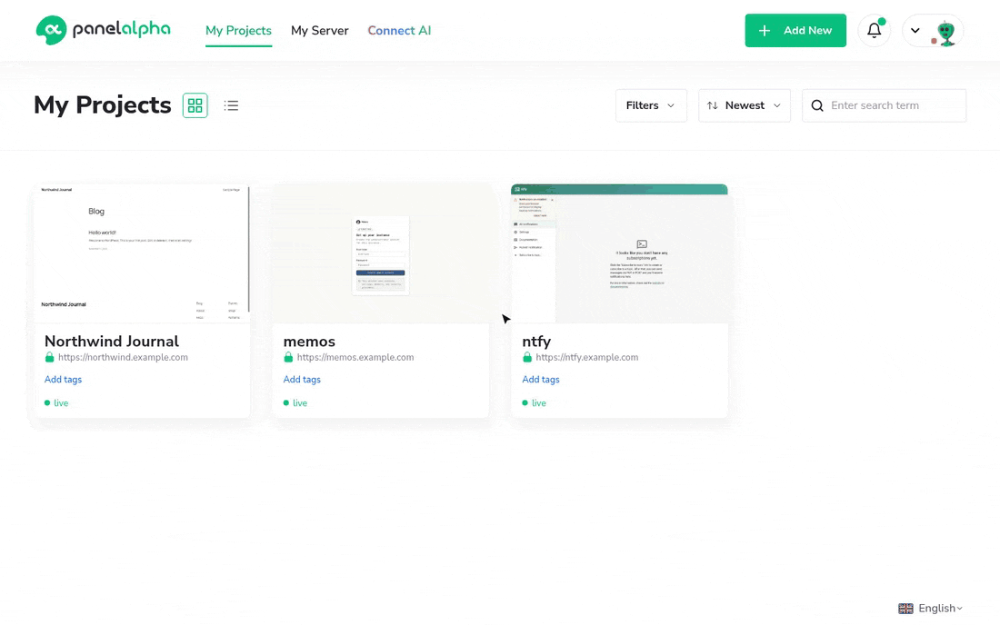
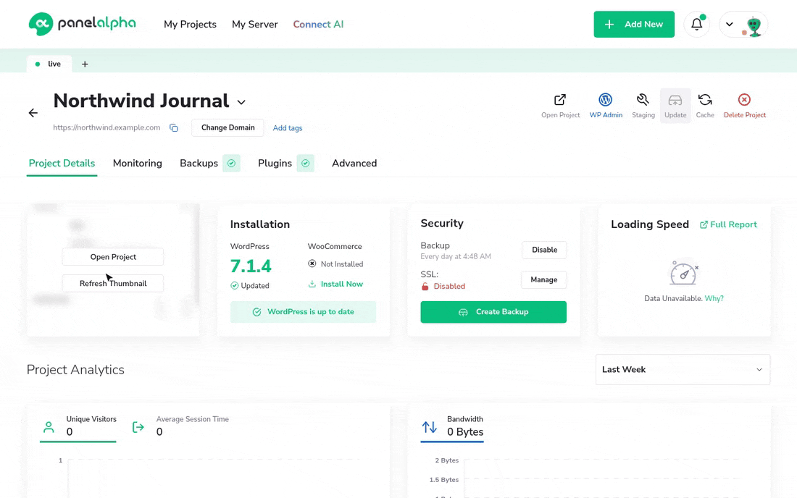

# Projects

A project is one site or app on your server. Every project lives on the one server that runs the panel (a PanelAlpha Engine). The Community Edition has no project limit.

## The two kinds of project

The panel shows no label for the kind. You see it in what the project offers.

A **PHP hosting project** runs on the server's shared PHP. WordPress sites and other PHP sites are PHP hosting projects.

- **A WordPress site** has the WordPress screens on its project page. Its card has a **Manage Site** button and a **WP Admin** button. **WP Admin** also sits in the project's top bar.
- **A PHP site that is not WordPress** has no WordPress screens and no **WP Admin**. Its card has **Manage** and **Open Project**. Its project page has only **Project Details**, **Monitoring**, **Backups** and **Advanced**.

A **container project** runs in its own containers. A site created from Git or from files is a container project. Its card has a **Manage** button, and its project page has a **Containers** page.

| You want to run | Create it from | Kind |
|---|---|---|
| A new or imported WordPress site | WordPress | PHP hosting project |
| An app from a Git repository | Git | Container project |
| An app from an archive of files | Files | Container project |

Create one: [Create a project](create-a-project.md).

## The project list

**My Projects** lists your projects as cards. Every card has a manage button (**Manage Site** on a WordPress card, **Manage** on others). It also has either a **WP Admin** button (WordPress) or an **Open Project** button.

**Open Project** works in two ways:

- On a project with the panel's free `panelalpha.online` address, it opens the site in a new tab.
- On a project with a domain of your own, it opens the **Preview Site** window, whether or not that domain points to this server yet: [Staging and preview](staging-and-preview.md).

**WP Admin** signs you in to the WordPress dashboard without a password: [Managing WordPress](wordpress.md).

In the table view, each row ends with an **Actions** menu instead. What the menu offers depends on the kind of project: **Manage**, **WP Admin** (WordPress) or **Admin Area** (another app with its own admin login), **Show Logs**, **Push To Live**, **Staging**, **Update**, **Clear Cache** and **Delete Project**.

**Show Logs** opens the deploy log of a container project. You find it on the card in **My Projects** while the project deploys or after a failed deploy, or in the row's **Actions** menu in the table view. **Advanced > Logs**, on the **Deploy Logs** tab, keeps the earlier deploys.

### Finding projects

Above the list:

- **Search**: type in the search field (`Enter search term`) to narrow the list.
- **Sort**: in the card view, choose **Name**, **Bandwidth**, **Storage** or **Newest**. In the table view, select the **Name**, **Bandwidth**, **Storage** or **Newest** header. A project the Engine has not measured yet has no bandwidth or storage figure, so it is listed after the projects that have one.
- **Filters**: select **Filters**, pick **Tags**, then **Apply**. **Clear Filter** removes them.
- **Grid or table**: the switch beside the heading changes the view.
- **Per page**: choose 8, 16, 32 or all projects per page.

To delete several projects at once, tick the box on each card or row. In the table view, the box in the header selects every project on the page. A bar at the bottom shows how many are selected, with **Select All**, **Clear Selection** and **Remove**. **Remove** opens the same delete dialog as **Delete Project**: [Deleting a project](#deleting-a-project).

## The project page

Select **Manage** to open a project. The tabs are **Project Details**, **Monitoring**, **Backups**, **Plugins** and **Advanced**. Some are shown only for a WordPress project or only when your account may use them.

The project name is at the top of the page. The title also opens a search field (`Search project...`) to jump to another project. On a WordPress project, you can rename the project:

1. Select the pencil next to the name.
2. Type a new name.
3. Confirm with the check mark or Enter.

The name also becomes the WordPress site title.

### Project Details

**Project Details** shows the source of the project:

- A WordPress project has an **Installation** card.
- A Git project has a **Source** card with the repository.
- A files project has a **Source** card with its archive.

Three more cards sit beside it:

- A thumbnail of the site, in the card beside **Installation** or **Source**. Hover over it for **Open Project** and **Refresh Thumbnail**. **Refresh Thumbnail** takes a new screenshot. Before the first one the card says `Preview not available.` and its **Why?** link explains why.
- **Loading Speed**: **Desktop** and **Mobile** scores, and a **Full Report** link to Google PageSpeed. This panel does not store the scores, so the card shows `Data Unavailable.`
- **Security**: **Automatic Backups**, **SSL** with **Manage**, and **Create Backup**.

### Advanced

**Advanced** holds the rest, in a side list.

Every kind of project has these pages:

- **Project Details**, which lists the plan, domain, URL, project name and creation date.
- Pages for domains, databases, cron, files and logs.
- **Git**.

A WordPress project also shows its version on **Project Details**, with its **Installation Details** on the same page: the directory and the database name, user, host and password.

Some pages belong to one kind only:

- **Environment variables** for projects that are not WordPress. A WordPress project keeps its variables in **System Configuration**.
- **Installed Themes**, **Users** and **Auto Updates** for WordPress.

Where each page is described:

- WordPress pages: [Managing WordPress](wordpress.md).
- Git: [Git](git.md).
- Domains and certificates: [Domains and SSL](../looking-after-a-project/domains-and-ssl.md).
- Databases: [Databases](../looking-after-a-project/databases.md).
- Backups: [Backups](../looking-after-a-project/backups.md).
- Files, FTP and SFTP: [Files and access](../looking-after-a-project/files-and-access.md).
- Cron and PHP: [Cron jobs and PHP](../looking-after-a-project/cron-and-php.md).
- Usage and logs: [Statistics and logs](../looking-after-a-project/statistics-and-logs.md).

## Starting, stopping and restarting

You start, stop and restart **container projects** from **Advanced > Containers**. A PHP hosting project has no start or stop. It is always on while the server runs.

**Stop All and Restart make the site unavailable.** Stop All keeps it down until you select **Start All**. Restart takes it down until the containers run again.

1. Open the project and go to **Advanced > Containers**.
2. Open the **Actions** menu at the top and choose **Start All**, **Stop All**, **Restart** or **Pull & Redeploy**. **Start All** starts the containers at once. The other three ask you to confirm first.

Each container also has its own actions: [Statistics and logs](../looking-after-a-project/statistics-and-logs.md).

## Deleting a project

**Deleting a project erases its data on the server and cannot be undone.** Take a backup first if you may need it: [Backups](../looking-after-a-project/backups.md).

1. In **My Projects**, open the **Actions** menu of the project and choose **Delete Project**.
2. Tick **I understand that the project's files will be deleted**, **I understand that the project's databases will be deleted** and **Yes, I understand and want to proceed with the removal of the project.**
3. Select **Delete Project**.

The **Delete Project** button stays disabled until every box is ticked. The boxes are acknowledgements only. The panel always deletes the project with its files and databases, and the server has no option to keep them. For a WP Cloud site the dialog also warns that its manual backups must be deleted first.

A project that has a staging copy cannot be deleted. Delete the staging copy first: [Staging and preview](staging-and-preview.md).

## Troubleshooting

**"Cannot remove project with existing staging project."** The project has a staging copy. Delete the staging copy, then delete the project.

**"The server operator has protected this project, so it cannot be deleted, stopped or redeployed from the panel."** The person who runs the server marked the project as protected. Ask them to lift the protection.

**"The project is busy with another operation. Please try again later."** A deploy, backup or other task is running on the project. Wait for it to finish and try again: [Tasks](../the-panel/tasks.md).
