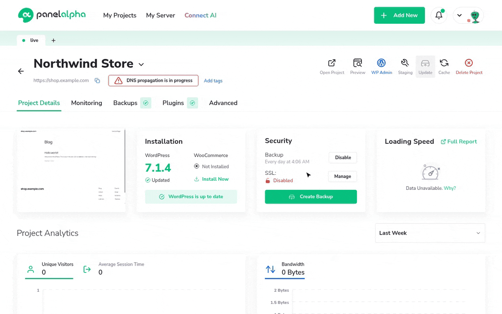
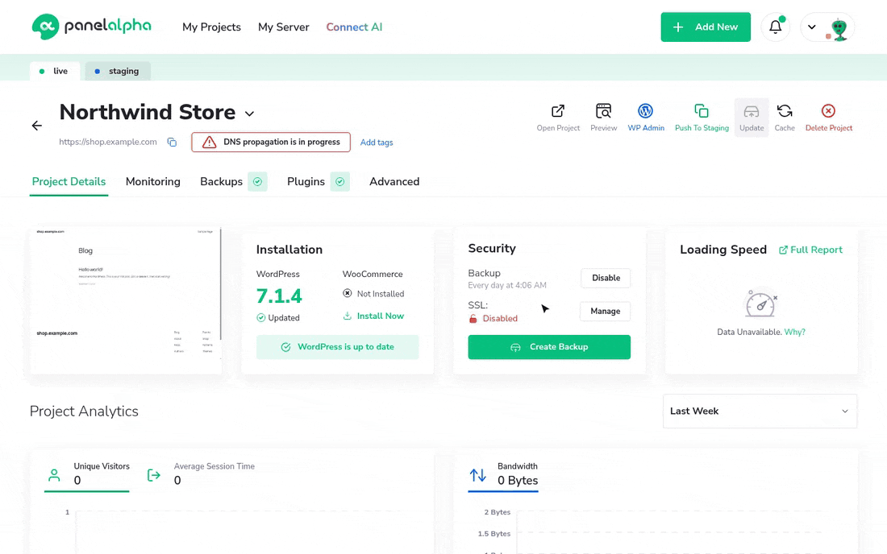
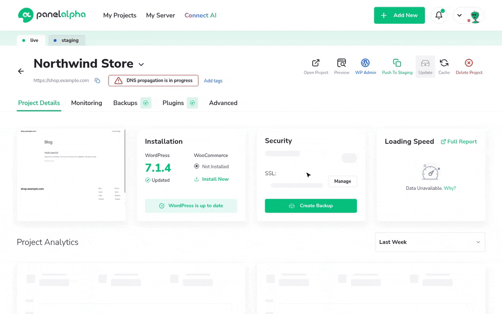

# Staging and preview

A staging copy is a second copy of a project where you can try changes before they reach the live site. A preview link shows a site on a temporary address before its domain points to this server.

## Creating a staging copy

A project can have one staging copy. A staging copy cannot have its own.

1. Open the project and select **Staging** in the top bar.
2. Enter a **Subdomain** for the copy. The panel adds the project's own domain after it, so on `example.com` the name `staging` gives `staging.example.com`. Enter only the name, without dots.
3. For a WordPress site, you can tick **Skip Uploads Directory** to leave out `wp-content/uploads`. This saves space and time.
4. Select **Create Staging**.

A site on the panel's free `panelalpha.online` address does not ask for a name. The copy gets its own free address there when it is created, and you cannot enter an address in that zone.

The panel shows `Staging Installation In Progress` and notifies you when the copy is ready.

The copy appears under its live project, not as a separate project:

- In **My Projects**, a `staging` tag sits on the live project's card. In the table view, the copy is a row under the live project.
- The project's top bar has a `staging` tab. Select it to open the copy. Its address is in its own top bar once the copy is ready.

The project page of a staging copy has no WordPress screens such as **Plugins** or **Users**. To change the copy's files, use **Advanced > File Manager**, or **WP Admin** from the copy's **Actions** menu.

A copy under `panelalpha.direct` has a self-signed certificate, so your browser warns when you open it.

## Pushing staging to live

Push To Live copies the staging copy to the live project.

**Push To Live replaces what you tick on the live project with the staging copy's.** Check the staging copy first.

1. Open the live project in **My Projects**. Select its `staging` tag (or the `staging` tab in the top bar) and choose **Push To Live** in the copy's top bar. The same action is in the copy's **Actions** menu.
2. Tick what to overwrite (see the options below).
3. Confirm. The panel shows `Push To Live In Progress`.

A notification tells you when the push finishes.

What you can tick depends on the project.

- **A PHP hosting project** (a WordPress site or another PHP site) offers **Overwrite files**, **Push full database**, **Push structure changes in tables** and **Push tables with changed data**.
- **A container project** (a site from Git or from files) offers **Overwrite files** and **Overwrite volumes (including databases)**. It has no table lists, because the panel compares database tables only for PHP hosting projects.

### Pushing only some tables

For a PHP hosting project, **Push structure changes in tables** and **Push tables with changed data** each hold a list of the tables that differ between the copy and the live project. Tick **Push full database** and pick tables in either list to replace only those tables. Both lists are empty when nothing differs, and stay empty on a project without a database.

If the panel cannot compare the two databases, the window says `Could not compare database changes. You can still push files and database, but selective table changes are unavailable.` The two lists are not shown, and a push then copies the whole database.

## Deploying a Git project to staging

You can deploy a branch of a Git project to its staging copy and leave production unchanged. The project needs a staging copy first: [Creating a staging copy](#creating-a-staging-copy).

1. Open the live project.
2. Select **Redeploy** on its **Source** card.
3. Tick **Deploy to staging environment**.

The chosen branch goes to the copy: [Git](git.md).

A Git project without a staging copy shows no tick. The copy's own **Redeploy** window has no tick either.

## Deleting a staging copy

Deleting a staging copy removes its files and databases. The live site stays as it is.

1. Open the copy (its `staging` tag on the live project's card, or its `staging` tab).
2. Select **Delete Staging** in its top bar.
3. In the **Delete Staging** dialog, which names the copy and its domain, tick all three acknowledgements:
   - **I understand that the project's files will be deleted.**
   - **I understand that the project's databases will be deleted.**
   - **Yes, I understand and want to proceed with the removal of the staging site.**
4. Select **Delete Staging**. The button stays disabled until every box is ticked.

The panel shows `The staging site has been deleted.`

The live project cannot be deleted while a staging copy exists: [Projects](projects.md).

## Preview link

A preview link opens the site on a temporary address on this server, so you can look at it before the real domain points here.

**The link works for 15 minutes.** After that, create a new one. **Anyone who has the link can open the site**, because a preview link has no password.

1. Open the project and select **Preview** in the top bar.
2. In **Preview Site**, select **Get Temporary URL**.
3. Select **Copy URL** to share it, or **Visit Site** to open it.

The window shows `Your Site Temporary URL:`. While the first link is still valid, the panel shows it again.

The domain warning on a project also has **Not live yet? Preview the site on the server** with a **Generate URL** button.

### More detail about Open Project

**Open Project** is another way to reach **Preview Site**.

- On a project with a domain of your own, **Open Project** opens **Preview Site**, whether or not that domain points to this server yet.
- On the panel's free `panelalpha.online` address, **Open Project** opens the site itself in a new tab, so there is nothing to preview.
- In **My Projects**, the button is on the card of a project that is not WordPress. A WordPress card has no **Open Project**. Open the project and select **Open Project** in its top bar. Every project has it there.

Something not working? The messages you may see on this page and what to do about them: [Troubleshooting: Projects](../troubleshooting/projects.md#staging-and-preview).
