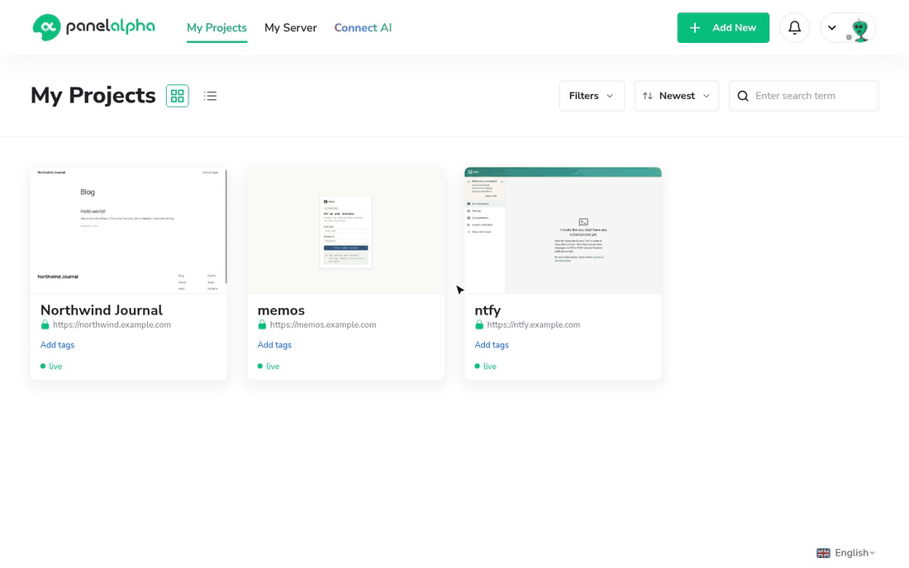
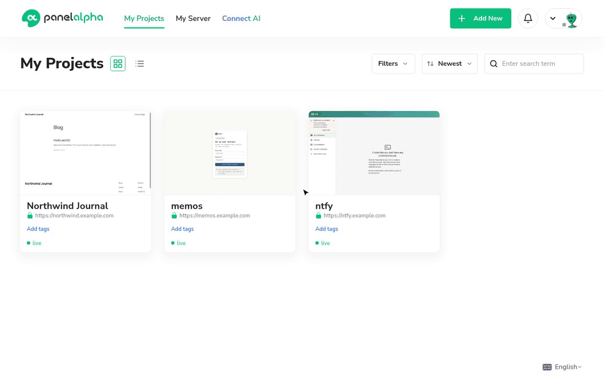

# Managing WordPress

A WordPress site in the panel is a PHP hosting project. You log in to it, update it, manage its plugins and themes and change its settings from the project page. Create one first: [Create a project](create-a-project.md).

## Logging in to WordPress

**WP Admin** signs you in to WordPress without a password.

1. In **My Projects**, select **WP Admin** on the card (in the table view it is in the row's **Actions** menu), or open the project and select **WP Admin** in the top bar.
2. A site with one administrator signs in at once. The dialog says `Logging in to WordPress` while it makes the link, then opens the dashboard in a new tab.
3. With more than one administrator, pick one in **Log In As** and select **Generate Login Link**. It makes a one-off link and opens it in a new tab. If your browser blocks the tab, the dialog offers a **Log in to WordPress** button for it. The link also works in another browser.
4. If the site's domain does not point to this server yet, the dialog warns `Warning! This domain may not be pointing to this server yet.` and offers **Log in with Temporary URL**, which works before the DNS is set, or **Log in directly**.

A site installed with the full install form also offers **Log in to WordPress** when the install finishes.

### Opening the site

A WordPress project card has no **Open Project** button. **Open Project** sits in the project's top bar, next to **WP Admin**. In the table view, the row's **Actions** menu has **WP Admin** and no **Open Project** either.

- On the panel's free `panelalpha.online` address, **Open Project** opens the site in a new tab.
- On a project with a domain of your own, it opens the **Preview Site** window, whether or not that domain points to this server yet: [Staging and preview](staging-and-preview.md).

## Updating WordPress

**Installation** on **Project Details** shows the WordPress version and whether an update is ready.

**While the site is current:**

- The card shows the version with `Updated` under it.
- Its action button is disabled and reads `WordPress is up to date` (`Systems are up to date` when WooCommerce is installed).
- The top bar's **Update** is disabled with the tooltip `There are no available updates.`
- There is no **Update WordPress** button on the card.

**When an update is ready:**

- The card keeps the installed version and adds `<new version> is available` under it.
- Its action button becomes **Update WordPress** and can be selected.
- The top bar's **Update** is enabled and shows no tooltip.

To update:

1. Select **Update WordPress** on the **Installation** card, or **Update** in the top bar, or **Update** in the row's **Actions** menu in the table view.
2. Pick the version and tick **Create Backup** if you want a backup first.
3. Confirm.

**Update** in the row's **Actions** menu and **Update** in the top bar apply to the WordPress core only (WordPress itself, not plugins or themes). The row's entry answers `No updates available.` while the core is current.

A WooCommerce update comes from the same card button. When only WooCommerce has an update, that button reads **Update WooCommerce**.

## Plugins and themes

The **Plugins** tab lists **Installed Plugins** and **New Plugins**. For each plugin you can choose **Install Plugin**, **Activate**, **Disable**, **Update** or **Remove**. Use **Add New** and the search field to find more.

**You install a plugin or theme by its wordpress.org name.** Installing from a URL is not available: `Installing from a URL is not available on PanelAlpha Engine: a plugin or theme is installed by its wordpress.org name.`

Themes are under **Advanced > Installed Themes**, which lists **Installed Themes** and **Available Themes**. Use **Use This Theme**, **Preview**, **Install This Theme**, **Update** or **Remove**. The active theme cannot be removed.

## Other WordPress pages in Advanced

- **Users**: WordPress users. **Create User**, **Edit User**, **Reset Password** and **Delete User**. **Create User** needs a username, an email address, a display name, a role and a password. The password needs at least 8 characters, with an upper case letter, a lower case letter, a number and a symbol.
- **System Configuration**: the settings in `wp-config.php`. Create, edit and delete a setting. The database user and password and the keys and salts are masked (`********`). Select **Show** to read one. The panel asks for your panel password when you have not entered it recently. Every request is recorded in the project's **Logs**. A value can be at most 4094 bytes long: [More detail](#more-detail).
- **Auto Updates**: **Auto Upgrade**, **Auto Upgrade Plugins** and **Auto Upgrade Themes**. A site can block automatic updates itself: [More detail](#more-detail).
- **Developer Settings**: **Debug Mode**, **Maintenance Mode**, **PHPMyAdmin** and **PHP Version**.
- **Security**: **Force HTTPS Redirect** and **Disable Search Engine Indexing**.

**Debug Mode and Maintenance Mode should be off on a live site.** Debug Mode makes the site display application errors to its visitors. Maintenance Mode shows them the maintenance notice instead of the site. Check both switches in **Advanced > Developer Settings** before the site goes live.

To clear the cache, choose **Clear Cache** in the row's **Actions** menu in the table view, or **Cache** in the project's top bar, and confirm.

PHP version and limits: [Cron jobs and PHP](../looking-after-a-project/cron-and-php.md).
Domains and the certificate: [Domains and SSL](../looking-after-a-project/domains-and-ssl.md).

Something not working? Messages and fixes: [Troubleshooting: Projects](../troubleshooting/projects.md#managing-wordpress).

## More detail

**Long values in System Configuration.** A value can be at most 4094 bytes long, which is about 4000 characters. A character outside plain ASCII takes more than one byte (`ą` two, `€` three), so fewer of those fit. The dialog refuses a longer value. A value that is too long cannot be read back. The page then says why it lists nothing, in place of the settings, and **Remove by name**, next to **Create Configuration**, deletes a setting by the name you type.

**Constants that block updates.** The panel does not read the WordPress constants that block updates. A site that sets one, such as `AUTOMATIC_UPDATER_DISABLED`, shows the same three switches and no message. WordPress applies no automatic update there, whatever the switches say. The constants are in `wp-config.php`, which **System Configuration** lists.
