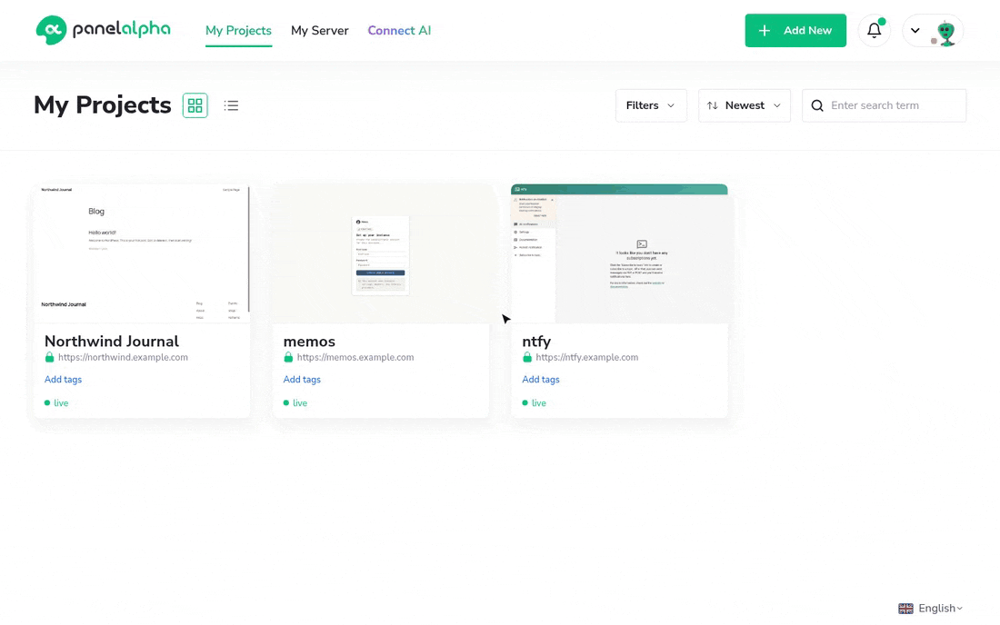

# Connect AI

Connect AI lets an AI assistant manage your projects by chat. Open **Connect AI** in the top menu.

The assistant talks to the panel over **MCP** (the Model Context Protocol), a standard way for AI tools to use other programs. It signs in with a **token**, a long secret text that you create in the panel and paste into your tool.

The assistant can reach all your live and staging projects. It cannot reach the project the panel itself runs in, nor any other project that runs a panel.

## Connecting your tool

Every tool connects the same way: you create a token in the panel, then put the panel's address and the token into your tool. The sections below give the steps for each tool:

- [Claude Code](#claude-code)
- [ChatGPT](#chatgpt)
- [Codex](#codex)
- [Claude](#claude)
- [Cursor](#cursor)
- [Windsurf](#windsurf)
- [VS Code](#vs-code)
- [Other tool](#other-tool)

The **Connect AI** page shows the same steps. Pick your tool under **Your tool** and the page fills in your panel address for you, with a **Copy** button on each part to paste. A **One-click connect** banner on each page is marked `Coming soon`. It does nothing yet.

In the examples below the panel address is `https://panel.example.com`. Use your own.

## Creating a token

You need a token for every tool except the Claude app.

1. Open **Connect AI** in the top menu and pick your tool under **Your tool**.
2. Under **Generate an MCP token**, select **Create Token**. Enter a **Token Name**, such as `Claude on my laptop`, and create it. If you already have a token, select **use one you already have** instead.
3. **The token is shown once.** You cannot see it again after you close the dialog. Copy the token, then confirm with `I have saved my token in a safe place`.

   

In every step below, replace `YOUR_TOKEN` with your token.

## Claude Code

Run and manage this server straight from your terminal.

1. Create a token: [Creating a token](#creating-a-token).
2. Run this in a terminal on your own computer, with your token:

   ```bash
   claude mcp add --transport http panelalpha \
     https://panel.example.com/mcp \
     --header "Authorization: Bearer YOUR_TOKEN"
   ```

3. Restart Claude Code or run `/mcp` to confirm PanelAlpha is connected.

Claude Code's own guide: [Connect Claude Code to tools via MCP](https://code.claude.com/docs/en/mcp).

## ChatGPT

Connect this server to ChatGPT and control it by asking.

1. Create a token: [Creating a token](#creating-a-token).
2. In ChatGPT, open **Settings → Connectors** and choose **Create**. Name it `PanelAlpha` and select **URL server connection**.
3. Paste your server URL: `https://panel.example.com/mcp`.
4. Choose **Access token / API key**, set the header scheme to **Bearer**, and paste your token.
5. Confirm the notice and create. PanelAlpha is now connected.

ChatGPT's own guide: [Connect from ChatGPT](https://developers.openai.com/apps-sdk/deploy/connect-chatgpt).

## Codex

Give Codex direct access to this server.

1. Create a token: [Creating a token](#creating-a-token).
2. Add PanelAlpha to your Codex config file, `~/.codex/config.toml`:

   ```toml
   [mcp_servers.panelalpha]
   url = "https://panel.example.com/mcp"
   http_headers = { "Authorization" = "Bearer YOUR_TOKEN" }
   ```

3. Restart Codex or run `/mcp` to confirm the connection.

Codex's own guide: [Model Context Protocol](https://developers.openai.com/codex/mcp).

## Claude

The Claude app cannot connect yet. It has no place to paste a token, so it cannot reach your server. Its page on **Connect AI** says so and offers **Set up Claude Code instead**: [Claude Code](#claude-code).

## Cursor

Let Cursor manage this server as you build.

1. Create a token: [Creating a token](#creating-a-token).
2. In Cursor, open **Settings → Tools & MCP** and click **New MCP server**. This opens the `mcp.json` file.
3. Add PanelAlpha:

   ```json
   {
     "mcpServers": {
       "panelalpha": {
         "url": "https://panel.example.com/mcp",
         "headers": {
           "Authorization": "Bearer YOUR_TOKEN"
         }
       }
     }
   }
   ```

4. Save the file. PanelAlpha appears in **Settings → Tools & MCP** with a green dot when it is connected.

Cursor's own guide: [Model Context Protocol](https://cursor.com/docs/mcp).

## Windsurf

Connect Windsurf to this server.

1. Create a token: [Creating a token](#creating-a-token).
2. In Windsurf, open **Settings → Manage MCPs** and choose **View raw config**.
3. Add PanelAlpha:

   ```json
   {
     "mcpServers": {
       "panelalpha": {
         "serverUrl": "https://panel.example.com/mcp",
         "headers": {
           "Authorization": "Bearer YOUR_TOKEN"
         }
       }
     }
   }
   ```

4. Save, then restart Windsurf or run `/mcp` to confirm PanelAlpha is connected.

Windsurf's own guide: [Model Context Protocol](https://docs.devin.ai/windsurf/plugins/cascade/mcp).

## VS Code

Use this server from GitHub Copilot in VS Code.

1. Create a token: [Creating a token](#creating-a-token).
2. Open the Command Palette, run **MCP: Add Server** and choose **HTTP**. Or edit `.vscode/mcp.json` directly.
3. Use this config:

   ```json
   {
     "servers": {
       "panelalpha": {
         "type": "http",
         "url": "https://panel.example.com/mcp",
         "headers": {
           "Authorization": "Bearer YOUR_TOKEN"
         }
       }
     }
   }
   ```

4. Trust the server when VS Code asks.

VS Code's own guide: [MCP servers](https://code.visualstudio.com/docs/agent-customization/mcp-servers).

## Other tool

Any MCP tool that supports a remote HTTP server and custom headers works.

1. Create a token: [Creating a token](#creating-a-token).
2. In your tool's MCP settings, add a new remote HTTP server.
3. Paste your server URL: `https://panel.example.com/mcp`.
4. Add the auth header:

   ```text
   Authorization: Bearer YOUR_TOKEN
   ```

The MCP authorization specification: [Authorization](https://modelcontextprotocol.io/specification/draft/basic/authorization).

## After connecting

Ask in the chat, for example `List my projects.`

## The MCP address

Your tool connects to the panel address with `/mcp` added, for example `https://panel.example.com/mcp`. **MCP URL & tokens** shows it as **MCP Server URL**. The tool sends your token in an `Authorization: Bearer <token>` header. A tool without a page of its own uses **Other tool**, which shows the same address.

## Revoking a token

1. Open **MCP URL & tokens**. The table shows **Name**, **Token**, **Last Used**, **Created**, **Status** and **Actions**.
2. In the token's row, point at the rotate arrow in **Actions** to read **Revoke**, then select it and confirm.



**A revoked token stops working at once.** Every request that uses it is refused. It stays in the list with the status `Revoked`. Select **Delete**, the bin in **Actions**, to remove it from the list for good. A delete cannot be undone.

## What the assistant can do

The assistant can use the Engine's tools on your projects. The panel passes its requests on and has no tool list of its own.

It cannot do these things:

- Use tools about the whole server.
- Create a new project or read the server load, because its token reaches only your existing projects.
- Change a project's limits or suspend a project. The Engine refuses suspend for the panel's tokens.
- Touch the panel's own project, or any other project that runs a panel. A panel's account, its files, its settings and its certificate are never handed to the assistant.

Some requests have no single tool. "Update all my sites" and "list all sites without automatic backups" make the assistant go through your projects one by one. The Engine's server settings can also narrow what it offers.

### What to ask

The page **What You Can Do with AI** shows examples. It has six groups that open one at a time: **Daily Management**, **Backups**, **Domains & SSL**, **Developer Workflow**, **Monitoring & Troubleshooting** and **Bulk Operations**. Each example is a card with a sentence, such as `Which of my sites are currently down?` or `Create a staging copy of my production WordPress`, and a copy button. Paste the sentence into your assistant's chat.

### More detail

An assistant loads only a short list of tools at first: listing projects, reading a project, deploying an archive or files, rebuilding a project, reading deploy logs and container logs, health checks, deleting and restarting a project, and listing and adding domains and certificates. For anything else it uses `search_tools` to find a tool and `execute_tools` to run it.

## Activity

**Activity Log** lists each tool the assistant runs: **Time**, **Token**, **Tool** and **Status** (`Success` or `Error`). A request that runs no tool, such as loading the tool list, leaves no row. Filter by token with **Filter by token**. With nothing yet it says `No activity yet. Start using your AI tool to see logs here.`


