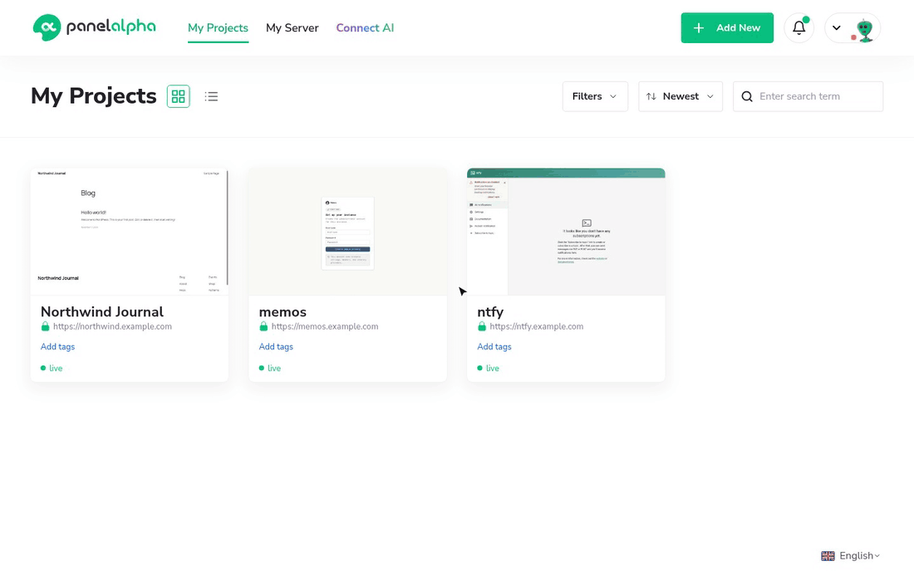
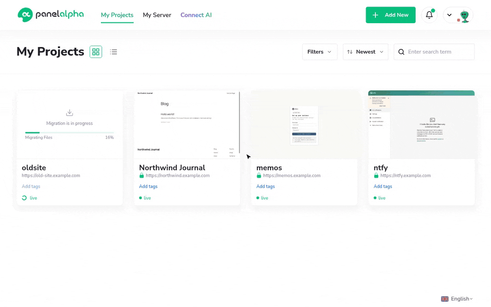

# Connect AI

Connect AI lets an AI assistant manage your projects by chat. Open **Connect AI** in the top menu.

The assistant talks to the panel over **MCP** (the Model Context Protocol), a standard way for AI tools to use other programs. It signs in with a **token**, a long secret text that you create in the panel and paste into your tool.

The assistant can reach all your live and staging projects. It cannot reach the project the panel itself runs in, nor any other project that runs a panel.

## Connecting your tool

You connect your tool from the panel. Every step below is on the **Connect AI** page.

1. Open **Connect AI** in the top menu and pick your tool under **Your tool**: Claude Code, ChatGPT, Codex, Claude, Cursor, Windsurf, VS Code or Other tool. The page for that tool lists the steps in order. A **One-click connect** banner on each page is marked `Coming soon`. It does nothing yet, so follow the steps on the page.
2. Under **Generate an MCP token**, select **Create Token**. Enter a **Token Name**, such as `Claude on my laptop`, and create it. If you already have a token, select **use one you already have** instead.
3. **The token is shown once.** You cannot see it again after you close the dialog. Copy the token, then confirm with `I have saved my token in a safe place`.

   

4. The next step shows what to put into your tool, with your panel address already filled in. Select **Copy**, paste it into your tool and replace `YOUR_TOKEN` with your token. For Claude Code it is a command for your terminal:

   ```bash
   claude mcp add --transport http panelalpha \
     https://panel.example.com/mcp \
     --header "Authorization: Bearer YOUR_TOKEN"
   ```

5. Follow **Verify the connection** on the same page. For Claude Code: restart it or run `/mcp` to confirm PanelAlpha is connected.

Then ask in the chat, for example `List my projects.`

The Claude app does not work yet, because it has no place to paste a token. Its page says so and offers **Set up Claude Code instead**.

## The MCP address

Your tool connects to the panel address with `/mcp` added, for example `https://panel.example.com/mcp`. **MCP URL & tokens** shows it as **MCP Server URL**. The tool sends your token in an `Authorization: Bearer <token>` header. A tool without a page of its own uses **Other tool**, which shows the same address.

## Revoking a token

1. Open **MCP URL & tokens**. The table shows **Name**, **Token**, **Last Used**, **Created**, **Status** and **Actions**.
2. In the token's row, point at the rotate arrow in **Actions** to read **Revoke**, then select it and confirm.


**A revoked token stops working at once.** Every request that uses it is refused. It stays in the list with the status `Revoked`. Select **Delete**, the bin in **Actions**, to remove it from the list for good. A delete cannot be undone.

## What the assistant can do

The assistant can use the Engine's tools on your projects. The panel passes its requests on and has no tool list of its own.

It cannot do these things:

- Use tools about the whole server.
- Create a new project or read the server load, because its token reaches only your existing projects.
- Change a project's limits or suspend a project. The Engine refuses suspend for the panel's tokens.
- Touch the panel's own project, or any other project that runs a panel. A panel's account, its files, its settings and its certificate are never handed to the assistant.

Some requests have no single tool. "Update all my sites" and "list all sites without automatic backups" make the assistant go through your projects one by one. The Engine's server settings can also narrow what it offers.

### What to ask

The page **What You Can Do with AI** shows examples. It has six groups that open one at a time: **Daily Management**, **Backups**, **Domains & SSL**, **Developer Workflow**, **Monitoring & Troubleshooting** and **Bulk Operations**. Each example is a card with a sentence, such as `Which of my sites are currently down?` or `Create a staging copy of my production WordPress`, and a copy button. Paste the sentence into your assistant's chat.

### More detail

An assistant loads only a short list of tools at first: listing projects, reading a project, deploying an archive or files, rebuilding a project, reading deploy logs and container logs, health checks, deleting and restarting a project, and listing and adding domains and certificates. For anything else it uses `search_tools` to find a tool and `execute_tools` to run it.

## Activity

**Activity Log** lists each tool the assistant runs: **Time**, **Token**, **Tool** and **Status** (`Success` or `Error`). A request that runs no tool, such as loading the tool list, leaves no row. Filter by token with **Filter by token**. With nothing yet it says `No activity yet. Start using your AI tool to see logs here.`


