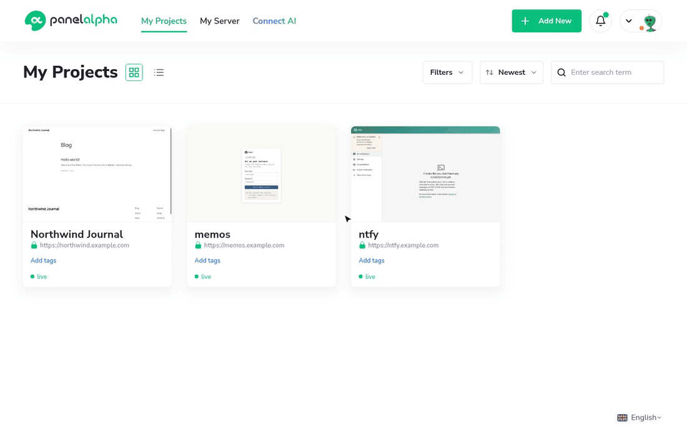
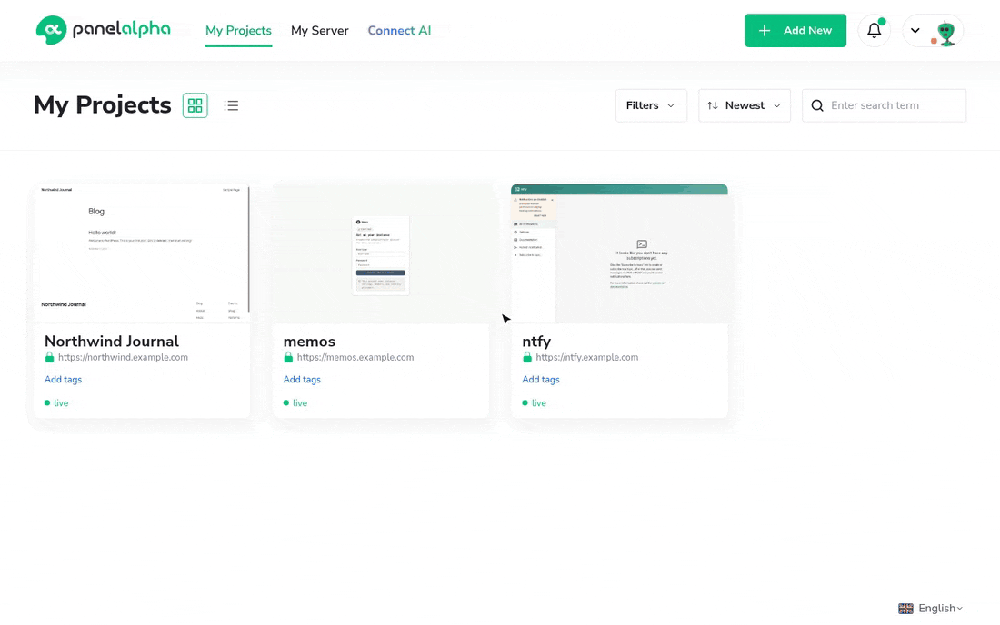

# Settings

Settings holds the panel's own options: its name, language, date format, address, the default domain for new projects and the default backup schedule.

Open it from the user menu with **Settings**. It has two tabs, **General** and **Backups**. Save a change with **Save Changes**. You see `Settings saved.`

## PanelAlpha Hub

PanelAlpha Hub is your PanelAlpha account at [hub.panelalpha.com](https://hub.panelalpha.com), where you see all the servers you connected. The card above the tabs connects this server to it. It is free and optional. The server keeps working on its own either way.

A connected server gives you:

- **App monitoring**: the status of every site on this server, in the Hub.
- **Reusable integrations**: link a service once, and every server of yours uses it.
- **One login**: **Sign in with PanelAlpha** on the panel's login page, and **Login** next to the server in the Hub.
- **PanelAlpha GO!**: the catalog of ready apps in **Create a project**: [Create a project](../projects/create-a-project.md#creating-a-project-from-panelalpha-go).

To connect:

1. Select **Connect to PanelAlpha Hub**.
2. Sign in on PanelAlpha Hub and approve. You come straight back here.
3. The card shows `This server is connected to PanelAlpha Hub` and `Linked to the account <account>.`

If the card shows `PanelAlpha Hub has not confirmed the connection yet. Check again in a moment.`, select **Check again**. If you wait more than 15 minutes, it shows `The link expired. Start again.`

If you deny the request on PanelAlpha Hub, you see `Not connected. The request was denied on PanelAlpha Hub.` If the panel cannot reach the Hub, you see `PanelAlpha Hub could not be reached. Try again in a moment.`

### Signing in with PanelAlpha

**Only the PanelAlpha account that approved the connection can sign in with it.** Another account gets `This login link is not valid any more. Log in again from PanelAlpha.` To change the account, disconnect, then connect again while signed in to the other account.

**Signing in through PanelAlpha skips the panel's two-factor check.** To turn two-factor authentication on or off, sign in with your email and password: [Your account](your-account.md#two-factor-authentication).

If **Sign in with PanelAlpha** is missing on a panel you connected a while ago, disconnect and connect again.

### Disconnecting

**Disconnecting removes this server from your PanelAlpha account and turns off Sign in with PanelAlpha until you connect again.** The PanelAlpha GO! catalog also stops working. To disconnect, select **Disconnect** and confirm in the `Disconnect from PanelAlpha Hub?` dialog. If you signed up through the Hub and have no password, the panel asks you to set one in **My Account** first.

### What the panel reports to the Hub

While connected, the panel reports to the Hub every five minutes. The report has:

- the name, type, status and address of each project
- how much of the server's CPU, memory and disk is in use, and how much the server has
- the version of the panel and of PanelAlpha Engine, the hosting software the panel runs on
- the panel's own address

It does not send the files, databases or passwords of your projects.

## General

- **Server name**: the name the panel shows in page titles. The default is `My Server`.
- **Default language**: the language people see before they choose their own. The default is English.
- **Default date format**: how the panel writes dates. Choose `YYYY-MM-DD` (default), `DD.MM.YYYY`, `DD/MM/YYYY` or `MM/DD/YYYY`. Accounts have no date format of their own.

## Application URL

The **Application URL** is the address the panel uses in the links it sends, such as password-reset emails. Saving a new address also moves the panel to that address.

**The address the panel has now stops answering when you save.** Point the new domain's DNS at this server first: [The panel address](../getting-started/panel-address.md).

## New projects

**Default domain** is the domain that new projects are named under. To set it:

1. Create a wildcard DNS record `*.example.com` that points at this server. It makes every name under `example.com` point here.
2. Open **Settings > General**, enter `example.com` in **Default domain** and select **Save Changes**.

A new project called `shop` then gets `shop.example.com`. Existing projects keep their domain.

If you leave the field empty (`Not set`), PanelAlpha Engine picks a name for each new project. Select the help icon next to the label to see which name it picks.

## Backups

The **Backups** tab holds the backup store and the schedule that new projects start with. A **backup store** is the place where backups are kept.

A server comes with a local store, so **Create Backup** works and the schedule applies to new projects with nothing to set up. **A local store is lost with the server.** If the server is deleted or its disk fails, the backups go with it. Set up another store to keep copies elsewhere.

The tab shows the store in use as its type and directory, for example `Local · /opt/panelalpha/backups/local`. Stores made on the server earlier are kept and used: [On the server](../getting-started/on-the-server.md#backup-stores-made-on-the-server).

### Setting up a store

1. Open **Settings > Backups**.
2. Select **Configure store** (or **Change store** if one exists).
3. Choose a **Store type**: Local, S3, SFTP, FTP or FTPS.
4. Fill in the fields for that type and save. You see `Backup store saved.`

   

| Type | Fields |
|---|---|
| Local | **Directory** (default `/opt/panelalpha/backups/local`) |
| S3 | **Bucket**, **Access key ID**, **Secret access key**, **Region**, **Endpoint (optional)**, **Use path-style endpoint** |
| FTP and FTPS | **Host**, **Port**, **Username**, **Password**, **Remote path** |
| SFTP | **Host**, **Port**, **Username**, **Password** or **Private key (instead of a password)**, **Key passphrase (optional)**, **Remote path** |

**A local store must be inside `/home/<name>`, `/opt/panelalpha` or `/var/www/html/storage`.** A backup anywhere else is lost when PanelAlpha Engine is updated.

The panel tests the store before it saves it.

### Removing a store

Select **Remove store** to stop using your own store. Later backups use the server's local store again. Tick the box in the dialog to confirm. A store the panel created is deleted from the server when no backup or schedule uses it. A store made on the server is never deleted.

### Schedule for new projects

These defaults apply to projects you create from now on. Existing projects keep their own schedule.

- **Automatic backups**: Enabled (default) or Disabled.
- **Backups to keep**: a number from 1 to 365. The default is 7.
- **Frequency**: Daily (default), Weekly or Monthly. Weekly adds **Day of the week**. Monthly adds **Day of the month**, 1 to 28.
- **Time**: the hour, 0 to 23, in which backups start. The default is 03:00 UTC. You see it in your local time.

Each new project gets its own minute inside that hour, so backups do not all start at once. The project's **Backups** tab shows its exact schedule.

For taking and restoring a backup of one project: [Backups](../looking-after-a-project/backups.md).

If something does not work, see the messages you may meet on this page and what to do about them: [Troubleshooting: The panel and your account](../troubleshooting/panel-and-account.md#settings).
