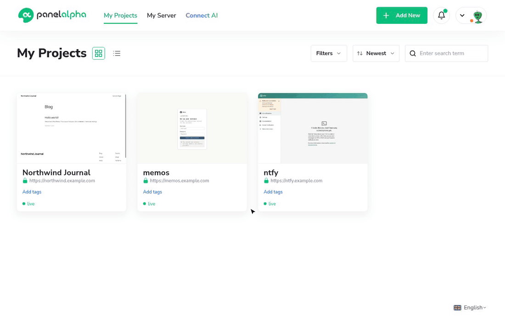

# Tasks

Tasks lists the work PanelAlpha Engine, the hosting software the panel runs on, does for your projects, such as deploys, backups and staging copies. Each entry shows its status and how long it took.

Open it from the user menu with **Tasks**. The menu item shows a dot while a task runs.

## Reading the list

Each row has five columns.

- **Task**: what was done. A push from your Git host shows as `Git auto-deploy`.
- **Project**: a link to the project. Housekeeping tasks of the server have no project and show a dash.
- **Started**: how long ago the task began. A task that has not begun shows `Waiting`. Hover to see the date and time.
- **Duration**: how long the task ran, or has been running so far.
- **Status**: `Pending` (waiting to start), `Running`, `Completed`, `Failed` or `Cancelled`.

Hover over a failed task to see why it failed, when the engine gave a reason.

## Finding a task

1. Open **Tasks**.
2. Set **Status** to a single state, or to `Active` to see the pending and running tasks together.
3. Set **Task type** to narrow the list to one kind of work.

If nothing matches, you see `No tasks`.

For a failed deploy, the deploy log of the project has the detail: [Git](../projects/git.md).
