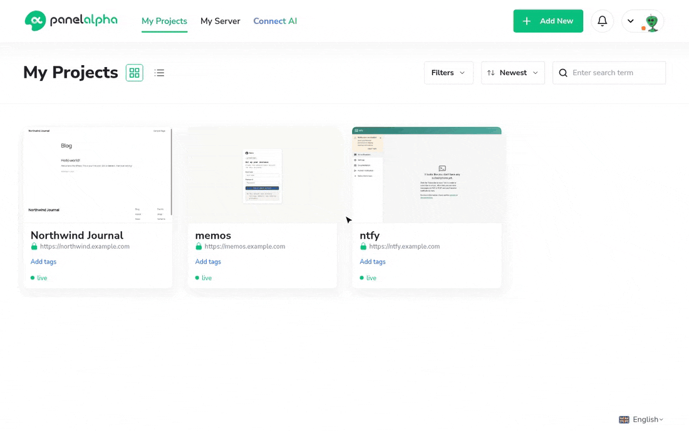

# Your account

Your account is your sign-in on the panel: your name, email address, password, two-factor authentication and the devices you are signed in on. Open the user menu and select **Account Details**. The page is called **My Account** and has two tabs, **Personal Information** and **Active Devices**.

## Changing your details

1. Open **My Account > Personal Information**.
2. Change **First Name**, **Last Name**, **Company Name** or **Language**. First and last name are required, up to 20 characters each.
3. Save. You see `Personal information details have been updated.`

   

**New Device Detection Notification** lets you choose what counts as a new device (new IP address, device, browser or a combination). The panel stores the choice, but it does not send an email about a new device.

The dates you see follow the panel default, not a setting of your own: [Settings](settings.md). The user menu also has a **Dark Mode** switch that turns Dark Mode on and off: [Around the panel](around-the-panel.md).

## Changing your email address

1. In **Personal Information**, select **Change Email Address**.
2. Enter the new address and your current password.
3. Confirm. You see `Email address has been changed.`

An address already used by another account is refused with `The email has already been taken.`

## Changing your password

1. In **Password**, select **Change Password**.
2. Enter **Current Password**, **New Password** and **Confirm Password**.

A password needs at least 8 characters with letters in upper and lower case, numbers and symbols. If the two new entries differ you see `Passwords do not match.`

## Two-factor authentication

Two-factor authentication asks for a code from an app on your phone each time you sign in.

1. In **Security Settings**, select **Two-Factor Authentication**.
2. Scan the QR code with Google Authenticator or another authenticator app. You can also copy the code and enter it by hand.
3. Enter the code the app shows.
4. Save your backup codes and confirm that you did.

   

You see `Two-Factor Authentication has been enabled.` **Each backup code works once.** Keep them somewhere other than your phone. To turn it off, open the same dialog and confirm. You see `Two-Factor Authentication has been disabled.`

**A backup code signs you in when you cannot use the app.** The panel then gives you a new set of backup codes and the old ones stop working, so save the new set the same way.

## Devices

**Active Devices** lists where you are signed in, with **IP Address**, **Browser**, **Device** and **Last Login**. Your current one is marked `Current Device`. Select the logout icon (tip **Log Out Device**) on a row to end that session. The bin icon (tip **Forget Device**) removes a device you no longer use. With nothing to show the page says `No Active Devices Found`.


## Forgotten password

On the sign-in screen, choose the forgotten password link and enter your email address. The panel answers every address with the same message, `If an account exists for that e-mail address, we have sent it a link to reset the password.`, whether or not that address has an account. If it has one, an email arrives with the subject `Reset your password` and a **Reset Password** button. The link goes to the panel's Application URL and works for 60 minutes. You can ask for a new link once every 60 seconds: a second ask inside that minute gets the same message and sends nothing. The page takes at most 6 asks a minute from one IP address: the seventh sends nothing and shows `Too Many Attempts.`, so wait a minute and ask again. The email is the only message the panel sends in Single Server Free.

The reset page asks for the new password twice. It follows the same rule as a password change: at least 8 characters with letters in upper and lower case, numbers and symbols.

**A new install sends its mail through the server's relay.** The Engine hands the panel the address of the mail server on its host, and the panel sends each message there. The message comes from `no-reply@` at the panel's own address, with the server name from [Settings](settings.md) as the sender name. When the Engine hands no address, the panel writes each message to its log and sends nothing.

What happens after the panel hands the message over is the Engine's: its outgoing mail settings decide the server the mail goes through, and the sender and DNS records that receiving servers check. A relay that is not set up, or a domain without those records, means the message is refused on the way, and the panel never learns that it did not arrive.

Without mail, set a new password on the server. Run this as `root`, with your panel project name, your email and a new password that follows the rules above:

```bash
docker exec -i panel docker exec -i -u www-data panelalpha-v1-panel php /app/backend/artisan users:update you@example.com --password='<new password>'
```

It prints `User updated: you@example.com (password=***)`. The same command with `--email=` changes the address.

## Sign-in limits

The panel allows 5 sign-in attempts a minute for each email address and IP address together, and 5 two-factor code attempts a minute for each sign-in. An attempt is one email address and password submitted together; the screen that only asks for your email address is counted apart, with 20 a minute from one IP address. Wait a minute after that.

## Troubleshooting

**"These credentials do not match our records."** The email or the password is wrong. Check both and try again.

**"The entered code is invalid."** The two-factor code is wrong or expired. Enter the current code from the app, or use an unused backup code.

**"The entered backup code is invalid."** The backup code is wrong or was already used. Each backup code works once; use one you have not used, or enter the current code from the app.

**"Two-Factor Authentication is on, but your backup codes could not be loaded. Try again; if it keeps failing, turn Two-Factor Authentication off and on again to get a new set."** The panel could not read your backup codes. Follow the message to get a new set.
