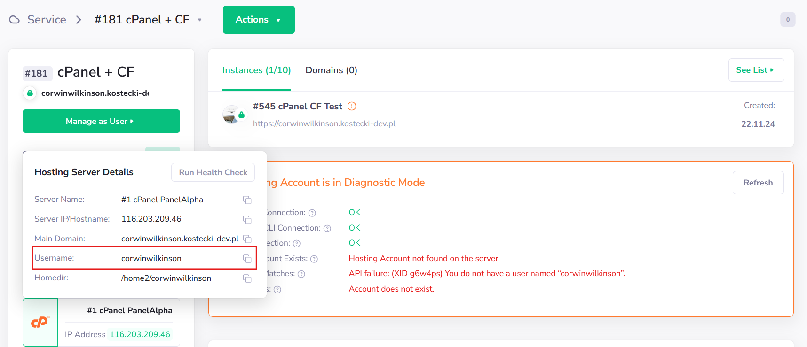
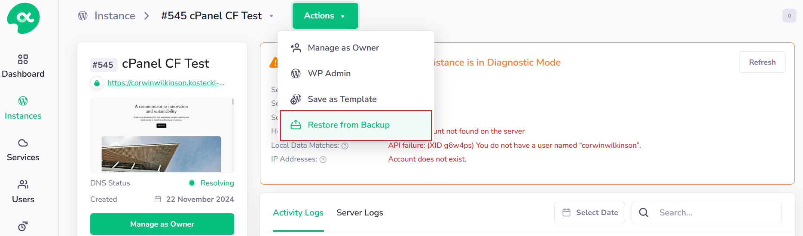
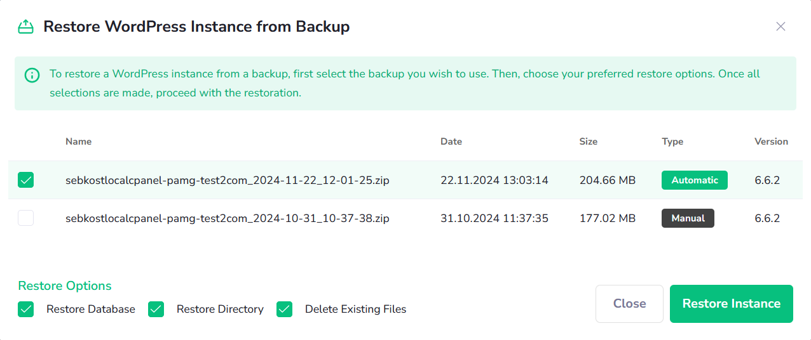

# Diagnostic Mode

## Hosting Account Not Found

**Problem:** The hosting account has not been detected. It may have been removed.

**Solutions for the administrator:**

> [!WARNING]
> **Warning:** Deleting a service removes associated client data. Back up the service before deleting and recreate it carefully.

1. Delete the service manually from PanelAlpha.
2. Recreate the service manually. You will need the username associated with the missing hosting account. If you have a backup of the WordPress installation from that service, you may also restore it.

### How to Restore a Hosting Service

1. Find the username associated with the missing hosting account:

   

2. Manually create a service with the previously used username on the **hosting server**.

3. If WordPress instances were previously installed on the corrupted hosting service, restore them using backups:

   

   

## Instance Files Not Found

**Problem:** The WordPress installation files could not be detected.

**Solution:** Restore the WordPress installation from a backup.

See [Snapshot Tool Issues](../backups/snapshot-tool-issues.md) for restore procedures.

   

## Manually Disabling Diagnostic Mode

**Problem:** You need to manually disable diagnostic mode for a specific instance. This is only necessary when Diagnostic Mode displays the message: "Diagnostic Mode has been enabled by admin."

You can also review active incidents and historical events in **Admin Area → Logs → Diagnostic Mode** (`/logs/diagnostic-mode`) using the **Current Incidents** and **Logs** tabs.

**Solution:** Use the following command on your PanelAlpha server:

```bash
docker compose -f /opt/panelalpha/app/docker-compose.yml exec api php artisan diagnostic-mode --app-id=INSTANCE_ID --disable
```

**Note:** Replace `INSTANCE_ID` with the actual ID of the instance for which you want to disable diagnostic mode.
