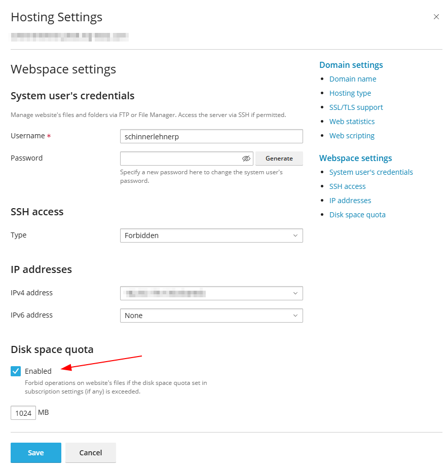
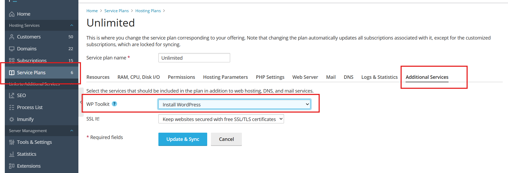

# Plesk

This page covers common Plesk-related issues in PanelAlpha.

## FAQ

### Manage Plesk Mailbox Within PanelAlpha

**Question:** Can Plesk mailboxes be managed within PanelAlpha?

**Answer:** Yes. Users can manage Plesk mailboxes within PanelAlpha if the Email Server is set to Plesk's internal server in the plan configuration. This setting will apply only to new services.

## Troubleshooting

### Issues with SSO to Plesk

**Problem:** The **Log In to Control Panel** button in the Client Area opens a URL, but the user is not logged in — Plesk shows the standard login form instead.

**Symptoms:**

1. Clicking **Log In to Control Panel** (or **Login to Control Panel** in Developer Settings) opens Plesk, but the user must enter credentials manually.
2. The PanelAlpha API call `POST /server-accounts/{id}/control-panel-sso-url` succeeds and returns a URL (no error in the Client Area).
3. The same behavior may occur for phpMyAdmin SSO on Plesk, because both features use Plesk session tokens.
4. **Important:** If one-time login links generated by Plesk itself also fail, the issue is on the Plesk server configuration — not in PanelAlpha. Whitelisting PanelAlpha server IP for Plesk API access does not fix browser-based SSO.

**How PanelAlpha SSO works:**

PanelAlpha calls the Plesk XML API method `server.create_session` for the subscription owner, then redirects the browser to:

```
https://your-plesk-server:8443/enterprise/rsession_init.php?PLESKSESSID={token}
```

Plesk binds this session to the client's IP address. If session IP validation is too strict (common behind reverse proxies, Cloudflare, or dynamic IPs), the token is rejected and the user sees the login form.

**Solution:**

Enable **Allow IP address changes during a single session** on the Plesk server.

**In the Plesk administrator panel:**

1. Log in to Plesk as administrator.
2. Go to **Tools & Settings**.
3. Open **Security** section.
4. Click **Session Idle Time**.
5. Enable **Allow IP address changes during a single session**
6. Leave **Session Idle Time** at the default **30 minutes** unless you have a separate reason to change idle timeout — this value does not block one-time SSO links.
7. Click **OK**.

**Related PanelAlpha settings:**

1. The plan privilege **Control Panel SSO** must be enabled for the service.
2. The hosting server connection (admin URL, username, password) must work — other Plesk operations in PanelAlpha should succeed before troubleshooting SSO.

Learn more in the Plesk [Knowledge Base](https://www.plesk.com/kb/support/a-user-is-being-logged-out-from-plesk-periodically-or-plesk-redirects-to-the-login-page-after-a-successful-login-attempt/).

### Issues with Disk Quota Exceeded

**Problem:** When a client has reached or exceeded their disk space quota, file operations such as creating staging instances, uploading files through the control panel, or other file-related operations may fail silently or with the error `Disk quota exceeded`.

  

**Solution:**
1. Check if the subscription has a disk space limit configured.
2. Verify if there is also a disk quota in place.
3. Ensure both limits are aligned appropriately.
4. Consider increasing the disk quota if it is more restrictive than intended.

### Error: The 'wp-config.php' File Already Exists

**Problem:** During instance installation, the client receives the error:

```
Error: The 'wp-config.php' file already exists. (exit code 1)
```

This occurs even though the installation is being performed on a new hosting account. Investigation reveals that a `wp-config.php` file already exists in the domain directory, but with different database credentials than those PanelAlpha is trying to use.

**Cause:** WordPress is being installed simultaneously by both PanelAlpha and another source — typically the Plesk WP Toolkit. When the WP Toolkit option is set to **Install WordPress** in the Service Plan, Plesk automatically installs WordPress when creating a new subscription, which conflicts with PanelAlpha's installation process.

  

**Solution:**
1. Log in to your Plesk server.
2. Go to **Service Plans** → select the relevant hosting plan.
3. Navigate to the **Additional Services** tab.
4. Change the **WP Toolkit** setting from **Install WordPress** to **Do not install WordPress** or another option that does not auto-install.
5. Click **Update & Sync**.

This prevents Plesk from automatically installing WordPress, allowing PanelAlpha to handle the installation without conflicts.
